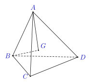
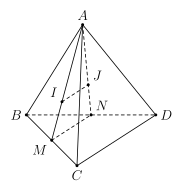
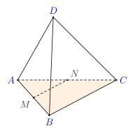
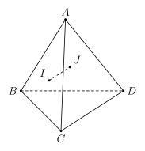
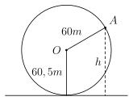

## Phần I. Thí sinh trả lời từ câu 1 đến câu 12, mỗi câu hỏi chọn một phương án.

### Câu 1

Dãy số nào sau đây là một cấp số cộng?

- **A.** $(u_n): \begin{cases} u_1 = 1 \\ u_{n+1} = u_n + 2, \forall n \ge 1 \end{cases}$.

- **B.** $(u_n): \begin{cases} u_1 = 3 \\ u_{n+1} = 2u_n + 1, \forall n \ge 1 \end{cases}$.

- **C.** $(u_n): 1; 3; 6; 10; 15; \ldots$.

- **D.** $(u_n):\text{–}1; 1;\text{–}1; 1;\text{–}1; \ldots$.

### Câu 2

Cho cấp số cộng $(u_n)$ có $u_1 = \frac{1}{3}$, $u_8 = 26$. Tìm công sai $d$.

- **A.** $d = \frac{11}{3}$.

- **B.** $d = \frac{10}{3}$.

- **C.** $d = \frac{3}{10}$.

- **D.** $d = \frac{3}{11}$.

### Câu 3

Cho $\tan \alpha = 2$. Tính $\tan \left(\alpha - \frac{\pi}{4}\right)$.

- **A.** $-\frac{1}{3}$.

- **B.** 1.

- **C.** $\frac{2}{3}$.

- **D.** $\frac{1}{3}$.

### Câu 4

Cho dãy số $(u_n)$, biết $u_n = \frac{2n^2 - 1}{n^2 + 3}$. Tìm số hạng $u_5$.

- **A.** $u_5 = \frac{1}{4}$.

- **B.** $u_5 = \frac{17}{12}$.

- **C.** $u_5 = \frac{7}{4}$.

- **D.** $u_5 = \frac{71}{39}$.

### Câu 5

Cho tứ diện $ABCD$ và điểm $G$ như hình vẽ. Khẳng định nào sau đây đúng

- **A.** điểm $G$ thuộc mặt phẳng $(BCD)$.

- **B.** điểm $G$ thuộc mặt phẳng $(ABC)$.

- **C.** điểm $G$ thuộc mặt phẳng $(ACD)$.

- **D.** điểm $G$ thuộc mặt phẳng $(ABD)$.

### Câu 6

Cho đường tròn đường kính $12\,\mathrm{cm}$. Tìm số đo ($\mathrm{rad}$) của cung có độ dài $3\,\mathrm{cm}$.

- **A.** $\frac{1}{2}$.

- **B.** $\frac{1}{4}$.

- **C.** $\frac{1}{3}$.

- **D.** $\frac{1}{6}$.

### Câu 7

Cho tứ diện $ABCD$. Gọi $M, N$ lần lượt là trung điểm của $BC, BD$; $I, J$ lần lượt là trọng tâm các tam giác $ABC$ và $ABD$ (hình vẽ).

Chọn khẳng định đúng trong các khẳng định sau?

- **A.** $IJ$ song song với $CD$.

- **B.** $IJ$ song song với $AB$.

- **C.** $IJ$ chéo $CD$.

- **D.** $IJ$ cắt $AB$.

### Câu 8

Cho tứ diện $ABCD$ có $M, N$ lần lượt là trung điểm của $AB, AC$ (hình vẽ). Mặt phẳng nào sau đây song song với đường thẳng $MN$?

- **A.** $(ACD)$.

- **B.** $(ABD)$.

- **C.** $(ABC)$.

- **D.** $(BCD)$.

### Câu 9

Tất cả các nghiệm của phương trình $\sin \left(x + \frac{\pi}{6}\right) =\text{–}1$

- **A.** $x = \frac{\pi}{3} + k\pi \ (k \in \mathbb{Z})$.

- **B.** $x = -\frac{\pi}{6} + k2\pi \ (k \in \mathbb{Z})$.

- **C.** $x = -\frac{2\pi}{3} + k2\pi \ (k \in \mathbb{Z})$.

- **D.** $x = \frac{5\pi}{6} + k2\pi \ (k \in \mathbb{Z})$.

### Câu 10

Một loại vi khuẩn được nuôi cấy trong ống nghiệm, cứ 20 phút lại nhân đôi một lần. Nếu ban đầu có 100 vi khuẩn thì số lượng vi khuẩn có trong ống nghiệm sau 3 h bằng

- **A.** 3200.

- **B.** 51200.

- **C.** 12800.

- **D.** 1600.

### Câu 11

Cho tứ diện $ABCD$. Gọi $I, J$ lần lượt là trọng tâm các tam giác $ABC$ và $ABD$. Khẳng định nào sau đây là đúng

- **A.** Đường thẳng $IJ$ song song với đường thẳng $CD$.

- **B.** Đường thẳng $IJ$ song song với đường thẳng $AB$.

- **C.** Đường thẳng $IJ$ cắt đường thẳng $CD$.

- **D.** Đường thẳng $IJ$ cắt đường thẳng $AB$.

### Câu 12

Gọi $M, m$ lần lượt là giá trị lớn nhất và giá trị nhỏ nhất của hàm số $y = 2\cos^2 x + 4$ trên đoạn $\left[\frac{3\pi}{4}; \pi\right]$. Khi đó $M + 2m$ bằng

- **A.** 17.

- **B.** 16.

- **C.** 11.

- **D.** 1.

## Phần II. Thí sinh trả lời từ câu 1 đến câu 2, trong ý a), b), c), d) ở mỗi câu câu, thí sinh chọn ĐÚNG hoặc SAI.

### Câu 1

Vào mùa hè, nhiệt độ ngoài trời ở thôn Phú Hậu, xã Xuân Lập, Tỉnh Thanh Hóa trong một ngày có thể được mô phỏng bởi công thức $T(t) = 36 + 3\sin\frac{\pi}{12}(t - 7)$, với $h$ tính bằng độ $\mathrm{C}$ và $t$ là thời gian trong ngày tính bằng giờ ($0 < t \le 24$).

- **A.** Nhiệt độ vào lúc $7\,\mathrm{h}$ sáng là $36^\circ\mathrm{C}$.

- **B.** Nhiệt độ lúc $1\,\mathrm{h}$ chiều là $33^\circ\mathrm{C}$.

- **C.** Trong ngày nhiệt độ $39^\circ\mathrm{C}$ đạt vào các thời điểm $t_1; t_2$. Khi đó $t_1 + t_2 = 26\,\mathrm{h}$.

- **D.** Vào lúc $13\,\mathrm{h}$ trong ngày thì nhiệt độ ngoài trời thôn Phú Hậu là cao nhất.

### Câu 2

Cho hàm số $y =\text{–}6\sin^2(2x) - 8$.

- **A.** Hàm số có tập xác định là $D = [-9; 2]$.

- **B.** Giá trị lớn nhất của hàm số bằng –8.

- **C.** Hàm số có chu kì $T = \pi$.

- **D.** Tập giá trị của hàm số là $T = [-14;\text{–}8]$.

## Phần III. Thí sinh trả lời từ câu 1 đến câu 4 (không làm tròn các phép tính trung gian trong các câu từ 1 đến câu 6).

### Câu 1

Một chiếc điện thoại có giá 10 triệu đồng. Mỗi năm giá của nó giảm $20\%$ so với năm trước. Hỏi sau 3 năm, giá trị còn lại của chiếc điện thoại đó là bao nhiêu triệu đồng?

### Câu 2

Nam nhận lời mời làm việc cho một doanh nghiệp ở TP Hồ Chí Minh với giả định sau khi trừ mọi chi phí thì số dư khởi điểm cho năm đầu là 45000 đô la. Sau mỗi năm số dư được tăng thêm 2500 đô la. Gia đình Nam cho Nam vay tiền mua một căn chung cư, giá khoảng 307500 đô la. Nếu toàn bộ số dư sau khi trừ mọi chi phí của Nam đều chuyển trả nợ vào tài khoản gia đình của Nam thì sau bao nhiêu năm làm việc Nam trả hết số tiền mua nhà?
Giả sử công việc ổn định và số dư (lương) tăng đều mỗi năm.

### Câu 3

Cho hình chóp $S.ABCD$ có đáy là hình bình hành. Gọi $N$ là trung điểm của cạnh $SC$. Lấy điểm $M$ đối xứng với $B$ qua $A$. Gọi giao điểm $G$ của đường thẳng $MN$ với mặt phẳng $(SAD)$. Tính tỉ số $\frac{GM}{GN}$.

### Câu 4

Phương trình $2\sin\left(2x - \frac{\pi}{3}\right) - \sqrt{3} = 0$ có bao nhiêu nghiệm thuộc khoảng $(0; 3\pi)$?

## Phần IV. Thí sinh trình bày lời giải chi tiết từ câu 1 đến câu 3.

### Câu 1

Đều đặn ngày đầu mỗi tháng, anh Hùng gửi 10 triệu đồng tiết kiệm ở một ngân hàng theo hình thức lãi kép, kỳ hạn 1 tháng với lãi suất tiết kiệm là $4\%/\text{năm}$. Sau khi gửi được 12 tháng, kể từ tháng 13, ngân hàng thay đổi lãi suất tiền gửi lên mức $5\%/\text{năm}$ với kỳ hạn 1 tháng (số tiền gửi cũ sẽ được tính theo lãi suất mới kể từ tháng thứ 13). Anh Hùng tiếp tục gửi 10 triệu đồng mỗi tháng từ tháng thứ 13 đến tháng thứ 24. Đầu tháng thứ 25 anh Hùng quyết định rút toàn bộ số tiền (cả gốc và lãi) ra để đầu tư kinh doanh. Hỏi tổng số tiền anh Hùng nhận được là bao nhiêu triệu đồng? (làm tròn kết quả đến hàng triệu).

### Câu 2

Cho hình chóp $S.ABCD$ có đáy $ABCD$ là hình bình hành. Gọi $M, N$ lần lượt là trọng tâm của $\triangle SAB, \triangle SCD$. Cho biết $I$ là giao điểm của $BM$ và $CN$. Tính tỉ số $\frac{SI}{AB}$.

### Câu 3

Một vòng quay trò chơi có bán kính 60 m, trục quay cách mặt đất 60,5 m. Khi vòng quay ngược chiều kim đồng hồ với tốc độ quay không đổi thì thời gian quay hết 1 vòng là 5 phút. Một cabin gắn tại điểm $A$ của vòng quay cách mặt đất $h =$ 90,5 m như hình minh họa khi vòng quay bắt đầu quay. Hỏi sau bao lâu kể từ khi vòng quay bắt đầu quay thì cabin lần đầu tiên ở vị trí thấp nhất? (Kết quả làm tròn đến hàng phần trăm)

