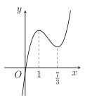
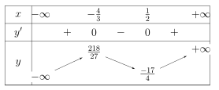
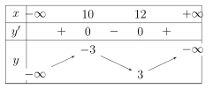
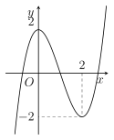
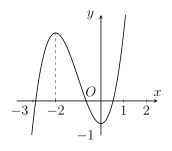

## Phần I. Thí sinh trả lời từ câu 1 đến câu 12, mỗi câu hỏi chọn một phương án.

### Câu 1

Cho hàm số có đồ thị như hình vẽ bên. Khẳng định nào sau đây là **đúng**?

- **A.** Hàm số nghịch biến trên khoảng $(-\infty; 1)$.

- **B.** Hàm số nghịch biến trên khoảng $(-\infty; 0)$.

- **C.** Hàm số nghịch biến trên khoảng $\left(\frac{7}{3}; +\infty\right)$.

- **D.** Hàm số đồng biến trên khoảng $(-\infty; 1)$.

### Câu 2

Cho hàm số $y = \dfrac{8 - 5x}{-4x - 9}$. Khẳng định nào sau đây là **sai**?

- **A.** Hàm số đồng biến trên khoảng $\left(-\infty; -\frac{37}{4}\right)$.

- **B.** Hàm số đồng biến trên khoảng $\left(-\infty; -\frac{9}{4}\right)$.

- **C.** Hàm số đồng biến trên khoảng $\left(-\frac{9}{4}; +\infty\right)$.

- **D.** Hàm số nghịch biến trên khoảng $\left(-\infty; -\frac{37}{4}\right)$.

### Câu 3

Cho hàm số có bảng biến thiên như sau

Khẳng định nào sau đây là **đúng**?

- **A.** Hàm số nghịch biến trên khoảng $\left(-\infty; -\frac{4}{3}\right)$.

- **B.** Hàm số đồng biến trên khoảng $\left(-\frac{4}{3}; \frac{1}{2}\right)$.

- **C.** Hàm số nghịch biến trên khoảng $\left(\frac{7}{2}; +\infty\right)$.

- **D.** Hàm số đồng biến trên khoảng $\left(-\infty; -\frac{7}{3}\right)$.

### Câu 4

Cho hàm số $f(x)$ liên tục trên $ \mathbb{R} $ và có đạo hàm $f'(x)=(x-1)^2(2-x)$. Hàm số $f(x)$ đồng biến trên khoảng nào?

- **A.** $(\text{–}1;3)$.

- **B.** $(2;+\infty)$.

- **C.** $(-\infty;2)$.

- **D.** $(2;5)$.

### Câu 5

Tìm tất cả các giá trị thực của tham số $m$ để hàm số $y = -\frac{1}{3}x^3 - mx^2 + (2m - 3)x - m + 2$ nghịch biến trên $\mathbb{R}$.

- **A.** $m \le -3$, $m \ge 1$.

- **B.** $\text{–}3 < m < 1$.

- **C.** $\text{–}3 \le m \le 1$.

- **D.** $m \le 1$.

### Câu 6

Cho hàm số $y = -x^3 - mx^2 + (4m + 9)x + 5$, với $m$ là tham số thực. Có bao nhiêu giá trị nguyên của $m$ để hàm số nghịch biến trên $(-\infty; +\infty)$?

- **A.** 5.

- **B.** 6.

- **C.** 7.

- **D.** 4.

### Câu 7

Cho hàm số $y = 7x^3 + 9x^2 - 3x - 4$. Khẳng định nào sau đây là **sai**?

- **A.** Giá trị cực đại $y = 1$.

- **B.** Hàm số đạt cực tiểu tại $x = \frac{1}{7}$.

- **C.** Giá trị cực tiểu $y = \frac{1}{7}$.

- **D.** Hàm số đạt cực đại tại $x =\text{–}1$.

### Câu 8

Cho hàm số $y = f(x)$ xác định trên $\mathbb{R}$ và có bảng biến thiên như hình vẽ sau:

Hàm số $y = f(x)$ đạt cực đại tại

- **A.** $x = 10$.

- **B.** $x = 8$.

- **C.** $x = 12$.

- **D.** $x = 17$.

### Câu 9

Cho hàm số $y=f(x)$ xác định trên tập $\mathbb{R}$ và có đồ thị như hình bên. Mệnh đề nào dưới đây đúng?

- **A.** Hàm số đạt cực đại tại $x=0$ và đạt cực tiểu tại $x=2$.

- **B.** Hàm số có giá trị lớn nhất bằng 2 và giá trị nhỏ nhất bằng –2.

- **C.** Hàm số có giá trị cực tiểu bằng 2.

- **D.** Hàm số có ba điểm cực trị.

### Câu 10

Tìm tất cả các giá trị thực của $m$ để hàm số $y=x^3-3x^2+(m+1)x+2$ có hai điểm cực trị.

- **A.** $m < 2$.

- **B.** $m \le 2$.

- **C.** $m > 2$.

- **D.** $m < -4$.

### Câu 11

Cho hàm số $y=x^3-2mx^2+\left(-\frac{4}{3}m^2-40m-144\right)x-5$ ($m$ là tham số thực). Tìm tất cả các giá trị của $m$ để hàm số có cực trị?

- **A.** $\text{–}11 < m < -6$.

- **B.** $m < -9$ hoặc $m > -4$.

- **C.** $\text{–}14 < m < -6$.

- **D.** $m < -9$ hoặc $m > -6$.

### Câu 12

Cho hàm số $y=8x^3-6mx^2+9mx+6m$ ($m$ là tham số thực). Giá trị của $m$ để hàm số đạt cực tiểu tại $x=\text{–}6$ thuộc khoảng nào sau đây?

- **A.** $\left(-\infty; -\frac{35}{3}\right)$.

- **B.** $\left(-\infty; -\frac{47}{3}\right)$.

- **C.** $\left(-\frac{23}{3}; +\infty\right)$.

- **D.** $\varnothing$.

## Phần II. Thí sinh trả lời từ câu 1 đến câu 4, trong ý a), b), c), d) ở mỗi câu câu, thí sinh chọn ĐÚNG hoặc SAI.

### Câu 1

Cho hàm số $f(x)=\dfrac{1}{3}x^3-5x^2+9x+8$

- **a)** Hàm số đã cho có đạo hàm là $f'(x)=x^2-10x+9$.

- **b)** Phương trình $f'(x)=0$ có tập nghiệm là $S=\{1;9\}$.

- **c)** Hàm số đã cho nghịch biến trên khoảng $(1;9)$.

- **d)** Giá trị cực tiểu của hàm số đã cho bằng $\frac{37}{3}$.

### Câu 2

Cho hàm số $f(x)=2x-4+\dfrac{2}{x+1}$.

- **a)** Hàm số có đạo hàm $f'(x)=\dfrac{2(x^2+2x)}{(x+1)^2}$.

- **b)** Giá trị nhỏ nhất của hàm số trên khoảng $(\text{–}1;+\infty)$ bằng –2.

- **c)** Điểm cực đại của đồ thị hàm số có tọa độ $(0;\text{–}2)$.

- **d)** Hàm số $y=f(x)$ có tập xác định là $D=\mathbb{R} \setminus \{-1\}$.

### Câu 3

Cho hàm số $f(x)=x^3-3x^2-1$.

- **a)** Hàm số đã cho nghịch biến trên $\mathbb{R}$.

- **b)** Hàm số đã cho đồng biến trên $(3;+\infty)$.

- **c)** Hàm số đã cho nghịch biến trên $(1;2)$.

- **d)** Hàm số $g(x)=f(x)+2$ đồng biến trên $(-\infty;0)$.

### Câu 4

Cho hàm số $y=f(x)$ có đồ thị như hình vẽ bên.

- **a)** Hàm số đã cho nghịch biến trên khoảng $(\text{–}2,0)$.

- **b)** Hàm số đã cho đồng biến trên khoảng $(\text{–}3;1)$.

- **c)** Hàm số đã cho đồng biến trên khoảng $(2;+\infty)$.

- **d)** Hàm số $f=|f(x)|$ nghịch biến trên khoảng $(\text{–}2,0)$.

## Phần III. Thí sinh trả lời từ câu 1 đến câu 6 (không làm tròn các phép tính trung gian trong các câu từ 1 đến câu 6).

### Câu 1

Cho hàm số $y = 4x^3 + 8x^2 - 3x + 3$. Giá trị cực đại của hàm số bằng bao nhiêu?

### Câu 2

Điểm cực tiểu của hàm số $y = x^3 - 5x^2 - 8x + 8$ bằng bao nhiêu?

### Câu 3

Một chuyển động có vận tốc được xác định bởi phương trình $v(t) = -t^2 + 3t - 2$ với $t \ge 0$, trong đó $t$ tính bằng giây và $v$ tính bằng m/s. Kể từ giây thứ bao nhiêu trở đi thì vận tốc của vật giảm?

### Câu 4

Cho hàm số $y = x^3 - 4x^2 + 5x + 2$. Hàm số có điểm cực đại và điểm cực tiểu lần lượt là $x_1, x_2$. Tính giá trị biểu thức $A = x_1 - 3x_2$.

### Câu 5

Cho hàm số $y = -x^3 - mx^2 + (4m + 9)x + 3$ với $m$ là tham số. Có bao nhiêu giá trị nguyên của $m$ để hàm số nghịch biến trên $(-\infty; +\infty)$?

### Câu 6

Đồ thị hàm số $y = x^3 - 3x^2 + 2ax + b$ có điểm cực tiểu $A(2;\text{–}2)$. Khi đó $a + b$ bằng bao nhiêu?
