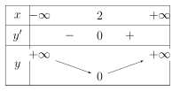
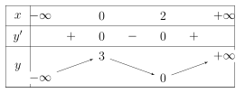
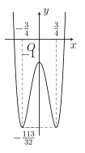
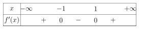

## Phần I. Thí sinh trả lời từ câu 1 đến câu 12, mỗi câu hỏi chọn một phương án.

### Câu 1

Cho hàm số $y = \dfrac{x + 1}{x - 3}$. Trong các mệnh đề sau, mệnh đề nào **sai**?

- **A.** Hàm số nghịch biến trên từng khoảng xác định của nó.

- **B.** Hàm số nghịch biến trên tập xác định của nó.

- **C.** Hàm số nghịch biến trên khoảng $(3; +\infty)$.

- **D.** Hàm số nghịch biến trên khoảng $(-\infty; 3)$.

### Câu 2

Cho hàm số $y = \frac{1}{3}x^3 - \frac{1}{2}x^2 - 12x - 1$. Mệnh đề nào sau đây đúng?

- **A.** Hàm số nghịch biến trên khoảng $(\text{–}3; +\infty)$.

- **B.** Hàm số đồng biến trên khoảng $(-\infty; 4)$.

- **C.** Hàm số đồng biến trên khoảng $(\text{–}3; 4)$.

- **D.** Hàm số đồng biến trên khoảng $(4; +\infty)$.

### Câu 3

Hàm số nào không đồng biến trên $(-\infty; +\infty)$?

- **A.** $y = x^5 + x^3 - 1$.

- **B.** $y = x^3 + 2$.

- **C.** $y = \frac{x - 1}{x + 2}$.

- **D.** $y = x + 1$.

### Câu 4

Cho hàm số $y = x - 2\sqrt{x}$. Mệnh đề nào đúng?

- **A.** Hàm số nghịch biến trên khoảng $(1; +\infty)$.

- **B.** Hàm số đồng biến trên khoảng $(2; +\infty)$.

- **C.** Hàm số đồng biến trên khoảng $(0; +\infty)$.

- **D.** Hàm số nghịch biến trên khoảng $(-\infty; 1)$.

### Câu 5

Hàm số $y = x^4 - 2x^2 + 1$ đồng biến trên khoảng nào dưới đây?

- **A.** $(\text{–}1;0)$.

- **B.** $(\text{–}1;+\infty)$.

- **C.** $(\text{–}3;8)$.

- **D.** $(-\infty;\text{–}1)$.

### Câu 6

Cho hàm số $y = f(x)$ xác định và liên tục trên $\mathbb{R}$, có bảng biến thiên như hình sau. Tìm khẳng định đúng.

- **A.** Hàm số có 2 cực trị.

- **B.** Hàm số có giá trị cực đại bằng 2.

- **C.** Hàm số có giá trị cực tiểu bằng 0.

- **D.** Hàm số đạt cực đại tại $x = 0$.

### Câu 7

Cho hàm số $y = f(x)$ có bảng biến thiên như sau. Mệnh đề nào dưới đây là **sai**?

- **A.** Hàm số **không** đạt cực tiểu tại điểm $x = 2$.

- **B.** Hàm số đạt cực đại tại điểm $x = 0$.

- **C.** Giá trị cực đại của hàm số là $y = 3$.

- **D.** Giá trị cực tiểu của hàm số là $y = 0$.

### Câu 8

Cho hàm số $y = f(x)$ có bảng biến thiên như sau. 	Tìm giá trị cực đại $y_{\text{CĐ}}$ và giá trị cực tiểu $y_{\text{CT}}$ của hàm số.

- **A.** $y_{\text{CĐ}} = 3$ và $y_{\text{CT}} = 2$.

- **B.** $y_{\text{CĐ}} = 2$ và $y_{\text{CT}} = 0$.

- **C.** $y_{\text{CĐ}} = 3$ và $y_{\text{CT}} = 3$.

- **D.** $y_{\text{CĐ}} = 3$ và $y_{\text{CT}} = 0$.

### Câu 9

Cho hàm số $y = -\dfrac{1}{4}x^4 + \dfrac{1}{2}x^2 - 3$. Khẳng định nào sau đây là khẳng định đúng?

- **A.** Hàm số đạt cực tiểu tại $x =\text{–}3$.

- **B.** Hàm số đạt cực tiểu tại $x = 0$.

- **C.** Hàm số đạt cực đại tại $x = 0$.

- **D.** Hàm số đạt cực tiểu tại $x =\text{–}1$.

### Câu 10

Cho hàm số có đồ thị như hình bên. Khẳng định nào **sai**?

- **A.** Hàm số có một cực tiểu tại $x = \dfrac{3}{4}$ và đạt cực đại tại $x = 0$.

- **B.** Giá trị cực đại $y =\text{–}1$ và giá trị cực tiểu $y = -\dfrac{113}{32}$.

- **C.** Hàm số có một cực tiểu tại $x = -\dfrac{3}{4}$.

- **D.** Hàm số có một cực đại tại $x = -\dfrac{3}{4}$.

### Câu 11

Tìm tất cả các giá trị của tham số $m$ để hàm số $y = x^3 + mx^2 + (1 - 2m)x + m - 3$ đồng biến trên khoảng $(\text{–}3;0)$.

- **A.** $m \ge 2\sqrt{3} + 3$.

- **B.** $m \le 2\sqrt{3} - 3$.

- **C.** $m \ge 6 - \sqrt{42}$.

- **D.** $m \le 6 + \sqrt{42}$.

### Câu 12

Tìm tất cả các giá trị của tham số $m$ sao cho hàm số $y = -x^3 - 3mx^2 + 4m - 1$ đồng biến trên khoảng $(0;4)$.

- **A.** $\text{–}2 \le m < 0$.

- **B.** $m \le -4$.

- **C.** $m \le -2$.

- **D.** $m > 0$.

## Phần II. Thí sinh trả lời từ câu 1 đến câu 4, trong ý a), b), c), d) ở mỗi câu câu, thí sinh chọn ĐÚNG hoặc SAI.

### Câu 1

Cho hàm số $y=f(x)=x^3-6x^2+9x+2$.

- **a)** Đạo hàm của hàm số đã cho là $f'(x)=3x^2-12x+9$.

- **b)** Phương trình $f'(x)=0$ có tập nghiệm là $S=\{1;3\}$.

- **c)** Hàm số đã cho đồng biến trên đoạn $ [4;5] $.

- **d)** Gọi $x_1, x_2$ là hai điểm cực trị của hàm số $y=f(x)$. Khi đó, phương trình đường thẳng đi qua hai điểm $M_1(x_1; f(x_1))$ và $M_2(x_2; f(x_2))$ là $y=\text{–}2x+1$.

### Câu 2

Cho hàm số $y=f(x)$ xác định trên $\mathbb{R}$ và có bảng xét dấu của đạo hàm như hình vẽ.

- **a)** Hàm số có 2 cực trị.

- **b)** Hàm số nghịch biến trên khoảng $(\text{–}1; 1)$.

- **c)** Hàm số đồng biến trên khoảng $(1; +\infty)$.

- **d)** Hàm số $f(1-x)$ đồng biến trên khoảng $(\text{–}1; 1)$.

### Câu 3

Cho hàm số $y = \dfrac{x^2 + 2x + 2}{x + 1}$ có đồ thị (C). Gọi $A, B$ lần lượt là điểm cực tiểu và điểm cực đại của (C).

- **a)** Tập xác định của hàm số là $\mathbb{R}$.

- **b)** Hàm số nghịch biến trên khoảng $(\text{–}2; 0)$.

- **c)** Tọa độ điểm $A(\text{–}2;\text{–}2)$, $B(0; 2)$.

- **d)** Khoảng cách giữa hai điểm cực trị là $AB = 2\sqrt{5}$.

### Câu 4

Một chất điểm chuyển động dọc theo trục $Ox$ có tọa độ tại thời điểm $t$ xác định bởi $x(t) = t^3 - 6t^2 + 9t$ với $t \ge 0$. Khi đó $v(t)=x'(t),a(t)=v'(t)$ là vận tốc và gia tốc của chất điểm tại thời điểm $t$.

- **a)** Phương trình hàm vận tốc là $v(t) = 3t^2 - 6t + 9$.

- **b)** Phương trình hàm gia tốc là $a(t) = 6t - 12$.

- **c)** Vận tốc của chất điểm tăng khi $t \in (0; 1)$ hoặc $t \in (3; +\infty)$.

- **d)** Vận tốc của chất điểm giảm khi $t \in (1; 3)$.

## Phần III. Thí sinh trả lời từ câu 1 đến câu 6 (không làm tròn các phép tính trung gian trong các câu từ 1 đến câu 6).

### Câu 1

Cho hàm số $y = f(x) = \dfrac{2x^2 + 12x + 8}{x + 6}$ có giá trị cực tiểu bằng $y_1$ và giá trị cực đại bằng $y_2$. Tính $P = -y_1 + 2y_2$, (kết quả làm tròn đến hàng phần mười).

### Câu 2

Sau khi một hóa chất bị tràn xuống hồ, nồng độ của hóa chất đó trong nước $C$ (đơn vị: $\text{ppm}$) đo được sau $t$ giờ (kể từ lúc bắt đầu sự cố) tuân theo mô hình:

$$

	C(t) = -t^3 + 12t^2 + 60t,\quad (0 \le t \le 15)

$$

Sau bao nhiêu giờ kể từ lúc sự cố xảy ra thì nồng độ hóa chất trong hồ đạt mức cao nhất? Mức nồng độ cao nhất đó là bao nhiêu $\text{ppm}$?

### Câu 3

Hằng ngày mực nước của hồ thủy điện ở miền Trung lên và xuống theo lượng nước mưa, và các suối nước đổ về hồ. Từ  8 h sáng, độ sâu của mực nước trong hồ (tính bằng mét) lên xuống theo thời gian $t$ (giờ) cho bởi công thức $h(t) = 24t + 5t^2 - \dfrac{t^3}{3}$. Biết rằng phải thông báo cho các hộ dân phải di dời trước khi xả nước theo quy định trước 5 giờ. Hỏi cần thông báo cho hộ dân di dời lúc mấy giờ trong ngày (tính theo 24 giờ)? Biết rằng mực nước trong hồ phải lên cao nhất mới xả nước.

### Câu 4

Cho hàm số $y = \dfrac{mx + 2}{2x + m}$, $m$ là tham số thực. Gọi $S$ là tập hợp tất cả các giá trị nguyên của $m$ để hàm số nghịch biến trên khoảng $(0; 1)$. Tìm số phần tử của $S$.

### Câu 5

Tìm giá trị của tham số $m$ để hàm số $f(x) = (m^2 - 3)x - 2m \ln x$ đạt cực tiểu tại điểm $x_0 = 1$.

### Câu 6

Gọi $A, B$ là hai điểm cực trị của đồ thị hàm số $y = x^3 - 3x^2 + 4$. Tính diện tích $S$ của tam giác $OAB$ với $O$ là gốc tọa độ.
