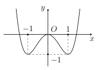
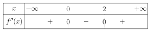
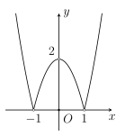
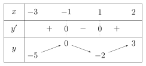
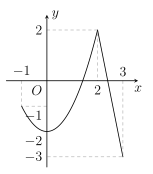

## Phần I. Thí sinh trả lời từ câu 1 đến câu 12, mỗi câu hỏi chọn một phương án.

### Câu 1

Tìm giá trị nhỏ nhất của hàm số $y = \dfrac{x + 3}{x - 1}$ trên đoạn $[-1;0]$.

- **A.** $\min\limits_{[-1;0]} y =\text{–}3$.

- **B.** $\min\limits_{[-1;0]} y =\text{–}2$.

- **C.** $\min\limits_{[-1;0]} y =\text{–}4$.

- **D.** $\min\limits_{[-1;0]} y = 3$.

### Câu 2

Cho hàm số $ y=f(x) $ có đồ thị như hình vẽ sau. Giá trị nhỏ nhất trên tập xác định $ \mathcal{D} $ của hàm số là

- **A.** $\min\limits_{\mathcal{D}} y =\text{–}1$.

- **B.** $\min\limits_{\mathcal{D}} y = 1$.

- **C.** $\min\limits_{\mathcal{D}} y = 0$.

- **D.** $\min\limits_{\mathcal{D}} y =\text{–}2$.

### Câu 3

Tìm giá trị lớn nhất trên đoạn $[1; 3]$ của hàm số

$$
f(x) = x^3 - 2x^2 - 4x + 1.
$$

- **A.** $\max\limits_{[1;3]} f(x) =\text{–}7$.

- **B.** $\max\limits_{[1;3]} f(x) =\text{–}4$.

- **C.** $\max\limits_{[1;3]} f(x) =\text{–}2$.

- **D.** $\max\limits_{[1;3]} f(x) = -\frac{67}{27}$.

### Câu 4

Giá trị lớn nhất của hàm số $y = \dfrac{x + 1}{x - 2}$ trên $[-1; 0]$ là

- **A.** $-\dfrac{1}{2}$.

- **B.** $-\dfrac{2}{3}$.

- **C.** 2.

- **D.** 0.

### Câu 5

Cho hàm số $f(x) =\text{–}2x^4 + 4x^2 + 10$. Tìm giá trị lớn nhất $M$ và giá trị nhỏ nhất $m$ của hàm số trên đoạn $[0; 2]$.

- **A.** $M = 10; m =\text{–}6$.

- **B.** $M = 12; m =\text{–}6$.

- **C.** $M = 10; m =\text{–}8$.

- **D.** $M = 12; m =\text{–}8$.

### Câu 6

Giá trị lớn nhất của hàm số $y = \sqrt{x + 2} - x$ là

- **A.** $-\dfrac{5}{4}$.

- **B.** $\sqrt{3} - 1$.

- **C.** $\dfrac{9}{4}$.

- **D.** 2.

### Câu 7

Tìm giá trị lớn nhất $M$ của hàm số $y =\text{–}2\sqrt{4 - x}$.

- **A.** $M =\text{–}4$.

- **B.** $M =\text{–}2$.

- **C.** $M = 1$.

- **D.** $M = 0$.

### Câu 8

Tìm giá trị lớn nhất $M$ của hàm số $y = \dfrac{x + 1}{\sqrt{x^2 + 1}}$ trên khoảng $(-\infty; +\infty)$.

- **A.** $M = 2\sqrt{2}$.

- **B.** $M = 1$.

- **C.** $M = \sqrt{2}$.

- **D.** $M = 2$.

### Câu 9

Giá trị lớn nhất của hàm số $y = 2x + \dfrac{1}{x}$ khi $x < 0$ là

- **A.** $2\sqrt{2}$.

- **B.** $\text{–}2\sqrt{2}$.

- **C.** Không tồn tại.

- **D.** 4.

### Câu 10

Giá trị lớn nhất của hàm số $f(x) = x(1 - x^2)$ trên khoảng $(0; 1)$ là

- **A.** $\frac{1}{9}$.

- **B.** $\frac{1}{\sqrt{3}}$.

- **C.** 0.

- **D.** $\frac{2\sqrt{3}}{9}$.

### Câu 11

Cho hàm số $y = f(x)$ có đạo hàm cấp hai trên $\mathbb{R}$. Biết $f'(0) = 3$, $f'(2) =\text{–}2$ và bảng xét dấu của $f''(x)$ như sau:

Hàm số $y = f(x + 3) + 2x$ đạt giá trị nhỏ nhất tại điểm $x_0$ thuộc khoảng nào sau đây?

- **A.** $(3; +\infty)$.

- **B.** $(-\infty;\text{–}3)$.

- **C.** $(0; 3)$.

- **D.** $(\text{–}2; 0)$.

### Câu 12

Xét hàm số $f(x) = |x^2 + ax + b|$, với $a, b$ là tham số. Gọi $M$ là giá trị lớn nhất của hàm số trên $[-1; 3]$. Khi mà $M$ nhận giá trị nhỏ nhất có thể được, hãy tính $a + 2b$.

- **A.** 3.

- **B.** 4.

- **C.** –4.

- **D.** 2.

## Phần II. Thí sinh trả lời từ câu 1 đến câu 4, trong ý a), b), c), d) ở mỗi câu câu, thí sinh chọn ĐÚNG hoặc SAI.

### Câu 1

Cho hàm số $y=f(x)$ xác định trên tập $\mathscr{D}$. Số $M$ và $m$ lần lượt được gọi là giá trị lớn nhất và giá trị nhỏ nhất của hàm số $y=f(x)$ trên $\mathscr{D}$.

- **A.** $f(x) \ge M$ với mọi $x \in \mathscr{D}$ thì M là GTLN của hàm số.

- **B.** $m$ là GTNN nếu $f(x) \ge m$ với mọi $x \in \mathscr{D}$ và tồn tại $x_0 \in \mathscr{D}$ sao cho $f(x_0) = m$.

- **C.** $M - m = 0$.

- **D.** $M$ là GTLN nếu $f(x) \le M$ với mọi $x \in \mathscr{D}$ và tồn tại $x_0 \in \mathscr{D}$ sao cho $f(x_0) = M$.

### Câu 2

Cho hàm số $y=f(x)$ liên tục trên $\mathbb{R}$ và có đồ thị như hình dưới đây.

- **A.** Hàm số nghịch biến trên khoảng $(0; 1)$.

- **B.** Hàm số đồng biến trên khoảng $(\text{–}1; 2)$.

- **C.** Hàm số có ba điểm cực trị.

- **D.** Hàm số có giá trị lớn nhất bằng 2.

### Câu 3

Cho hàm số $y=f(x)$ xác định và liên tục trên khoảng $(\text{–}3; 2)$ có $\lim\limits_{x \to (\text{–}3)^+} f(x) =\text{–}5$, $\lim\limits_{x \to 2^-} f(x) = 3$ và có bảng biến thiên như sau:

- **A.** Hàm số không có GTNN trên khoảng $(\text{–}3; 2)$.

- **B.** Giá trị cực đại của hàm số bằng 0.

- **C.** GTLN của hàm số trên khoảng $(\text{–}3; 2)$ bằng 0.

- **D.** Giá trị cực tiểu của hàm số bằng –2.

### Câu 4

Một công ty sản xuất một loại sản phẩm. Nếu có $x$ sản phẩm được bán ra thì hàm giá bán trên mỗi sản phẩm là $q(x) = 10000 - 250x$ (nghìn đồng), với $0 < x < 40$. Gọi $f(x)$ là hàm doanh thu của công ty (đơn vị: nghìn đồng). Xem $y = f(x)$ là một hàm số xác định trên khoảng $(0; 40)$.

- **A.** $f(x) = x \cdot q(x)$.

- **B.** $f'(x) =\text{–}500x + 10000$.

- **C.** Phương trình $f'(x) = 0$ có nghiệm là $x = 2$.

- **D.** Doanh thu lớn nhất của công ty bằng 100 triệu đồng.

## Phần III. Thí sinh trả lời từ câu 1 đến câu 6 (không làm tròn các phép tính trung gian trong các câu từ 1 đến câu 6).

### Câu 1

Cho hàm số $y=f(x)$ liên tục trên đoạn $[-1; 3]$ và có đồ thị như hình vẽ bên dưới. Gọi $M, m$ lần lượt là giá trị lớn nhất và giá trị nhỏ nhất của hàm số đã cho trên đoạn $[-1; 3]$. Tính $M - m$.

### Câu 2

Biết hàm số $y = x^3 - 3x^2 - 9x + 28$ đạt giá trị nhỏ nhất trên đoạn $[0; 4]$ tại $x_0$. Tính $P = x_0 + 2$.

### Câu 3

Tìm $m$ để hàm số $y = \dfrac{x - m}{mx + 1}$ có giá trị nhỏ nhất trên $[0; 1]$ bằng –2.

### Câu 4

Một xưởng in có 8 máy in, mỗi máy in được 3600 bản in trong một giờ. Chi phí để vận hành một máy in trong mỗi lần in là 50 nghìn đồng. Chi phí cho $n$ máy in chạy trong một giờ là $10(6n + 10)$ nghìn đồng. Hỏi nếu in 50000 tờ quảng cáo thì phải sử dụng bao nhiêu máy in để được lãi nhiều nhất?

### Câu 5

Ông An muốn xây một cái bể chứa nước lớn dạng một khối hộp chữ nhật không nắp có thể tích bằng 288 m³. Đáy bể là hình chữ nhật có chiều dài gấp đôi chiều rộng, giá thuê nhân công để xây bể là 500000 đồng/ m². Nếu ông An biết xác định các kích thước của bể hợp lý thì chi phí thuê nhân công sẽ thấp nhất. Hỏi ông An trả chi phí thấp nhất để xây dựng bể đó là bao nhiêu? (Đơn vị: triệu đồng)

### Câu 6

Cho hàm số $y = f(x) = \dfrac{x^2 + x + 2}{x - 1}$. Gọi $M$ là giao điểm của đồ thị hàm số $y = f(x)$ với trục tung. Phương trình tiếp tuyến của đồ thị hàm số $y = f(x)$ tại điểm $M$ là $y = ax +b$ với $ a,b $ là các số nguyên. Tính giá trị của $ a+b.$
