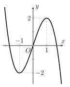
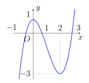

## Phần I. Thí sinh trả lời từ câu 1 đến câu 12, mỗi câu hỏi chọn một phương án.

### Câu 1

Cho hàm số có đồ thị $y = f(x)$ như hình vẽ bên dưới. Hàm số đã cho nghịch biến trên khoảng nào sau đây?

- **A.** $(\text{–}1; 1)$.

- **B.** $(-\infty; 1)$.

- **C.** $(-\infty;\text{–}1)$.

- **D.** $(\text{–}1; +\infty)$.

### Câu 2

Cho hàm số $y = f(x)$ liên tục trên $\mathbb{R}$ và có đạo hàm là $f'(x) = x^2 (x^2 - 5x + 4)$, $\forall x \in \mathbb{R}$. Hàm số $f(x)$ có bao nhiêu điểm cực tiểu?

- **A.** 0.

- **B.** 2.

- **C.** 1.

- **D.** 3.

### Câu 3

Giá trị nhỏ nhất của hàm số $y = \sqrt{16 - x^2}$ trên đoạn $[-2; 2]$ bằng

- **A.** 4.

- **B.** $2\sqrt{3}$.

- **C.** $2\sqrt{5}$.

- **D.** 0.

### Câu 4

Giá trị nhỏ nhất của hàm số $y = 2 \cos^3 x - \frac{9}{2} \cos^2 x + 3 \cos x + \frac{1}{2}$ là

- **A.** –9.

- **B.** 1.

- **C.** $-\frac{3}{2}$.

- **D.** $\frac{1}{2}$.

### Câu 5

Tiếp tuyến của đồ thị hàm số $y = \dfrac{2x + 3}{x - 2}$ tại điểm có hoành độ bằng 3 có phương trình là

- **A.** $y = 7x + 13$.

- **B.** $y = 30 - 7x$.

- **C.** $y = 3x + 9$.

- **D.** $y = -\dfrac{4}{3}x - 2$.

### Câu 6

Hàm số $y = f(x) = \frac{1}{2}x^2 + x - 6\ln x + 2025$ nghịch biến trên khoảng nào sau đây?

- **A.** $(\text{–}3; 2)$.

- **B.** $(2; +\infty)$.

- **C.** $(0; 3)$.

- **D.** $(0; 1)$.

### Câu 7

Tìm giá trị thực của tham số $a$ để hàm số $f(x) = -x^3 - 3x^2 + a$ có giá trị nhỏ nhất trên đoạn $[-1; 1]$ bằng 0.

- **A.** $a = 2$.

- **B.** $a = 6$.

- **C.** $a = 0$.

- **D.** $a = 4$.

### Câu 8

Một cửa hàng buôn giày nhập một đôi với giá là 40 đô-la. Cửa hàng ước tính rằng nếu đôi giày được bán với giá $x$ đô-la thì mỗi tháng khách hàng sẽ mua $(120 - x)$ đôi. Hỏi cửa hàng bán một đôi giày giá bao nhiêu đô-la thì thu được nhiều lãi nhất?

- **A.** 80.

- **B.** 160.

- **C.** 40.

- **D.** 240.

### Câu 9

Cho hàm số $y = f(x)$ liên tục trên $\mathbb{R}$ và có đồ thị như hình bên.

Tìm giá trị lớn nhất của hàm số $y = f^2(x) + 3$ trên đoạn $[0; 2]$.

- **A.** 12.

- **B.** 13.

- **C.** 2.

- **D.** 9.

### Câu 10

Cho hàm số $f(x) = \dfrac{x - m^2}{x + 8}$ với $m$ là tham số thực. Tìm giá trị lớn nhất của $m$ để hàm số có giá trị nhỏ nhất trên đoạn $[0; 3]$ bằng –2.

- **A.** $m =\text{–}4$.

- **B.** $m = 5$.

- **C.** $m = 4$.

- **D.** $m = 1$.

### Câu 11

Cho hàm số $f(x)$ có đạo hàm $f'(x) = (x + 1)(x - 1)^2(x - 2)$. Giá trị nhỏ nhất của hàm số $g(x) = f(x) + \frac{1}{3}x^3 - x - 2$ trên đoạn $[-1; 2]$ bằng

- **A.** $f(2) - \frac{4}{3}$.

- **B.** $f(1) - \frac{8}{3}$.

- **C.** $f(0) - 2$.

- **D.** $f(\text{–}1) - \frac{4}{3}$.

### Câu 12

Tập hợp nào dưới đây chứa tất cả các giá trị thực của tham số $m$ để giá trị lớn nhất của hàm số $y = \left|x^4 - 2x^2 + m\right|$ trên đoạn $[0; 2]$ bằng 5?

- **A.** $(-\infty;\text{–}5) \cup (0; +\infty)$.

- **B.** $(\text{–}5;\text{–}2)$.

- **C.** $(\text{–}4;\text{–}1) \cup (5; +\infty)$.

- **D.** $(\text{–}4;\text{–}3)$.

## Phần II. Thí sinh trả lời từ câu 1 đến câu 4, trong ý a), b), c), d) ở mỗi câu câu, thí sinh chọn ĐÚNG hoặc SAI.

### Câu 1

Cho hàm số $f(x) = x^3 - 12x - 8$.

- **A.** Hàm số đã cho có đạo hàm là $f'(x) = 3x^2 - 12$.

- **B.** Phương trình $f'(x) = 0$ có tập nghiệm là $S = \{2\}$.

- **C.** $f(2) = 24$.

- **D.** Giá trị lớn nhất của hàm số $f(x)$ trên đoạn $[-3; 3]$ bằng 24.

### Câu 2

Lợi nhuận thu được $P$ (nghìn $\text{USD}$) của một công ty khi dùng số tiền $x$ (nghìn $\text{USD}$) chi cho quảng cáo được cho bởi công thức $P = P(x) = -\frac{1}{10}x^3 + 6x^2 + 400$ với $x \ge 0$.

- **A.** Lợi nhuận của công ty tăng khi số tiền chi cho quảng cáo tăng.

- **B.** Có hai phương án giúp công ty có thể thu được lợi nhuận bằng 800 nghìn $\text{USD}$.

- **C.** Hàm số $P = P(x)$ có hai điểm cực trị.

- **D.** Lợi nhuận tối đa mà công ty thu được bằng $3{,}6$ triệu $\text{USD}$.

### Câu 3

Cho hàm số $y = f(x) = \dfrac{x^2 + 2x + 4}{x + 2}$.

- **A.** Hàm số đã cho đồng biến trên khoảng $(0; +\infty)$.

- **B.** Gọi $A, B$ là các điểm cực đại, cực tiểu của đồ thị hàm số. Diện tích của tam giác $OAB$ bằng 8 *(đơn vị diện tích)*, trong đó $O$ là gốc tọa độ.

- **C.** Đường thẳng đi qua hai điểm cực trị của đồ thị hàm số là $y = 2x + 2$.

- **D.** Tổng giá trị lớn nhất và giá trị nhỏ nhất của hàm số trên đoạn $[-3; 3]$ bằng $\text{–}3{,}2$.

### Câu 4

Bạn An làm đèn lồng bằng cách dùng một sợi dây đồng dài 28 (dm) cắt thành ba đoạn để uốn làm khung đèn. Đoạn thứ nhất uốn thành hình vuông $ABCD$ có cạnh bằng $x\ ($ dm $)$ để làm đáy, hai đoạn còn lại có độ dài bằng nhau uốn thành các đường gấp khúc $ASC$ và $BSD$. Khung đèn sau khi hoàn thiện có hình dạng là một hình chóp tứ giác đều $S.ABCD$ và bề mặt ngoài của đèn được dán giấy màu để trang trí, không dán mặt đáy *(xem các mối nối, dán là không đáng kể)*.

- **A.** Độ dài cạnh bên của khung đèn bằng $(7 - x)\ (\text{dm})$ với $0 < x < 7\ (\text{dm})$.

- **B.** Khi $x = 4\ (\text{dm})$ thì độ dài đường cao của khung đèn là $1\, (\text{dm})$.

- **C.** Khi các cạnh bằng nhau thì diện tích giấy màu cần dùng là $14\sqrt{3}\ (\text{dm}^2)$.

- **D.** Thể tích phần không gian của đèn lồng lớn nhất khi $x = 3,25\ (\text{dm})$ *(kết quả làm tròn đến hàng phần trăm)*.

## Phần III. Thí sinh trả lời từ câu 1 đến câu 6 (không làm tròn các phép tính trung gian trong các câu từ 1 đến câu 6).

### Câu 1

Gọi $m$ và $M$ lần lượt là giá trị nhỏ nhất và giá trị lớn nhất của hàm số $y = \frac{1}{2}x - \sqrt{x+2}$ trên đoạn $[-1; 34]$. Tổng $S = 3m + M$ bằng

### Câu 2

Cho hàm số $y = (x+m)^3 - 3(x+m) + 1 + n$. Biết hàm số nghịch biến trên khoảng $(0; 2)$ và giá trị lớn nhất của hàm số trên $[-1; 1]$ bằng 4. Tính $m+n$.

### Câu 3

Cho hàm số $y = (-x^3 + 3x - m - 1)^2$. Tính tổng tất cả các giá trị của tham số $m$ sao cho giá trị nhỏ nhất của hàm số trên đoạn $[-1; 1]$ bằng 4.

### Câu 4

Một vật chuyển động theo quy luật $S = -\frac{1}{2}t^3 + 9t^2$, với $t$ ( s) là khoảng thời gian tính từ lúc vật bắt đầu chuyển động và $S$ ( m) là quãng đường vật đi được trong thời gian đó. Trong khoảng thời gian 10 giây, kể từ lúc bắt đầu chuyển động, tính vận tốc lớn nhất của vật đạt được.

### Câu 5

Một công ty sản xuất dụng cụ thể thao nhận được một đơn đặt hàng sản xuất 8000 quả bóng tennis. Công ty này sở hữu một số máy móc, mỗi máy có thể sản xuất 30 quả bóng trong một giờ. Chi phí thiết lập các máy này là 200 nghìn đồng cho mỗi máy. Khi được thiết lập, hoạt động sản xuất sẽ hoàn toàn diễn ra tự động dưới sự giám sát. Số tiền phải trả cho người giám sát là 192 nghìn đồng một giờ. Số máy móc công ty nên sử dụng là bao nhiêu để chi phí hoạt động là thấp nhất?

### Câu 6

Một công ty sản xuất một loại sản phẩm. Nếu có $x$ sản phẩm được bán ra thì bộ phận tài chính của công ty đưa ra hàm giá bán trên mỗi sản phẩm là $q(x) = 10000 - 250x$ (nghìn đồng), với $0 < x < 40$. Gọi $f(x)$ là hàm doanh thu của công ty (đơn vị: nghìn đồng). Xem $y = f(x)$ là một hàm số xác định trên khoảng $(0; 40)$. Doanh thu lớn nhất của công ty bằng là bao nhiêu triệu đồng?
