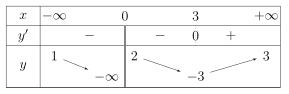
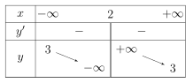
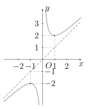
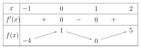
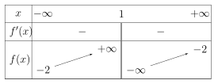
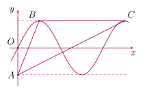
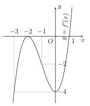

## Phần I. Thí sinh trả lời từ câu 1 đến câu 12, mỗi câu hỏi chọn một phương án.

### Câu 1

Cho hàm số $y=f(x)$ có $\lim\limits_{x \to +\infty} f(x) = 1$ và $\lim\limits_{x \to -\infty} f(x) =\text{–}1$. Khẳng định nào sau đây là đúng?

- **A.** Đồ thị hàm số đã cho có hai đường tiệm cận ngang là các đường thẳng $x=1$ và $x=\text{–}1$.

- **B.** Đồ thị hàm số đã cho không có tiệm cận ngang.

- **C.** Đồ thị hàm số đã cho có đúng một đường tiệm cận ngang.

- **D.** Đồ thị hàm số đã cho có hai đường tiệm cận ngang là các đường thẳng $y=1$ và $y=\text{–}1$.

### Câu 2

Tiệm cận ngang của đồ thị hàm số $y = \frac{x-2}{x+1}$ có phương trình là

- **A.** $y =\text{–}2$.

- **B.** $y = 1$.

- **C.** $x =\text{–}1$.

- **D.** $x = 2$.

### Câu 3

Tiệm cận đứng của đồ thị hàm số $y = \frac{2x-1}{2x+4}$ có phương trình là

- **A.** $y =\text{–}2$.

- **B.** $x =\text{–}2$.

- **C.** $x = 1$.

- **D.** $y = 1$.

### Câu 4

Cho hàm số $y=f(x)$ có bảng biến thiên như hình sau. 	Tổng số tiệm cận đứng và tiệm cận ngang của đồ thị hàm số đã cho là

- **A.** 2.

- **B.** 3.

- **C.** 4.

- **D.** 1.

### Câu 5

Cho hàm số $y=f(x)$ có bảng biến thiên như hình sau. Tìm phương trình đường tiệm cận đứng của đồ thị hàm số đã cho.

- **A.** $x =\text{–}1$.

- **B.** $y =\text{–}1$.

- **C.** $y =\text{–}2$.

- **D.** $x =\text{–}2$.

### Câu 6

Trong các hàm số dưới đây, đồ thị hàm số nào nhận đường thẳng $x=1$ là đường tiệm cận đứng?

- **A.** $y = \dfrac{2x-1}{x-1}$.

- **B.** $y = \dfrac{x^2+2x-3}{2x-3}$.

- **C.** $y = x - \sqrt{x^2+2}$.

- **D.** $y = \dfrac{2}{x^2+x+1}$.

### Câu 7

Đồ thị hàm số nào sau đây có đúng một đường tiệm cận?

- **A.** $y = \dfrac{x+3}{2x-1}$.

- **B.** $y = \dfrac{x^2+3x-2}{x+3}$.

- **C.** $y = \dfrac{2x}{x^2+1}$.

- **D.** $y = \dfrac{4}{x-1}$.

### Câu 8

Cho hàm số $y=f(x)$ có đồ thị như hình vẽ bên dưới.

Đồ thị hàm số có đường tiệm cận xiên đi qua điểm nào dưới đây?

- **A.** $M(1; 2)$.

- **B.** $N(\text{–}2; 1)$.

- **C.** $P(2; 2)$.

- **D.** $Q(1;\text{–}1)$.

### Câu 9

**Câu 4.** Cho hàm số bậc ba $y = f(x)$ có bảng biến thiên trên đoạn $[-1; 2]$ như sau:

Hàm số đồng biến trên khoảng

- **A.** $(\text{–}1; 0) \cup (1; 2)$.

- **B.** $(0; 5)$.

- **C.** $(\text{–}1; 1)$.

- **D.** $\left(1; \frac{3}{2}\right)$.

### Câu 10

Hàm số $y = \frac{ax + b}{cx + d}$ ($c \ne 0$, $ad - cb \ne 0$), có bảng biến thiên như hình vẽ dưới đây:

Tâm đối xứng của đồ thị hàm số là $I(m; n)$. Giá trị $2m + n$ bằng

- **A.** 0.

- **B.** 1.

- **C.** –2.

- **D.** –1.

### Câu 11

Giả sử chi phí $C(x)$ (nghìn đồng) để sản xuất $x$ đơn vị của một loại hàng hóa nào đó được cho bởi hàm số $C(x) = \frac{1}{8}x^3 - \frac{5}{2}x^2 + 300x + 30000$. Chi phí để sản xuất thêm đơn vị hàng hóa thứ 301 xấp xỉ bằng (kết quả làm tròn đến hàng phần chục của triệu đồng).

- **A.** $3302{,}7$.

- **B.** $3270{,}0$.

- **C.** $32{,}5$.

- **D.** $32{,}7$.

### Câu 12

Cho đồ thị hàm số $y = 2 \sin x$ như hình vẽ bên. Tính diện tích tam giác $ABC$?

- **A.** $2\pi$.

- **B.** $3\pi$.

- **C.** $4\pi$.

- **D.** $5\pi$.

## Phần II. Thí sinh trả lời từ câu 1 đến câu 4, trong ý a), b), c), d) ở mỗi câu câu, thí sinh chọn ĐÚNG hoặc SAI.

### Câu 1

Cho hàm số $y = f(x) = \dfrac{x^2 + x - 1}{x - 1}$, có đồ thị $(C)$.

- **a)** Tập giá trị của hàm số là $(-\infty; 1) \cup (1; +\infty)$.

- **b)** Tâm đối xứng của đồ thị hàm số đã cho là $I(1; 3)$.

- **c)** Điểm $M(3; 7)$ thuộc đường thẳng đi qua hai điểm cực trị của đồ thị $(C)$.

- **d)** Khoảng cách từ điểm $O(0; 0)$ đến đường tiệm cận xiên của đồ thị hàm số bằng $\sqrt{2}$.

### Câu 2

Một loại thuốc được dùng cho một bệnh nhân và nồng độ thuốc trong máu của bệnh nhân được giám sát bởi bác sĩ. Biết rằng nồng độ thuốc trong máu của bệnh nhân sau khi tiêm vào cơ thể trong $t$ giờ ($t \ge 0$) được cho bởi hàm số có công thức $c(t)=\frac{t}{t^2+4}\, ($ mg/l $).$

- **a)** Nồng độ thuốc trong máu của bệnh nhân sau 1 giờ là $0{,}2\,  ($ mg/l $)$.

- **b)** Trong khoảng thời gian từ 0 đến 2 giờ nồng độ thuốc trong máu bệnh nhân tăng.

- **c)** Đạo hàm của hàm số $c(t)$ là $c'(t)=\dfrac{4-t^2}{\left(t^2+4\right)^2}$ với $t \ge 0$.

- **d)** Nồng độ thuốc trong máu của bệnh nhân luôn thấp hơn $0{,}25\,  ($ mg/l $)$.

### Câu 3

Bạn An thiết kế một mô hình kim tự tháp là một khối chóp tứ giác đều có cạnh bên là 6 dm, cạnh đáy bằng 4 dm.

- **a)** Chiều cao của mô hình là $2\sqrt{7}\text{ dm}$.

- **b)** Thể tích của mô hình (*làm tròn đến hàng phần chục*) là $84{,}7\text{ dm}^3$.

- **c)** cosin của góc phẳng nhị diện có hai mặt lần lượt chứa mặt bên và mặt đáy của mô hình bằng $\frac{\sqrt{2}}{8}$.

- **d)** Bạn An thiết kế một dây đèn led trang trí xuất phát từ một đỉnh ở đáy di chuyển một vòng qua tất cả các mặt bên của mô hình và trở về vị trí ban đầu. Độ dài ngắn nhất của sợi dây đèn led (*làm tròn kết quả đến hàng phần chục*) là $11{,}7\text{ dm}$.

### Câu 4

Cho hàm số $y=f(x)$ liên tục và có đạo hàm trên $\mathbb{R}$, biết hàm số $y=f'(x)$ là hàm số bậc ba có đồ thị là đường cong như hình vẽ.

- **a)** Hàm số $y=f(x)$ nghịch biến trên khoảng $(\text{–}2;1)$.

- **b)** Hàm số $y=f(x)$ có hai điểm cực trị.

- **c)** Biết rằng $f(0)+f(2)=f(1)+f(3)$. Giá trị lớn nhất của hàm số $h(x)=f(3\sin x)$ trên đoạn $[0;\pi]$ là $f(3)$.

- **d)** Hàm số $g(x)=f(x)-\frac{1}{2}x^2+x+2026$ đồng biến trên khoảng $\left(-\frac{11}{4};-\frac{5}{4}\right)$.

## Phần III. Thí sinh trả lời từ câu 1 đến câu 6 (không làm tròn các phép tính trung gian trong các câu từ 1 đến câu 6).

### Câu 1

Tính tổng giá trị lớn nhất và giá trị nhỏ nhất của hàm số $y = (x^2 + x + 1)e^{-x}$ trên đoạn $[-1; 0]$ (kết quả làm tròn đến hàng phần chục).

### Câu 2

Trong một dự án giám sát sinh thái hồ, các chuyên gia môi trường mô hình hóa nồng độ oxygen hòa tan $DO$ (đơn vị: mg/L) trong nước hồ sau $t$ giờ ($t \ge 0$) kể từ khi xảy ra sự cố xả thải hữu cơ bằng hàm số $y = f(t)$ được xấp xỉ bởi công thức

$$
f(t) = 5 - \frac{15t}{9t^2 + 1}.
$$

Đạo hàm $f'(t)$ biểu thị tốc độ thay đổi nồng độ oxygen trong nước hồ (đơn vị: mg/(L·h)). Tốc độ phục hồi (hoặc gia tăng) nồng độ oxygen hòa tan trong hồ đạt giá trị lớn nhất tại thời điểm $t = \frac{\sqrt{a}}{b}$ giờ ($a$ và $b$ là các số nguyên tố). Tính giá trị của biểu thức $P = a - b$.

### Câu 3

Một doanh nghiệp công nghệ khởi nghiệp chuẩn bị mở rộng quy mô và cần thuê một mặt bằng làm trung tâm kho vận phân phối hàng hóa trong thời hạn 15 năm. Sau khi khảo sát, doanh nghiệp nhận được hai phương án hợp đồng từ hai đơn vị cho thuê bất động sản như sau:

- **Phương án 1 (Thanh toán theo quý):** Tiền thuê quý đầu tiên là 10 triệu đồng; từ quý thứ hai trở đi, tiền thuê mỗi quý tăng thêm $500\,000$ đồng so với quý trước đó.

- **Phương án 2 (Thanh toán theo năm):** Tiền thuê năm đầu tiên là 70 triệu đồng; từ năm thứ hai trở đi, tiền thuê mỗi năm tăng thêm 3 triệu đồng so với năm trước đó.

Để tối ưu hóa ngân sách, doanh nghiệp cần chọn một phương án để tổng chi phí thuê mặt bằng trong 15 năm là thấp nhất. Khi đó số tiền chi phí thấp nhất đó bằng bao nhiêu triệu đồng?

### Câu 4

Gọi $n$, $d$ lần lượt là số đường tiệm cận ngang và số tiệm cận đứng của đồ thị hàm số $y = \dfrac{\sqrt{1-x}}{(x-1)\cdot\sqrt{x}}$. Tính giá trị của biểu thức $T = 26n - 27d$.

### Câu 5

Tìm điểm cực tiểu của hàm số $y = \frac{x^3}{3} - \frac{5x^2}{2} + 4x + 6\ln(x + 1)$, kết quả làm tròn đến hàng phần trăm.

### Câu 6

Một công ty logistic vận chuyển một lô hàng siêu trọng trên cung đường dài 180 km bằng xe đầu kéo chuyên dụng. Xe di chuyển đều với vận tốc $v$ ( km/h), trong đó quy chuẩn an toàn giao thông giới hạn vận tốc xe trong khoảng $30 \le v \le 60$. Lượng nhiên liệu tiêu thụ cho mỗi kilômét di chuyển phụ thuộc vào vận tốc và được xác định theo công thức: $f(v) = \frac{8}{v} + \frac{v^2}{4500}\, ($ L/km $).$ Biết giá dầu diesel là 24.000 đồng/lít; chi phí nhân công (lương tài xế và phụ xe) là 180.000 đồng/giờ; chi phí hao mòn kỹ thuật và bảo hiểm hành trình cố định là 1.200 đồng cho mỗi kilômét xe lăn bánh. Để tổng chi phí vận chuyển của chuyến hàng (bao gồm tiền nhiên liệu, chi phí nhân công và chi phí hao mòn) đạt giá trị nhỏ nhất, tài xế cần điều khiển xe chạy với vận tốc bằng bao nhiêu km/h *(không làm tròn các kết quả trung gian, làm tròn kết quả cuối đến hàng phần chục)*?
