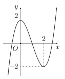
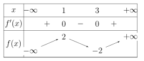
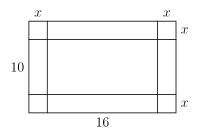

## Phần I. Thí sinh trả lời từ câu 1 đến câu 12, mỗi câu hỏi chọn một phương án.

### Câu 1

Cho hình chóp $S.ABC$ có $SA$ vuông góc với mặt phẳng đáy, đáy $ABC$ là tam giác vuông tại $B$. Biết $AB=a$ và $SA=2a$. Khoảng cách từ điểm $A$ đến mặt phẳng $(SBC)$ bằng:

- **A.** $\dfrac{2\sqrt{2}a}{3}$.

- **B.** $\dfrac{\sqrt{5}a}{3}$.

- **C.** $\dfrac{\sqrt{5}a}{5}$.

- **D.** $\dfrac{2\sqrt{5}a}{5}$.

### Câu 2

Cho hàm số $f(x)$ có đạo hàm $f'(x)=(x-1)^2(2-x)$. Hàm số $f(x)$ đồng biến trên khoảng nào?

- **A.** $(\text{–}1;3)$.

- **B.** $(2;+\infty)$.

- **C.** $(-\infty;2)$.

- **D.** $(2;5)$.

### Câu 3

Một xạ thủ lần lượt bắn hai viên đạn vào một bia. Xác suất trúng đích của viên đạn thứ nhất và thứ hai lần lượt là $0{,}8$ và $0{,}7$. Biết rằng kết quả các lần bắn là độc lập với nhau. Xác suất của biến cố ``Cả hai lần bắn đều không trúng đích'' là:

- **A.** $0{,}14$.

- **B.** $0{,}56$.

- **C.** $0{,}06$.

- **D.** $0{,}6$.

### Câu 4

Cho hàm số $y=f(x)$ xác định trên tập $\mathbb{R}$ và có đồ thị như hình bên. 		Mệnh đề nào dưới đây đúng?

- **A.** Hàm số đạt cực đại tại $x=0$ và đạt cực tiểu tại $x=2$.

- **B.** Hàm số có giá trị lớn nhất bằng 2 và giá trị nhỏ nhất bằng –2.

- **C.** Hàm số có giá trị cực tiểu bằng 2.

- **D.** Hàm số có ba điểm cực trị.

### Câu 5

Cho hình chóp $S.ABC$ có đáy $ABC$ là tam giác đều cạnh $a$. Cạnh bên $SA=a\sqrt{3}$ và vuông góc với mặt đáy $(ABC)$. Gọi $\varphi$ là góc nhị diện $[S,BC,A]$. Tính $\tan \varphi$.

- **A.** $\tan \varphi = \sqrt{3}$.

- **B.** $\tan \varphi = \frac{1}{2}$.

- **C.** $\tan \varphi = \frac{1}{\sqrt{3}}$.

- **D.** $\tan \varphi = 2$.

### Câu 6

Cho hàm số $f(x)$ có bảng biến thiên như sau:

Hàm số đã cho đạt cực tiểu tại điểm

- **A.** $x=3$.

- **B.** $x=2$.

- **C.** $x=1$.

- **D.** $x=\text{–}2$.

### Câu 7

Đạo hàm của hàm số $y=\sin x + \cos 2x$ là:

- **A.** $y'=-\cos x + 2\sin 2x$.

- **B.** $y'=2\cos 2x$.

- **C.** $y'=\cos x - 2\sin 2x$.

- **D.** $y'=\cos x + 2\sin 2x$.

### Câu 8

Cho hình lập phương $ABCD.A'B'C'D'$ có $AC=a\sqrt{2}$. Thể tích khối lập phương đó bằng:

- **A.** $\frac{2a^3\sqrt{2}}{3}$.

- **B.** $\frac{a^3}{3}$.

- **C.** $2a^3\sqrt{2}$.

- **D.** $a^3$.

### Câu 9

Giá trị lớn nhất của hàm số $y=x^3-3x+2$ trên đoạn $[0;2]$ bằng:

- **A.** 4.

- **B.** 2.

- **C.** 0.

- **D.** 5.

### Câu 10

Phương trình tiếp tuyến của đồ thị $y=x^3+x$ tại điểm $M(1;2)$ là:

- **A.** $y=\text{–}4x+2$.

- **B.** $y=4x-2$.

- **C.** $y=\text{–}4x+6$.

- **D.** $y=4x+2$.

### Câu 11

Cho hàm số $y=\frac{2x+3}{x-1}$. Khẳng định nào đúng.

- **A.** Hàm số nghịch biến trên các khoảng $(-\infty;1); (1;+\infty)$.

- **B.** Hàm số nghịch biến trên khoảng $(-\infty;1) \cup (1;+\infty)$.

- **C.** Hàm số nghịch biến trên $\mathbb{R} \setminus \{1\}$.

- **D.** Hàm số đồng biến trên $\mathbb{R} \setminus \{1\}$.

### Câu 12

Cho $A$ và $B$ là hai biến cố xung khắc liên quan đến một phép thử. Biết $P(A)=\frac{1}{2}, P(B)=\frac{1}{3}$, tính $P(A \cup B)$.

- **A.** $\frac{5}{6}$.

- **B.** $\frac{1}{6}$.

- **C.** 1.

- **D.** $\frac{2}{3}$.

## Phần II. Thí sinh trả lời từ câu 1 đến câu 4, trong ý a), b), c), d) ở mỗi câu câu, thí sinh chọn ĐÚNG hoặc SAI.

### Câu 1

Cho hàm số $f(x)=2x-4+\frac{2}{x+1}$.

- **a)** Hàm số có đạo hàm $f'(x)=\frac{2(x^2+2x)}{(x+1)^2}$.

- **b)** Giá trị nhỏ nhất của hàm số trên khoảng $(\text{–}1;+\infty)$ bằng –2.

- **c)** Điểm cực đại của đồ thị hàm số có tọa độ $(0;\text{–}2)$.

- **d)** Hàm số $y=f(x)$ có tập xác định là $D=\mathbb{R}\setminus \{-1\}$.

### Câu 2

Cho hình chóp $S.ABCD$ có $SA\perp (ABCD)$, đáy $ABCD$ là hình chữ nhật. Biết $AB=a\sqrt{2}, AD=a$ và $SA=a\sqrt{3}$.

- **a)** Thể tích khối chóp $S.ACD$ bằng $\frac{a^3\sqrt{6}}{6}$.

- **b)** Khoảng cách từ điểm $A$ đến mặt phẳng $(SBC)$ là $\frac{a\sqrt{30}}{6}$.

- **c)** Góc giữa hai mặt phẳng $(SCD)$ và $(ABCD)$ là $\widehat{SDA}$.

- **d)** $BC\perp (SAB)$.

### Câu 3

Một tổ có 16 bạn học sinh gồm 7 nam, 9 nữ. Chọn ngẫu nhiên từ tổ ra 6 bạn bất kì.

- **a)** Xác suất để 6 bạn được chọn có ít nhất 1 nam là $\frac{9}{11}$.

- **b)** Số phần tử của không gian mẫu là $n(\Omega)=C_{16}^6$.

- **c)** Xác suất để 6 bạn được chọn có đúng 2 nữ là $\frac{45}{286}$.

- **d)** Xác suất để 6 bạn được chọn toàn nam là $\frac{1}{114}$.

### Câu 4

Một người đang lái xe máy trên đường hẹp thì phát hiện phía trước có vật cản cách đó 50 m. Ngay tại thời điểm này, người lái xe bắt đầu đạp phanh. Trong quá trình đạp phanh, xe máy chuyển động theo phương trình $s(t)=\text{–}5t^2+30t$, trong đó $s$ (đơn vị mét) là độ dài quãng đường đi được sau khi đạp phanh, $t$ (đơn vị giây) là thời gian tính từ lúc bắt đầu đạp phanh.

- **a)** Tại thời điểm bắt đầu phanh, tốc độ xe máy là 30 m/s.

- **b)** Khi xe dừng hẳn, người đó còn cách vật cản 3 m.

- **c)** Kể từ lúc đạp phanh, vận tốc của xe máy giảm dần theo phương trình $v(t)=\text{–}10t+30$.

- **d)** Kể từ lúc đạp phanh, xe dừng hẳn sau 2 s.

## Phần III. Thí sinh trả lời từ câu 1 đến câu 6 (không làm tròn các phép tính trung gian trong các câu từ 1 đến câu 6).

### Câu 1

Một lớp ngôn ngữ có 60 sinh viên trong đó 40 sinh viên học tiếng Anh, 30 sinh viên học tiếng Pháp. Biết rằng mỗi sinh viên trong lớp đều phải học ít nhất một ngôn ngữ. Chọn ngẫu nhiên một sinh viên. Tính xác suất của biến cố ``Sinh viên học cả tiếng Anh và tiếng Pháp''. Kết quả làm tròn đến hàng phần trăm.

### Câu 2

Một chuyển động có vận tốc được xác định bởi phương trình $v(t)=-t^2+3t-2$ với $t \ge 0$, trong đó $t$ tính bằng giây và $v$ tính bằng m/s. Kể từ giây thứ bao nhiêu trở đi thì vận tốc của vật giảm?

### Câu 3

Cho hàm số $y=x^3-4x^2+5x+2$. Hàm số có điểm cực đại và điểm cực tiểu lần lượt là $x_1, x_2$. Tính giá trị biểu thức $A=x_1-3x_2$.

### Câu 4

Cho hàm số $y=x-\ln x$. Tích của giá trị lớn nhất và giá trị nhỏ nhất của hàm số trên đoạn $\left[\frac{1}{2};e\right]$ bằng $ae+b$. Tính $2026a-2027b$.

### Câu 5

Cho hình chóp $S.ABCD$ có đáy là hình thang vuông tại $A$ và $D$, $AB=3a, CD=a$, $SA$ vuông góc với mặt phẳng $(ABCD)$. Biết góc giữa đường thẳng $SD$ và mặt phẳng $(ABCD)$ bằng $60^\circ$ và khoảng cách từ $B$ đến $(SCD)$ bằng $\frac{a\sqrt{3}}{2}$. Thể tích khối chóp $S.ABCD$ là $\frac{m}{n}\sqrt{3}a^3$ trong đó $m,n$ là hai số nguyên dương và phân số $\frac{m}{n}$ tối giản. Tính $m+n$.

### Câu 6

Cho một tấm bìa hình chữ nhật có kích thước 10 cm $\times$ 16 cm. Từ tấm bìa đó, người ta cắt bỏ bốn hình vuông bằng nhau ở bốn góc (hình vuông bị cắt bỏ có độ dài cạnh là $x$ cm) rồi gập lại thành một chiếc hộp có dạng hình hộp chữ nhật không có nắp. Biết thể tích của chiếc hộp đó bằng 144 cm³. Tìm $x$.

