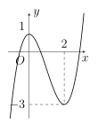
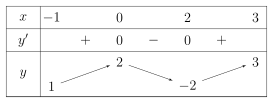
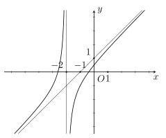
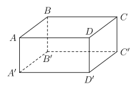

## Phần I. Thí sinh trả lời từ câu 1 đến câu 12, mỗi câu hỏi chọn một phương án.

### Câu 1

Cho hàm số bậc ba $y = f(x)$ có đồ thị như hình vẽ dưới. Điểm cực tiểu của đồ thị hàm số đã cho là

- **A.** $N(2;\text{–}3)$.

- **B.** $M(0; 1)$.

- **C.** $x = 2$.

- **D.** $x = 0$.

### Câu 2

Giả sử giá trị nhỏ nhất của hàm số $y = x + e^{-2x}$ trên đoạn $[0; 2]$ là $a + \ln b$. Tính $ab$.

- **A.** $ab = \frac{\sqrt{2}}{2}$.

- **B.** $ab = \frac{1}{2}$.

- **C.** $ab = 1$.

- **D.** $ab = 2$.

### Câu 3

Tính giới hạn $\lim\limits_{x \to (\text{–}1)^-} \dfrac{x - 2}{x + 1}$.

- **A.** $+\infty$.

- **B.** $-\frac{1}{2}$.

- **C.** $-\infty$.

- **D.** 1.

### Câu 4

Cho hàm số $y = f(x)$ liên tục trên đoạn $[-1; 3]$ và có bảng biến thiên như sau:

Tìm giá trị nhỏ nhất của hàm số đã cho trên đoạn $[-1; 3]$.

- **A.** 2.

- **B.** 3.

- **C.** –2.

- **D.** 1.

### Câu 5

Cho hàm số $y = f(x)$ có đạo hàm $f'(x) = 3x^2(x-1)^3(x+2)^2, \forall x \in \mathbb{R}$. Số điểm cực trị của hàm số đã cho là

- **A.** 2.

- **B.** 1.

- **C.** 4.

- **D.** 3.

### Câu 6

Cho hàm số $y = \dfrac{ax^2 + bx + 1}{cx + 2}$ có đồ thị như hình vẽ bên dưới. Tính giá trị biểu thức $T = 2a + 3b - c$.

- **A.** 8.

- **B.** 10.

- **C.** 9.

- **D.** 11.

### Câu 7

Cho hình hộp chữ nhật $ABCD.A'B'C'D'$ có $AB = 4a$, $AD = 3a$, $AA' = 2a$ (tham khảo hình vẽ bên dưới). Gọi $\varphi$ là số đo góc nhị diện $[B, A'C', D]$. Tính $\tan \varphi$.

- **A.** $-\frac{60}{11}$.

- **B.** $\frac{60}{11}$.

- **C.** $-\frac{40}{9}$.

- **D.** $\frac{40}{9}$.

### Câu 8

Hai xạ thủ độc lập bắn vào một mục tiêu. Xác suất trúng mục tiêu của xạ thủ thứ nhất là $0{,}75$. Xác suất trúng mục tiêu của xạ thủ thứ hai là $0{,}85$. Xác suất để mục tiêu bị bắn trúng là

- **A.** $\frac{13}{40}$.

- **B.** $\frac{77}{80}$.

- **C.** $\frac{3}{5}$.

- **D.** $\frac{51}{80}$.

### Câu 9

Kết quả khảo sát cân nặng của 25 quả bơ được cho trong bảng sau

| Cân nặng ($\mathrm{gam}$) | $[150; 155)$ | $[155; 160)$ | $[160; 165)$ | $[165; 170)$ | $[170; 175)$ | $[175; 180)$ |
| :---: | :---: | :---: | :---: | :---: | :---: | :---: |
| Số quả | 2 | 4 | 7 | 8 | 3 | 1 |

Tứ phân vị thứ ba (đơn vị: gam, kết quả làm tròn đến hàng phần chục) của mẫu số liệu trên bằng

- **A.** $Q_3 = 164{,}6$.

- **B.** $Q_3 = 168{,}6$.

- **C.** $Q_3 = 169{,}8$.

- **D.** $Q_3 = 160{,}2$.

### Câu 10

Tập nghiệm $T$ của bất phương trình $\log_{\frac{1}{3}}(x + 4) \ge -2$ là

- **A.** $T = (\text{–}4; 5]$.

- **B.** $T = (\text{–}4; 5)$.

- **C.** $T = [5; +\infty)$.

- **D.** $T = (-\infty; 5]$.

### Câu 11

Cho cấp số cộng $(u_n)$ có số hạng đầu $u_1 =\text{–}2$, công sai $d = 3$. Hỏi 199 là số hạng thứ mấy của cấp số cộng đã cho?

- **A.** 66.

- **B.** 67.

- **C.** 68.

- **D.** 69.

### Câu 12

Một nhà máy dự định sản xuất không quá 200 sản phẩm trong mỗi tháng. Biết giá bán của mỗi sản phẩm được tính theo hàm số $p(x) = 334 - \frac{3}{2}x$ (nghìn đồng), trong đó $x$ là số lượng sản phẩm sản xuất trong tháng. Hỏi mỗi tháng nhà máy đạt được doanh thu lớn nhất là bao nhiêu nghìn đồng *(giả sử rằng các sản phẩm mà nhà máy sản xuất ra đều bán hết)*?

- **A.** 18592.

- **B.** 18593.

- **C.** $18592{,}7$.

- **D.** $18592{,}5$.

## Phần II. Thí sinh trả lời từ câu 1 đến câu 4, trong ý a), b), c), d) ở mỗi câu câu, thí sinh chọn ĐÚNG hoặc SAI.

### Câu 1

Một công ty sau khi ra mắt sản phẩm mới đã ghi nhận lợi nhuận $P(t)$ (đơn vị: tỷ đồng) sau $t$ tháng kinh doanh. Trong năm đầu tiên, giả sử mối liên hệ giữa lợi nhuận và thời gian kinh doanh được mô hình hóa bởi hàm số:

$$

	P(t) = -t^3 + 12t^2 + 60t - 50, \quad 0 \le t \le 12.

$$

- **A.** Lợi nhuận của công ty tại thời điểm $t = 2$ là 110 tỷ đồng.

- **B.** Hàm số biểu thị tốc độ tăng trưởng lợi nhuận $P'(t) =\text{–}3t^2 + 24t + 10$.

- **C.** Lợi nhuận của công ty đạt mức tối đa tại thời điểm $t = 10$.

- **D.** Tại thời điểm $t = 4$ thì tốc độ tăng trưởng lợi nhuận là lớn nhất.

### Câu 2

Cho hàm số $f(x) = \log_2(x^2 - 4x + 8)$.

- **A.** Tập xác định của hàm số $f(x)$ là $D = \mathbb{R}$.

- **B.** Đạo hàm $f'(x) = \frac{2x - 4}{x^2 - 4x + 8}$.

- **C.** Giá trị nhỏ nhất của hàm số $f(x)$ trên $\mathbb{R}$ bằng 1.

- **D.** Phương trình $f(x) = 2025$ có đúng hai nghiệm.

### Câu 3

Cho hàm số $y = \dfrac{2x^2 - x + 2}{x - 1}$ có đồ thị $(C)$.

- **A.** Tập xác định của hàm số đã cho là $D = (1; +\infty)$.

- **B.** Hàm số đã cho có đúng hai điểm cực trị.

- **C.** Đồ thị $(C)$ có tiệm cận xiên là $y = 2x + 1$.

- **D.** Xét điểm $A$ thuộc $(C)$, tổng khoảng cách từ $A$ đến hai đường tiệm cận của $(C)$ luôn lớn hơn $2{,}3$.

### Câu 4

Cho hàm số $y = \left(9 - x^2\right)^{\frac{1}{3}} + \ln(1 - x)$

- **A.** Tập xác định của hàm số là khoảng $(-\infty; 1)$.

- **B.** Hàm số có đạo hàm $y' = \dfrac{1}{3\sqrt[3]{(9 - x^2)^2}} - \dfrac{1}{1 - x}$.

- **C.** Hàm số nghịch biến trên khoảng $(0; 1)$.

- **D.** Giá trị nhỏ nhất của hàm số trên đoạn $\left[\frac{1}{4}; \frac{1}{2}\right]$ bằng $\frac{1}{2}\sqrt[3]{70} - \ln(2)$.

## Phần III. Thí sinh trả lời từ câu 1 đến câu 6 (không làm tròn các phép tính trung gian trong các câu từ 1 đến câu 6).

### Câu 1

Một chất điểm chuyển động có phương trình chuyển động là $s(t) = -\frac{1}{2}t^2 + 20t$ (đơn vị: mét), với $t \ge 0$ (đơn vị: giây). Sau 8 giây tính từ khi chất điểm bắt đầu chuyển động, vận tốc tức thời của chất điểm bằng bao nhiêu mét/giây?

### Câu 2

Một nhà máy sản xuất và bán $x$ sản phẩm trong mỗi tháng. Chi phí sản xuất $x$ sản phẩm được cho bởi công thức $C = 10000 + 600x - 0{,}6x^2 + 0{,}004x^3$ (nghìn đồng). Biết giá bán của mỗi sản phẩm là $p = 1800 - 6x$ (nghìn đồng). Hỏi mỗi tháng nhà máy nên sản xuất bao nhiêu sản phẩm để lợi nhuận thu được là lớn nhất?

### Câu 3

Trong công nghệ sinh học sản xuất vắc-xin, sự phát triển số lượng vi khuẩn nuôi cấy trong môi trường dinh dưỡng giới hạn được mô hình hóa bởi hàm số Logistic $N(t) = \frac{A}{1 + Be^{-kt}}$ (trong đó $N(t)$ là số lượng vi khuẩn (đơn vị: *triệu con*) sau $t$ giờ nuôi cấy ($t \ge 0$) và $A, B, k$ là các hằng số dương). Tốc độ sinh trưởng của quần thể tại thời điểm $t$ được xác định bởi hàm $v(t) = N'(t)$ (đơn vị: *triệu con/giờ*). Biết rằng: Số lượng vi khuẩn tối đa mà môi trường này có thể duy trì khi thời gian nuôi cấy đủ lớn (xem số lượng này bằng $\lim\limits_{t \to +\infty} N(t)$) là 500 triệu con; Tại thời điểm ban đầu ($t = 0$) quần thể có 20 triệu con; Sau 2 giờ nuôi cấy, số lượng vi khuẩn đạt 100 triệu con. Người nuôi cấy cần can thiệp thu hoạch sinh khối tại thời điểm tốc độ sinh trưởng $v(t)$ đạt giá trị cực đại $v_{\max}$. Hãy tính tốc độ sinh trưởng cực đại $v_{\max}$ (triệu con/giờ) *(không làm tròn các kết quả trung gian, làm tròn kết quả sau cùng đến hàng đơn vị)*.

### Câu 4

Xét $A$ và $B$ là hai biến cố của một phép thử. Biết rằng xác suất của các biến cố $\overline{A}$, $B$, $A \cap B$ lần lượt là $P(\overline{A}) = 0{,}7$; $P(B) = 0{,}6$ và $P(A \cap B) = 0{,}1$. Hỏi xác suất của biến cố $A \cup B$ bằng bao nhiêu?

### Câu 5

Cho hình chóp $S.ABCD$ có đáy $ABCD$ là hình chữ nhật, $AB = a$, $AD = 2a$; cạnh bên $SA$ vuông góc với mặt phẳng đáy và $SA = 2a$. Gọi $\alpha$ là số đo của góc nhị diện $[S, BD, C]$. Hỏi $\cos \alpha$ bằng bao nhiêu?

### Câu 6

Tổng của tất cả các nghiệm của phương trình $2\log_2(x + 5) + \log_2 x^2 = 2\log_2 6$ bằng bao nhiêu?
