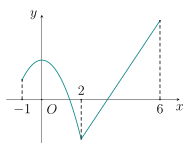
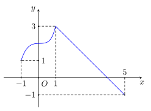
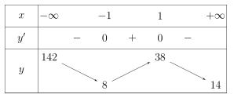
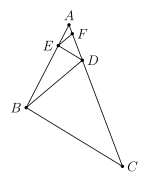
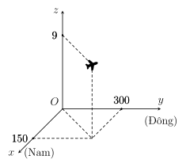
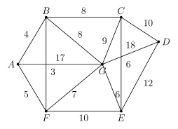

## Phần I. Thí sinh trả lời từ câu 1 đến câu 12, mỗi câu hỏi chọn một phương án.

### Câu 1

Cho hàm số $y=f(x)$ có đạo hàm trên $\mathbb{R}$ thỏa $f'(x) < 0, \forall x \in (1; 2)$ và $f'(x) > 0, \forall x \in (2; 3)$. Phát biểu nào sau đây là đúng?

- **A.** Hàm số $y=f(x)$ đồng biến trên cả hai khoảng $(1; 2)$ và $(2; 3)$.

- **B.** Hàm số $y=f(x)$ nghịch biến trên cả hai khoảng $(1; 2)$ và $(2; 3)$.

- **C.** Hàm số $y=f(x)$ đồng biến trên khoảng $(1; 2)$ và nghịch biến trên khoảng $(2; 3)$.

- **D.** Hàm số $y=f(x)$ nghịch biến trên khoảng $(1; 2)$ và đồng biến trên khoảng $(2; 3)$.

### Câu 2

Giá trị cực đại của hàm số $f(x) = 2x^3 - 9x^2 - 24x + 11$ là

- **A.** –1.

- **B.** 24.

- **C.** 4.

- **D.** –111.

### Câu 3

Cho lăng trụ $ABC.A'B'C'$. Khẳng định nào sau đây đúng?

- **A.** $\overrightarrow{BA} + \overrightarrow{A'C'} = \overrightarrow{BC}$.

- **B.** $\overrightarrow{BA} + \overrightarrow{A'C'} = \overrightarrow{BC'}$.

- **C.** $\overrightarrow{BA} + \overrightarrow{A'C'} = \overrightarrow{C'B}$.

- **D.** $\overrightarrow{BA} + \overrightarrow{A'C'} = \overrightarrow{B'C'}$.

### Câu 4

Hàm số $y=f(x)$ xác định trên đoạn $[-1; 6]$ và có đồ thị như hình vẽ.

Hàm số đã cho nghịch biến trên khoảng nào sau đây?

- **A.** $(\text{–}1; 2)$.

- **B.** $(0; 2)$.

- **C.** $(2; 6)$.

- **D.** $(\text{–}2; 0)$.

### Câu 5

Cho tứ diện $ABCD$. Lấy $G$ là trọng tâm của tam giác $ABC$. Phát biểu nào sau đây là **sai**?

- **A.** $\overrightarrow{GA} + \overrightarrow{GB} + \overrightarrow{GC} = \overrightarrow{0}$.

- **B.** $\overrightarrow{GA} + \overrightarrow{GB} + \overrightarrow{GC} + \overrightarrow{GD} = \overrightarrow{0}$.

- **C.** $\overrightarrow{GD} - \overrightarrow{GA} = \overrightarrow{AD}$.

- **D.** $\overrightarrow{DA} + \overrightarrow{DB} + \overrightarrow{DC} = 3\overrightarrow{DG}$.

### Câu 6

Một chiếc hộp hình lập phương $ABCD.A'B'C'D'$ có cạnh bằng 12 cm, mặt trên $A'B'C'D'$ không nắp. Có một con kiến ở đỉnh $A$ bên ngoài hộp và một miếng mồi của kiến tại điểm $O$ là tâm đáy $ABCD$ ở bên trong hộp. Quãng đường ngắn nhất mà con kiến tìm đến miếng mồi (*làm tròn đến hai chữ số thập phân*) là

- **A.** 32,49 cm.

- **B.** 36,29 cm.

- **C.** 12 cm.

- **D.** 30,59 cm.

### Câu 7

Giá trị nhỏ nhất của hàm số $f(x)=x^4-8x^2+a$, ($a\in\mathbb{R}$) trên đoạn $[-1; 3]$ bằng

- **A.** –6.

- **B.** $a$.

- **C.** $\text{–}16+a$.

- **D.** $9+a$.

### Câu 8

Hàm số $y=f(x)$ xác định trên đoạn $[-1; 5]$ và có đồ thị như hình vẽ.

Tập giá trị của hàm số $y=f(x)$ trên đoạn $[-1; 5]$ là

- **A.** $[-1; 5]$.

- **B.** $[1; 3]$.

- **C.** $[-1; 3]$.

- **D.** $[1; 5]$.

### Câu 9

Mỗi ngày bác Bình đều đi bộ để rèn luyện sức khoẻ. Quãng đường đi bộ mỗi ngày (đơn vị: $\mathrm{km}$) của bác Bình trong 20 ngày được thống kê lại ở bảng sau:

| **Quãng đường** | $[2{,}7; 3{,}0)$ | $[3{,}0; 3{,}3)$ | $[3{,}3; 3{,}6)$ | $[3{,}6; 3{,}9)$ | $[3{,}9; 4{,}2)$ |
| :---: | :---: | :---: | :---: | :---: | :---: |
| **Số ngày** | 3 | 6 | 5 | 4 | 2 |

Khoảng biến thiên của mẫu số liệu ghép nhóm trên bằng

- **A.** $1{,}2$.

- **B.** $0{,}362$.

- **C.** $3{,}39$.

- **D.** $1{,}5$.

### Câu 10

Trong không gian $Oxyz$, cho hai điểm $A(1; 1; 2)$ và $B(3; 1; 0)$. Trung điểm của đoạn thẳng $AB$ có tọa độ là

- **A.** $(2; 1; 1)$.

- **B.** $(4; 2; 2)$.

- **C.** $(2; 0;\text{–}2)$.

- **D.** $(1; 0;\text{–}1)$.

### Câu 11

Đường tiệm cận xiên của đồ thị hàm số $y = \frac{x^2 + 2x - 2}{x - 2}$ là

- **A.** $y = -x + 3$.

- **B.** $y = x + 3$.

- **C.** $y = x - 3$.

- **D.** $y = x + 4$.

### Câu 12

Trong không gian $Oxyz$, cho điểm $A(\text{–}3; 1;\text{–}4)$, $B(1;\text{–}5; 2)$. Đường thẳng $AB$ cắt mặt phẳng $(Oxy)$ tại điểm

- **A.** $M\left(-\frac{1}{3};\text{–}3; 0\right)$.

- **B.** $N\left(\frac{1}{3}; 3; 0\right)$.

- **C.** $P(0; 3; 1)$.

- **D.** $Q(\text{–}3; 1; 0)$.

## Phần II. Thí sinh trả lời từ câu 1 đến câu 4, trong ý a), b), c), d) ở mỗi câu câu, thí sinh chọn ĐÚNG hoặc SAI.

### Câu 1

Hàm số $y = f(x)$ liên tục trên $\mathbb{R}$ và có bảng biến thiên như sau:

- **A.** Đồ thị hàm số đã cho có hai đường tiệm cận ngang.

- **B.** Giá trị nhỏ nhất của hàm số trên $(-\infty; +\infty)$ bằng 8.

- **C.** Hàm số đồng biến trên $(8; 38)$.

- **D.** Giá trị lớn nhất của hàm số trên $\mathbb{R}$ bằng 142.

### Câu 2

Xét tam giác $ABC$ có $AC = 2AB$ và $BC =$ 10 cm. Trên cạnh $AC$ lấy điểm $D$ sao cho $AD = \frac{1}{4}AC$, trên cạnh $AB$ lấy điểm $E$ sao cho $AE = \frac{1}{4}AB$, trên cạnh $AD$ lấy điểm $F$ sao cho $AF = \frac{1}{4}AD$ và tiếp tục lấy các điểm $G, H, I, J...$ (vô hạn lần) theo quy luật đó. Xét tính đúng sai các mệnh đề sau.

- **A.** $\frac{AB}{AC} = \frac{AD}{AB}$.

- **B.** Tam giác $ABD$ đồng dạng với tam giác $ABC$.

- **C.** $BD =$ 5 cm; $DE =$ 3 cm.

- **D.** Độ dài đường gấp khúc $CBDEFGH\ldots$ bằng 20 cm.

### Câu 3

Hình vẽ sau, điểm $ M $ mô tả vị trí của máy bay vào thời điểm $9\mathrm{h}30$ phút. Biết các đơn vị trên hình tính theo đơn vị $\mathrm{km}$. Trong các khẳng định sau đây, khẳng định nào đúng, khẳng định nào sai?

- **A.** Máy bay đang ở độ cao 9 km.

- **B.** Tọa độ của máy bay $(300; 150; 9)$.

- **C.** Phi công để máy bay ở chế độ tự động với vận tốc theo hướng đông là 750 km/h, độ cao không đổi. Biết rằng gió thổi theo hướng đông với vận tốc 10 m/s. Giả sử vận tốc và hướng gió không đổi thì lúc $10\mathrm{h}30$ phút máy bay ở tọa độ $(150; 1086; 9)$.

- **D.** Sau khi bay đến vị trí lúc $10\mathrm{h}30$ thì máy bay bay theo hướng ngược lại với vận tốc 800 km/h với độ cao không đổi, biết lúc đó trời lặng gió thì lúc $11\mathrm{h}$ máy bay ở tọa độ $(686; 150; 9)$.

### Câu 4

Khảo sát chiều cao của 20 học sinh nam lớp 12A của một trường THPT X, người ta được kết quả thống kê trong bảng sau:

| **Chiều cao ($\mathrm{cm}$)** | $[160; 165)$ | $[165; 170)$ | $[170; 175)$ | $[175; 180)$ | $[180; 185)$ |
| :---: | :---: | :---: | :---: | :---: | :---: |
| **Số học sinh** | 3 | 5 | 7 | 4 | 1 |

- **A.** Gọi $x_1; x_2; \ldots; x_{20}$ là mẫu số liệu gốc gồm chiều cao của 20 học sinh trên được xếp theo thứ tự không giảm. Khi đó, $x_3 \in [165; 170)$ và $x_9 \in [170; 175)$.

- **B.** Tứ phân vị thứ ba của mẫu số liệu ghép nhóm đã cho bằng 175.

- **C.** Khoảng tứ phân vị của mẫu số liệu ghép nhóm đã cho là $\Delta Q = Q_3 - Q_1 = 8{,}5$.

- **D.** Chọn ngẫu nhiên một học sinh trong nhóm khảo sát nói trên, xác suất chọn được học sinh có chiều cao từ 175 cm trở lên bằng $0{,}25$.

## Phần III. Thí sinh trả lời từ câu 1 đến câu 6 (không làm tròn các phép tính trung gian trong các câu từ 1 đến câu 6).

### Câu 1

Một doanh nghiệp dự kiến sản xuất không quá 2000 sản phẩm cùng loại. Giả sử rằng doanh thu của doanh nghiệp khi sản xuất $x$ sản phẩm ($x \in \mathbb{N}; 0 \le x \le 2000$) là $R(x) = 16x - 0{,}005x^2$ (triệu đồng) và doanh nghiệp phải nộp một khoản thuế là $5\%$ của doanh thu $R(x)$. Chi phí để sản xuất mỗi sản phẩm là bốn triệu đồng. Lợi nhuận của doanh nghiệp (khi sản xuất $x$ sản phẩm) được tính theo công thức: Lợi nhuận bằng doanh thu trừ đi thuế và chi phí. Doanh nghiệp phải sản xuất bao nhiêu sản phẩm để thu được lợi nhuận lớn nhất?

### Câu 2

Một bác Shipper giao hàng xuất phát từ kho $A$ để lấy hàng và đi giao tất cả các con đường sau đó lại trở về kho $A$ để trả lại những hàng hóa mà khách hàng chưa nhận. Con đường có sơ đồ và thời gian giao hàng (phút) trên mỗi con đường được mô tả trong hình sau. Thời gian ngắn nhất để bác Shipper hoàn thành công việc trên là bao nhiêu phút?

### Câu 3

Trong không gian $Oxyz$, cho tam giác $ABC$ có $A(\text{–}4;\text{–}1; 2)$, $B(3; 5;\text{–}6)$ và $C(a; b; c)$. Biết trung điểm cạnh $AC$ thuộc trục tung, trung điểm cạnh $BC$ thuộc mặt phẳng $(Oxz)$. Tính $T = 2a + b - c$.

### Câu 4

Cho tập hợp $X = \{1; 2; 3; 4; 5; 6; 7; 8\}$. Gọi $S$ là tập hợp tất cả các số tự nhiên có 4 chữ số được lập từ các chữ số thuộc tập $X$. Chọn ngẫu nhiên một số từ tập hợp $S$. Xác suất để chọn được một số chia hết cho 3 bằng $\frac{a}{b}$ (với $a, b \in \mathbb{N}^*$, $\frac{a}{b}$ là phân số tối giản). Tính $T = a + b$.

### Câu 5

Một quần thể vi khuẩn được nuôi cấy trong phòng thí nghiệm. Nồng độ dinh dưỡng $S$ (đơn vị: $\mathrm{mg/\ell}$) thay đổi theo thời gian $t$ giờ ($t \ge 0$) được mô hình hóa bởi hàm số: $S(t) = \frac{10t + 5}{t + 1}$. Biết tốc độ sinh trưởng $V$ của vi khuẩn phụ thuộc vào nồng độ dinh dưỡng theo hàm số $V(S) = \frac{5S}{S + 2}$. Khi thời gian $t$ kéo dài, tốc độ sinh trưởng $V$ tăng dần và ổn định quanh một ngưỡng $K$ nhất định. Hỏi sau bao nhiêu phút thì tốc độ sinh trưởng của vi khuẩn đạt $90\%$ ngưỡng $K$?

### Câu 6

Trong không gian với hệ trục tọa độ $Oxyz$, mặt phẳng $(P) : bcx + acy + abz - abc = 0$ qua điểm $M(2; 4; 8)$ và cắt các tia $Ox, Oy, Oz$ lần lượt tại $A, B, C$ sao cho $OA = 2OB = 4OC$. Tính $T = a + b + c$.
