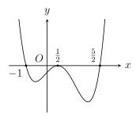
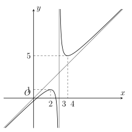
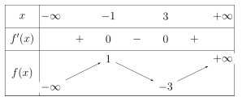
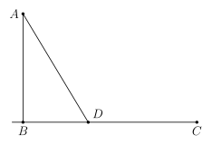

## Phần I. Thí sinh trả lời từ câu 1 đến câu 12, mỗi câu hỏi chọn một phương án.

### Câu 1

Cho hàm số $y = \frac{2x^3}{3} - 16x + 1$. Hàm số đã cho đồng biến trên khoảng nào dưới đây?

- **A.** $(3; +\infty)$.

- **B.** $(-\infty;\text{–}2)$.

- **C.** $(2; 4)$.

- **D.** $(\text{–}2; 2)$.

### Câu 2

Cho hàm số $y = \dfrac{x^2 - 4x + 5}{x - 2}$. Khẳng định nào sau đây là đúng?

- **A.** Điểm cực tiểu của hàm số là 2.

- **B.** Cực đại của hàm số bằng 1.

- **C.** Hàm số có hai điểm cực trị cùng dấu.

- **D.** Giá trị cực đại của hàm số lớn hơn giá trị cực tiểu của hàm số.

### Câu 3

Cho hàm số $y = \frac{x^3}{3} - \frac{x^2}{2} - 2x + 1$. Khẳng định nào sau đây là sai?

- **A.** Điểm cực đại của hàm số là $M\left(\text{–}1; \frac{13}{6}\right)$.

- **B.** Đồ thị hàm số có hai điểm cực trị nằm về hai phía của trục tung.

- **C.** Giá trị cực tiểu của hàm số bằng $-\frac{7}{3}$.

- **D.** Hàm số đạt cực tiểu tại $x = 2$.

### Câu 4

Cho hàm số $y=f(x)$ có đạo hàm liên tục trên $\mathbb{R}$. Hình vẽ bên là đồ thị đạo hàm của nó. Hàm số $y=f(x)$ nghịch biến trên khoảng nào dưới đây?

- **A.** $\left(\text{–}1;\frac{5}{2}\right)$.

- **B.** $\left(\frac{1}{2};+\infty\right)$.

- **C.** $\left(\frac{5}{2};+\infty\right)$.

- **D.** $(-\infty;\text{–}1)$.

### Câu 5

Cho hàm số $y = x^3 + 3x^2 - 3x + 2$. Phương trình đường thẳng đi qua hai điểm cực trị của đồ thị hàm số là:

- **A.** $y =\text{–}4x + 11$.

- **B.** $y = 4x + 11$.

- **C.** $y =\text{–}4x + 3$.

- **D.** $y =\text{–}4x + 1$.

### Câu 6

Một chất điểm chuyển động trên trục tọa độ có phương trình chuyển động là $s(t) = \frac{1}{3}t^3 - 5t^2 + 24t$ (trong đó $t$ tính bằng giây, $t \ge 0$ và $s$ tính bằng mét). Khi đó, $v(t) = s'(t)$ là vận tốc của chất điểm. Trong khoảng thời gian nào (đơn vị giây) tính từ lúc bắt đầu chuyển động, vận tốc của chất điểm giảm?

- **A.** $(0; 6)$.

- **B.** $(5; +\infty)$.

- **C.** $(0; 5)$.

- **D.** $(4; 6)$.

### Câu 7

Cho hàm số $y=f(x)$ xác định, liên tục trên $\mathbb{R} \setminus \{3\}$ và có đồ thị là đường cong trong hình vẽ bên. Hàm số đã cho đồng biến trên khoảng nào dưới đây?

- **A.** $(4; +\infty)$.

- **B.** $(-\infty; 3)$.

- **C.** $(3; 5)$.

- **D.** $(2; 3)$.

### Câu 8

Cho hàm số $y = f(x)$ có đạo hàm $f'(x) = (x^2 - 9)(x^2 - 4x + 3)(x + 1)^2$, $\forall x \in \mathbb{R}$. Điểm cực đại của hàm số đã cho là:

- **A.** $x =\text{–}1$.

- **B.** $x = 3$.

- **C.** $x = 1$.

- **D.** $x =\text{–}3$.

### Câu 9

Cho hàm số $y = \ln(x^3 - 6x^2 + 9x - 2)$. Điểm cực đại của hàm số đã cho là:

- **A.** $x = 3$.

- **B.** $x = 2$.

- **C.** $x = 1$.

- **D.** $y = \ln 2$.

### Câu 10

Cho hàm số $y = f(x)$ xác định, liên tục trên $\mathbb{R}$ và có bảng biến thiên như hình vẽ bên. Cực đại của hàm số đã cho bằng:

- **A.** –3.

- **B.** –1.

- **C.** 3.

- **D.** 1.

### Câu 11

Cho hàm số $y = 1 + \sqrt{4 - x^2}$. Hàm số đã cho đồng biến trên khoảng nào dưới đây?

- **A.** $(-\infty; 0)$.

- **B.** $(\text{–}2; 0)$.

- **C.** $(0; 2)$.

- **D.** $(\sqrt{2}; 2)$.

### Câu 12

Cho hàm số $y = x - 2\sin x$. Số điểm cực tiểu của hàm số trên khoảng $(0; 2\pi)$ là:

- **A.** 3.

- **B.** 0.

- **C.** 1.

- **D.** 2.

## Phần II. Thí sinh trả lời từ câu 1 đến câu 4, trong ý a), b), c), d) ở mỗi câu câu, thí sinh chọn ĐÚNG hoặc SAI.

### Câu 1

Cho hàm số $y = f(x)$ có đạo hàm $f'(x) = (2x^2 + x - 1)\mathrm{e}^x$ với mọi $x \in \mathbb{R}$. Gọi $(C)$ là đồ thị của hàm số $y = f(x)$.

- **A.** Hàm số $f(x)$ đạt cực tiểu tại điểm $x =\text{–}1$ và đạt cực đại tại điểm $x = \frac{1}{2}$.

- **B.** $f\left(\frac{1}{4}\right) < f\left(\frac{1}{5}\right) < f\left(\frac{1}{6}\right)$.

- **C.** Xét hàm số $g(x) = f'(x)$. Hàm số $g(x)$ đạt cực đại tại điểm $x = 0$.

- **D.** Không tồn tại tiếp tuyến nào của đồ thị $(C)$ có hệ số góc nhỏ hơn –1.

### Câu 2

Cho hàm số $y = -\frac{1}{3}x^3 + 2x^2 - 3x$ có đồ thị là $(C)$. Gọi $A$ và $B$ là hai điểm cực trị của đồ thị $(C)$.

- **A.** Đạo hàm của hàm số đã cho là $y' = -x^2 + 4x - 3$.

- **B.** Hàm số đã cho nghịch biến trên khoảng $(1; 3)$.

- **C.** Cho điểm $I(3;\text{–}2)$. Diện tích tam giác $IAB$ bằng 2.

- **D.** Gọi $d$ là đường thẳng đi qua hai điểm cực trị $A$ và $B$. Đường thẳng $d$ cắt trục hoành $Ox$ tại $M$ và cắt trục tung $Oy$ tại $N$ (với $O$ là gốc tọa độ). Bán kính đường tròn ngoại tiếp tam giác $OMN$ bằng $\frac{\sqrt{13}}{2}$.

### Câu 3

Cho hàm số $y=\dfrac{-3x^2-2x-2}{3x-1}$ có đồ thị là $(C)$.

- **A.** Đạo hàm của hàm số đã cho là $y'=\frac{-9x^2+6x+8}{(3x-1)^2}$.

- **B.** Hàm số đã cho đồng biến trên khoảng $\left(-\frac{2}{3}; \frac{4}{3}\right)$.

- **C.** Đường thẳng đi qua hai điểm cực trị của đồ thị $(C)$ vuông góc với đường thẳng $d_1 : x+2y-1=0$.

- **D.** Hai điểm cực trị của đồ thị $(C)$ đối xứng nhau qua đường thẳng $\Delta : x-2y-3=0$.

### Câu 4

Công ty A ký hợp đồng cung cấp một lô thiết bị cho đối tác B. Hai bên thỏa thuận giá như sau:

- Nếu số lượng thiết bị đặt hàng không vượt quá 40 chiếc, giá bán mỗi chiếc được cố định là 40 triệu đồng.

- Nếu số lượng đặt hàng lớn hơn 40 chiếc, thì kể từ chiếc thứ 41 trở đi, cứ mỗi một chiếc đặt thêm sẽ làm giảm giá bán mỗi chiếc của toàn bộ thiết bị đi 100 nghìn đồng.

Biết rằng bộ phận kế toán của công ty A ước tính chi phí sản xuất cho $x$ thiết bị được cho bởi hàm số $C(x) = \frac{1}{300}x^3 - 0{,}2x^2 + 20x$ (triệu đồng). Năng lực sản xuất tối đa của công ty A cho đơn hàng này giới hạn ở mức 90 thiết bị. Gọi $x$ (chiếc) là tổng số thiết bị đối tác B đặt hàng, biết rằng $x > 40$ và giả sử $x$ có thể nhận các giá trị thực liên tục để thuận tiện cho việc khảo sát.

- **A.** Mức giảm giá trên mỗi thiết bị khi đặt hàng $x$ (chiếc) với $x > 40$ là $100(x - 40)$ (triệu đồng).

- **B.** Hàm số biểu diễn lợi nhuận của công ty A là $L(x) = -\frac{1}{300}x^3 + 0{,}1x^2 + 24x$ (triệu đồng).

- **C.** Hàm số lợi nhuận $L(x)$ của công ty A đạt cực đại tại $x = 60$.

- **D.** Tại điểm cực đại của hàm số lợi nhuận, mức giá bán của mỗi thiết bị là 38 triệu đồng.

## Phần III. Thí sinh trả lời từ câu 1 đến câu 6 (không làm tròn các phép tính trung gian trong các câu từ 1 đến câu 6).

### Câu 1

Lợi nhuận tích lũy của một dự án khởi nghiệp sau $t$ tháng triển khai được ước tính bằng công thức

$$
P(t) = -\frac{t^4}{12} + 2t^3 + 10,
$$

 (đơn vị: triệu đồng), với thời gian $t \ge 0$. Nếu xem $P(t)$ là một hàm số thì đạo hàm $P'(t)$ biểu diễn tốc độ tăng trưởng lợi nhuận của dự án tại tháng thứ $t$. Biết khoảng thời gian dài nhất mà tốc độ tăng trưởng lợi nhuận của dự án liên tục tăng là khoảng $(m; n)$. Tính giá trị biểu thức $S = m + 2n$.

### Câu 2

Trong hội thao mùa hè, một học sinh trường THPT Nguyễn Trung Trực tham gia cuộc thi thể thao phối hợp (Chèo thuyền - Chạy bộ). Học sinh này đang ở trên thuyền Kayak tại vị trí $A$ trên mặt hồ, cách bờ hồ thẳng (tại điểm $B$) một khoảng 4 km. Đích đến là vị trí $C$ dọc theo bờ hồ, cách $B$ một khoảng 9 km.

Theo chiến thuật, học sinh sẽ chèo thuyền thẳng từ $A$ đến một điểm $D$ nằm giữa $B$ và $C$ trên bờ, sau đó lập tức lên bờ chạy bộ từ $D$ đến đích $C$. Biết vận tốc chèo thuyền của học sinh là 6 km/h và vận tốc chạy bộ trên bờ là 10 km/h.

Gọi $x$ (km) là khoảng cách từ $B$ đến điểm cập bến $D$ (với $0 < x < 15$) và $t(x)$ là hàm số biểu diễn tổng thời gian hoàn thành chặng đua. Hỏi hàm số $t(x)$ đạt cực tiểu tại điểm $x$ bằng bao nhiêu?

### Câu 3

Để chuẩn bị cho lễ hội Trung thu, các bạn học sinh lớp 12 trường THPT Nguyễn Trung Trực thiết kế những chiếc lồng đèn có dạng khối lăng trụ lục giác đều.

Các bạn dự định sử dụng một tấm bìa hình chữ nhật, có chu vi bằng 72 cm, chiều dài chiều rộng có thể thay đổi miễn là chu vi bằng 72 cm. Tiếp đó chia tấm bìa thành 6 phần bằng nhau rồi gấp lại để làm mặt xung quanh của chiếc lồng đèn (như hình vẽ minh họa). Phần hai mặt đáy của lồng đèn được dán bằng giấy kiếng trong suốt. Giả sử phần hao hụt do các mép gấp, dán là không đáng kể.

Gọi $x$ (cm) là độ dài cạnh đáy của chiếc lồng đèn (với $0 < x < 6$) và $V(x)$ là hàm số biểu diễn thể tích không gian bên trong chiếc lồng đèn. Hỏi giá trị cực đại của hàm số $V(x)$ bằng bao nhiêu $ \mathrm{cm^3} $? (làm tròn kết quả đến hàng đơn vị).
