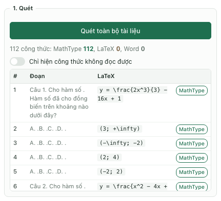
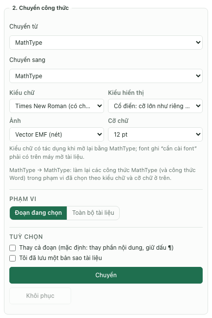
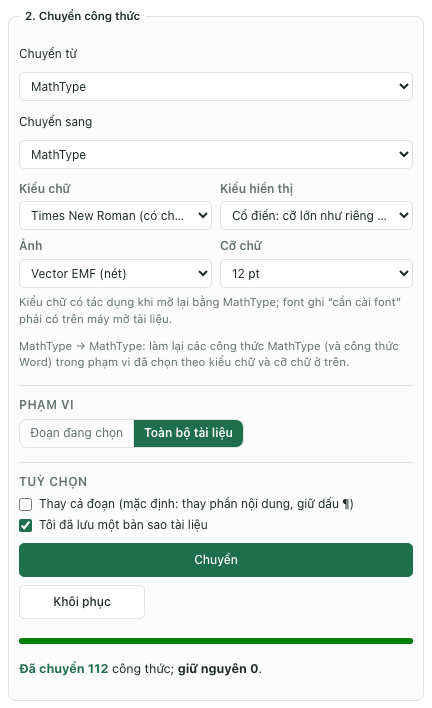
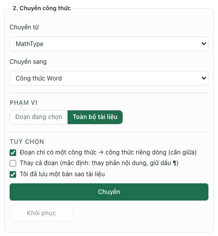
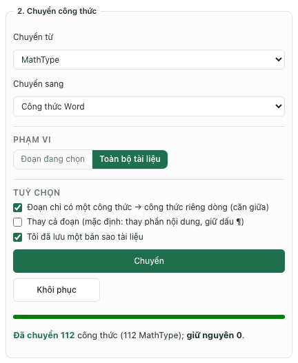
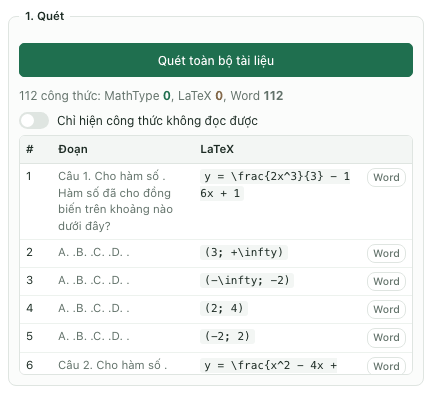
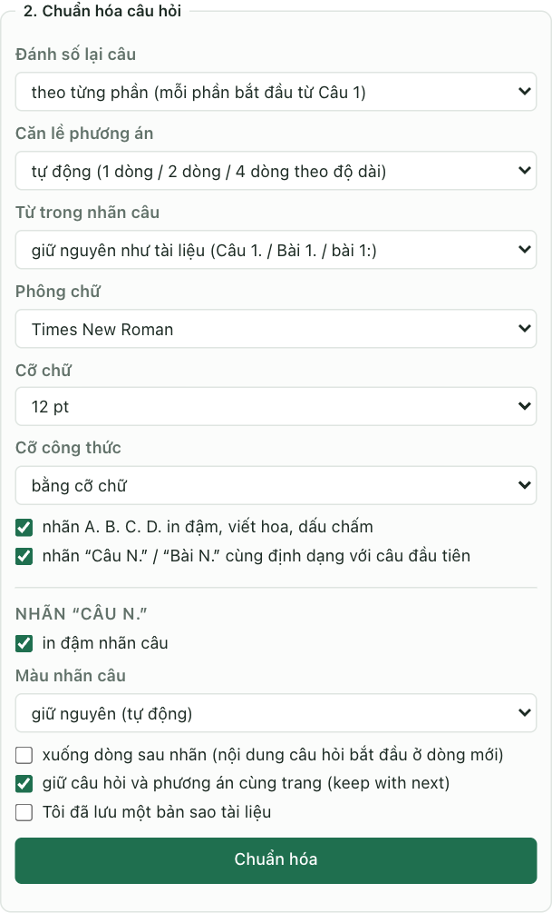

Tài liệu ghép từ nhiều nguồn thường có công thức MathType khác cỡ chữ, khác font hoặc nằm xen với công thức Word. Để chuẩn hóa trên MacBook bằng TexCraft, cần chọn một trong hai hướng: làm lại các đối tượng theo thiết lập MathType thống nhất, hoặc chuyển sang công thức Word để tiếp tục biên tập.

Chuẩn hóa hình thức không tự kiểm tra tính đúng sai của biểu thức toán. Sau mỗi lượt chuyển, vẫn phải đối chiếu dấu, chỉ số, phân số và các cấu trúc đặc biệt.

## Chọn đúng thao tác

| Mục tiêu | Thiết lập trong tab Công thức |
| --- | --- |
| Làm lại MathType theo font/cỡ chữ thống nhất | MathType → MathType |
| Đưa công thức cũ sang dạng sửa được bằng Equation của Word | MathType → Công thức Word |
| Đưa công thức Word sang quy trình MathType | Công thức Word → MathType |
| Lấy mã công thức để biên tập lại | MathType hoặc Công thức Word → LaTeX |

MathType → MathType trong TexCraft là quá trình đọc và tạo lại công thức theo tùy chọn mới. Những công thức mà tiện ích chưa đọc được có thể được giữ lại. Đặc biệt, công thức Word trong cùng phạm vi cũng được đưa sang MathType khi chọn hướng này; cần khoanh đúng phạm vi trước khi chạy.

## Bước 1. Lưu bản sao và chọn mẫu thử

1. Lưu một bản sao `.docx`, chẳng hạn `de-toan-ban-chuan-hoa.docx`.
2. Chọn một đoạn có công thức đơn giản và một đoạn có công thức phức tạp để thử trước.
3. Ghi nhận các cấu trúc cần đối chiếu: chỉ số trên/dưới, ma trận, dấu ngoặc nhiều tầng, tích phân có cận, ký hiệu hình học.
4. Mở TexCraft. Nếu chưa cài, xem [hướng dẫn cài đặt](../word-addin/huong-dan.html).

Không dựa hoàn toàn vào một lần `Cmd + Z` để quay lại cả lượt chuyển đổi. Tiện ích có thể thực hiện nhiều thay đổi riêng trong Word; bản sao là cách giữ nguyên tài liệu gốc rõ ràng nhất.

## Bước 2. Quét tài liệu và tìm công thức lỗi

Trong tab Công thức, bấm Quét toàn bộ tài liệu. Kiểm tra thông báo và danh sách công thức, sau đó bật Chỉ hiện công thức không đọc được để xem các đối tượng cần xử lý riêng.

Hình 1. Sau khi quét, dòng tổng hợp cho biết số công thức theo loại (ở tài liệu mẫu: 112 MathType, 0 LaTeX, 0 Word). Mỗi dòng bên dưới ghi đoạn chứa công thức, mã LaTeX đọc được và nhãn loại; nhãn đỏ “không đọc được” báo đối tượng cần xử lý riêng.

Nếu tài liệu có ảnh công thức, đừng chờ thao tác này biến ảnh thành công thức sửa được. Có thể nhập lại các công thức ít gặp bằng [tab Soạn thảo](./go-mathtype-tren-macbook.html), sau đó tiếp tục chuẩn hóa phần còn lại.

## Bước 3. Đồng nhất MathType theo font và cỡ chữ

1. Chọn Chuyển từ MathType và Chuyển sang MathType.
2. Đặt Kiểu chữ, chẳng hạn Times New Roman nếu đó là font đang dùng cho đề.
3. Chọn Cỡ chữ cụ thể, ví dụ 12 pt. Nếu muốn theo đoạn văn xung quanh, chọn Theo văn bản và kiểm tra tài liệu sau khi chuyển.
4. Chọn Kiểu hiển thị Cổ điển hoặc Gọn theo bố cục mong muốn.
5. Chọn ảnh hiển thị Vector EMF hoặc PNG, thử trên bản Word đang sử dụng.
6. Chọn Đoạn đang chọn, tích Tôi đã lưu một bản sao tài liệu rồi bấm Chuyển.

Hình 2. Thiết lập MathType → MathType: Times New Roman, kiểu Cổ điển, Vector EMF, cỡ chữ 12 pt, phạm vi Đoạn đang chọn. Dòng giải thích bên dưới nhắc rằng thao tác làm lại cả công thức Word trong phạm vi.

Sau khi chọn Toàn bộ tài liệu (hoặc đoạn đã thử), tích Tôi đã lưu một bản sao tài liệu rồi bấm Chuyển. Báo cáo hiện ngay dưới bảng:

Hình 3. Báo cáo “Đã chuyển 112 công thức; giữ nguyên 0”. Nếu số giữ nguyên lớn hơn 0, quay lại danh sách quét để xem công thức nào chưa xử lý.

Muốn nhập cỡ lẻ, chọn Số khác… rồi nhập như `11.5`. Nếu mục tiêu là đồng nhất tất cả công thức thành một cỡ, dùng giá trị cụ thể thay vì phụ thuộc cỡ chữ của từng đoạn.

Kiểu Cổ điển cho phân số và toán tử lớn dáng đầy đủ; kiểu Gọn tiết chế chiều cao khi đặt trong dòng chữ. Không nên chữa mọi vấn đề giãn dòng bằng cách thu nhỏ toàn bộ công thức: hãy xem lại kiểu hiển thị và cách đặt riêng dòng trước.

## Bước 4. Chuyển MathType sang công thức Word khi cần

Nếu ưu tiên chỉnh sửa bằng công cụ Equation của Word, chọn MathType → Công thức Word. Bắt đầu ở Đoạn đang chọn, thử chuyển và kiểm tra kết quả trước khi mở rộng phạm vi.

Tùy chọn Đoạn chỉ có một công thức → công thức riêng dòng phù hợp với đoạn chỉ chứa công thức. Nếu công thức phải nằm trong một câu văn, kiểm tra lại vị trí và dấu câu sau khi chuyển.

Hình 4. Thiết lập MathType → Công thức Word cho toàn bộ tài liệu mẫu (sau khi đã thử một đoạn).

Hình 5. Báo cáo sau khi chuyển 112 công thức, giữ nguyên 0.

Không thể vừa chuyển một đối tượng thành công thức Word vừa giữ nó là đối tượng MathType tại cùng vị trí. Hãy giữ bản gốc nếu cần đối chiếu hoặc trao đổi lại theo quy trình cũ.

## Bước 5. Chuẩn hóa toàn bộ khi mẫu thử đạt yêu cầu

Sau khi đã kiểm tra mẫu thử, chọn Toàn bộ tài liệu và thực hiện cùng thiết lập. Đọc báo cáo số công thức đã chuyển và số giữ nguyên, không chỉ dựa vào việc thanh tiến độ đã chạy hết.

Đối chiếu những điểm sau trên bản kết quả:

- Tử số, mẫu số và các chỉ số không bị mất.
- Dấu ngoặc, dấu căn, ký hiệu góc, vectơ và cận tích phân đúng với bản gốc.
- Công thức trong dòng không đẩy giãn đoạn quá mức.
- Công thức riêng dòng không làm mất dấu câu hoặc vị trí ngắt trang.
- Những công thức được báo giữ nguyên đã có phương án xử lý riêng.

Nếu đã chuyển toàn bộ MathType sang Công thức Word ở bước 4, bấm Quét toàn bộ tài liệu lần nữa: khi không có công thức bị giữ nguyên, số MathType phải về 0 và số Word tăng tương ứng. Nếu chọn MathType → MathType, kết quả vẫn mang loại MathType; kiểm tra lại hình thức và cỡ chữ trong Word.

Hình 6. Quét lại xác nhận 112 công thức đã thành loại Word.

Nút Khôi phục hỗ trợ quay lại thay đổi chuyển đổi đã được lưu trong phiên làm việc. Vẫn cần giữ bản sao `.docx`; không xem nút này như bản sao lưu lâu dài qua mọi lần đóng mở Word.

## Bước 6. Đồng bộ cỡ chữ của đề kiểm tra

Nếu tài liệu là đề có nhãn Câu và phương án A–D, mở tab Đề thi, bấm Phân tích tài liệu rồi dùng Chuẩn hóa câu hỏi để đặt phông chữ, cỡ chữ và bố cục phương án.

Hình 7. Chuẩn hóa câu hỏi là bước bố cục đề, khác với làm lại đối tượng MathType.

Cỡ công thức ở tab Đề thi không thay đổi trực tiếp nội dung bên trong đối tượng MathType cũ. Với trường hợp đó, dùng bước MathType → MathType, hoặc chuyển sang công thức Word rồi chuẩn hóa tiếp.

## Xử lý các tình huống thường gặp

| Tình huống | Hướng xử lý |
| --- | --- |
| Đổi cỡ chữ toàn văn bản nhưng MathType không đổi | Dùng MathType → MathType với cỡ cụ thể |
| Muốn giữ công thức Word đang có | Chọn riêng vùng chứa MathType cần xử lý; đích MathType có thể chuyển cả công thức Word trong phạm vi |
| Chuyển được đa số nhưng còn vài công thức | Xem báo cáo giữ nguyên, lọc đối tượng chưa đọc được và sửa riêng |
| Công thức mới bị khác ký hiệu | Khôi phục hoặc mở bản sao gốc, kiểm tra cấu trúc đó trước khi chuyển lại |
| Đối tượng bấm đúp không mở trên Mac | Dùng Lấy từ Word trong TexCraft nếu đọc được, hoặc chuyển sang công thức Word |

## Câu hỏi thường gặp

### Chuẩn hóa MathType có phải chỉ đổi font ảnh không?

TexCraft đọc và tạo lại đối tượng theo thiết lập, không chỉ phóng to hoặc thu nhỏ hình bên ngoài. Do đó có thể đồng bộ cỡ công thức nhưng cũng cần đối chiếu độ trung thực của biểu thức.

### Có bảo đảm chuyển được mọi tệp MathType không?

Không. Kết quả phụ thuộc loại đối tượng và cấu trúc công thức. Báo cáo công thức giữ nguyên và việc kiểm tra mẫu thử là những bước cần thiết trong quy trình.

### Chuẩn hóa xong có thể trộn đề ngay không?

Nên kiểm tra lại số câu và đáp án trước. Xem [trộn đề trên MacBook](./tron-de-tren-macbook.html) để phân tích, chuẩn hóa phương án và xuất đáp án theo từng mã đề.

Nguồn đối chiếu: giao diện và luồng chuyển đổi trong TexCraft; [hướng dẫn sử dụng](../word-addin/su-dung.html). Cập nhật ngày 22/10/2026. Hình 1–6 là ảnh chụp giao diện TexCraft chạy ở chế độ thử trong trình duyệt (không có Word) với tài liệu mẫu 112 công thức; trong Word cho Mac, bảng có cùng nội dung nhưng khung ngoài là của Word. Hình 7 lấy từ hướng dẫn TexCraft hiện có.
