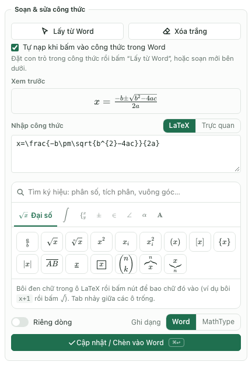
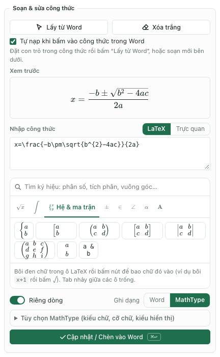
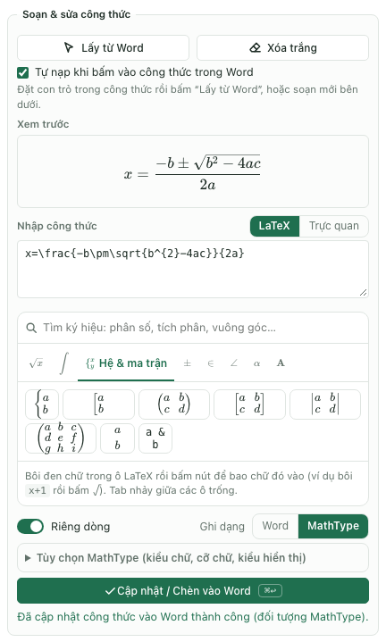

Muốn gõ MathType trên MacBook, trước hết cần phân biệt phần mềm MathType của Wiris với định dạng công thức MathType nhúng trong tài liệu Word. TexCraft là tiện ích độc lập của giasu.ai.vn, giúp soạn công thức và ghi ra dạng Word hoặc MathType. Bài này hướng dẫn cách dùng TexCraft, không phải hướng dẫn cài MathType của Wiris.

Theo [tài liệu cài đặt MathType 7 của Wiris](https://docs.wiris.com/en_US/mathtype-7/installing-mathtype-7-for-windows-and-mac), bản MathType 7 cho Mac có giới hạn tương thích hệ điều hành; không nên lấy hướng dẫn cài bản desktop cũ áp dụng cho mọi MacBook hiện nay. Nếu muốn dùng sản phẩm chính hãng của Wiris, hãy kiểm tra [MathType cho Office](https://msaddin.wiris.net/) và điều kiện giấy phép của sản phẩm đó.

## Chọn dạng công thức trước khi soạn

| Nhu cầu | Dạng nên cân nhắc |
| --- | --- |
| Soạn tài liệu mới, muốn sửa bằng công cụ công thức có sẵn của Word | Công thức Word |
| Gửi tài liệu cho đồng nghiệp đang sử dụng quy trình MathType | MathType |
| Lưu mã để tái sử dụng, trao đổi với công cụ soạn thảo khác | LaTeX |

Một đối tượng MathType có thể hiển thị trong Word nhờ hình xem trước, nhưng điều đó không đồng nghĩa MacBook đã có ứng dụng để mở nó bằng cách bấm đúp. Với TexCraft, có thể chọn công thức rồi dùng chức năng Lấy từ Word để sửa những công thức mà tiện ích đọc được.

## Bước 1. Cài TexCraft vào Word trên Mac

Chuẩn bị Microsoft Word trên Mac có hỗ trợ Office Add-ins và kết nối mạng để tải tiện ích lần đầu. Nếu tài khoản trường học chặn tiện ích bổ sung, cần làm việc với quản trị viên của trường.

1. Mở [trang cài đặt TexCraft](../word-addin/huong-dan.html) và tải `manifest.xml` từ trang này.
2. Mở Finder, nhấn `Cmd + Shift + G`, nhập đường dẫn bên dưới rồi nhấn Enter.
3. Nếu chưa có thư mục `wef`, mở thư mục `Documents` ở đường dẫn cha và tạo thư mục `wef`.
4. Chép `manifest.xml` vào `wef`. Lưu tài liệu đang mở, thoát hẳn Word bằng `Cmd + Q` rồi mở lại.
5. Tìm TexCraft trên Ribbon hoặc trong Add-ins / My Add-ins / Developer Add-ins. Tên và vị trí menu có thể khác giữa các bản Word.

```text
~/Library/Containers/com.microsoft.Word/Data/Documents/wef
```

Manifest dùng cho website chính thức là `manifest.xml`; không chọn `manifest.dev.xml`, vì đó là cấu hình phát triển cần máy chủ cục bộ. Có thể đọc thêm [hướng dẫn sử dụng tổng quát](../word-addin/su-dung.html).

## Bước 2. Gõ công thức đầu tiên

Trong bảng TexCraft, mở tab Soạn thảo. Đặt con trỏ tại nơi muốn chèn trong tài liệu Word, rồi nhập mã vào ô LaTeX. Ô soạn thảo nhận phần công thức, không cần bọc thêm dấu đô la như khi gõ LaTeX trong văn bản thường.

Thử công thức nghiệm phương trình bậc hai:

```latex
x=\frac{-b\pm\sqrt{b^2-4ac}}{2a}
```



Hình 1. Tab Soạn thảo: mã LaTeX ở ô Nhập công thức, kết quả dựng ở khung Xem trước phía trên.

Khung Xem trước phải hiện phân số, dấu căn và dấu cộng trừ đúng cấu trúc. Nếu chưa quen LaTeX, chuyển chế độ Nhập công thức sang Trực quan hoặc dùng bảng ký hiệu phía dưới. Có thể bắt đầu bằng phân số đơn giản rồi thêm cấu trúc phức tạp dần.

Chọn Ghi dạng Word hoặc MathType. Bật Riêng dòng nếu muốn công thức đứng thành một dòng riêng. Khi chọn MathType, mục Tùy chọn MathType xuất hiện ngay bên dưới.



Hình 2. Chọn Ghi dạng MathType, bật Riêng dòng, rồi bấm Cập nhật / Chèn vào Word.

Cuối cùng, bấm Cập nhật / Chèn vào Word, rồi kiểm tra kết quả trên trang tài liệu. Thông báo thành công xuất hiện dưới nút; hãy nhìn lại công thức trong Word để chắc chắn vị trí chèn đúng.



Hình 3. Thông báo sau khi chèn công thức dạng MathType.

## Bước 3. Đặt kiểu và cỡ chữ MathType

Khi chọn Ghi dạng MathType trong tab Soạn thảo, mở Tùy chọn MathType để đặt kiểu chữ, cỡ chữ và kiểu hiển thị. Những lựa chọn tương tự cũng có trong tab Công thức khi đích chuyển đổi là MathType.


Hình 4. Tùy chọn MathType với Times New Roman, cỡ chữ 12 pt. Đây là bảng chuyển đổi trong tab Công thức, không phải ô Soạn thảo.

Chọn Theo văn bản nếu muốn lấy cỡ chữ xung quanh, hoặc chọn một cỡ cụ thể để đồng nhất tài liệu. Mục Số khác… cho phép nhập cỡ lẻ, chẳng hạn `11.5`.

Kiểu Cổ điển làm phân số và các toán tử lớn có dáng như công thức riêng dòng. Kiểu Gọn phù hợp khi cần công thức nằm cùng dòng văn bản. Hãy xem lại độ cao dòng sau khi chèn, nhất là đoạn có nhiều phân số.

Lựa chọn Vector EMF hoặc Ảnh PNG liên quan đến phần hiển thị của đối tượng MathType. Nó không biến đối tượng đó thành công thức Word. Kiểu chữ được lưu trong đối tượng còn phụ thuộc font có trên máy khi mở lại bằng MathType.

## Bước 4. Sửa công thức từ tài liệu cũ

1. Mở một bản sao tài liệu `.docx` có công thức cần sửa.
2. Chọn công thức trong Word, mở tab Soạn thảo và bấm Lấy từ Word. Nếu đã bật tự nạp, tiện ích có thể nạp công thức khi vùng chọn thay đổi.
3. So sánh phần Xem trước với công thức gốc, đặc biệt các chỉ số, dấu căn và cận tích phân.
4. Sửa nội dung trong ô LaTeX hoặc ô Trực quan.
5. Chọn định dạng đầu ra, bấm Cập nhật / Chèn vào Word rồi kiểm tra vị trí vừa thay.

Không phải mọi công thức nhìn giống MathType đều là đối tượng MathType có thể giải mã. Công thức dán từ ảnh, ảnh chụp màn hình hoặc đối tượng lỗi có thể cần nhập lại. Không dùng chức năng chuyển đổi này như công cụ nhận dạng chữ từ ảnh.

## Bước 5. Kiểm tra nhiều công thức trước khi chuyển hàng loạt

Mở tab Công thức, bấm Quét toàn bộ tài liệu. Danh sách giúp kiểm tra công thức nào được đọc và công thức nào cần xử lý riêng.


Hình 5. Bảng quét công thức: dòng tổng hợp cho biết số công thức từng loại; cột LaTeX là mã TexCraft đọc được. Bật bộ lọc để chỉ xem công thức chưa đọc được.

Nếu muốn chuyển đồng loạt MathType sang công thức Word để tiếp tục biên tập trên Mac, xem [hướng dẫn chuẩn hóa công thức MathType trên MacBook](./chuan-hoa-cong-thuc-mathtype-macbook.html). Luôn thử một đoạn ngắn trước khi chọn toàn bộ tài liệu.

## Các lỗi thường gặp

| Hiện tượng | Cách kiểm tra |
| --- | --- |
| Không thấy TexCraft | Kiểm tra tên và vị trí manifest, thoát hẳn Word rồi mở lại; xem chính sách Add-ins của tài khoản |
| Bấm đúp MathType nhưng không sửa được | Chọn đối tượng, dùng Lấy từ Word; khả năng bấm đúp phụ thuộc ứng dụng MathType được cài trên máy |
| Công thức hiện mã thay vì hình toán | Kiểm tra ô Xem trước và cú pháp, không dán mã vào đoạn văn rồi coi đó là công thức đã chuyển |
| Công thức quá lớn so với dòng | Kiểm tra cỡ chữ và kiểu Cổ điển/Gọn, thử lại một công thức |
| Một số công thức không đọc được | Quét và lọc công thức lỗi; nhập lại riêng nếu đối tượng không được hỗ trợ |

## Câu hỏi thường gặp

### Có cần cài MathType của Wiris để dùng TexCraft không?

TexCraft có thể tạo đối tượng MathType và hình xem trước mà không cần cài ứng dụng MathType trên máy. Việc sửa đối tượng bằng ứng dụng MathType chính hãng là một quy trình riêng, phụ thuộc tương thích và giấy phép của Wiris.

### Nên dùng MathType hay công thức Word trên MacBook?

Nếu chỉ làm tài liệu mới trong Word, công thức Word thường thuận tiện cho việc sửa bằng Word. Nếu cần trao đổi theo quy trình MathType, chọn đầu ra MathType và kiểm tra thử trên máy của người nhận.

### Có thể dùng cách này để soạn cả đề kiểm tra không?

Có thể kết hợp soạn công thức với [soạn tài liệu toán trên MacBook](./soan-cong-thuc-toan-macbook.html), sau đó [chuẩn hóa và trộn đề](./tron-de-tren-macbook.html). Chuyển công thức và trộn câu hỏi là hai thao tác khác nhau, cần kiểm tra kết quả từng bước.

Nguồn đối chiếu: tài liệu Wiris liên kết ở đầu bài và giao diện TexCraft trong dự án. Nội dung cập nhật ngày 22/10/2026. Các Hình 1–5 là ảnh chụp giao diện TexCraft chạy ở chế độ thử trong trình duyệt (không có Word) với tài liệu mẫu; trong Word cho Mac, bảng có cùng nội dung nhưng khung ngoài là của Word. Một số vị trí điều khiển có thể thay đổi theo phiên bản.
