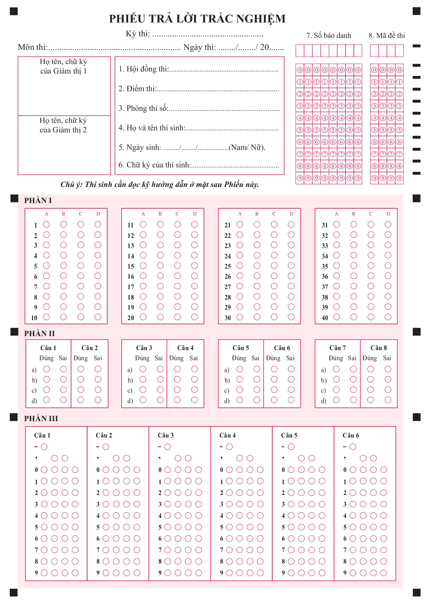
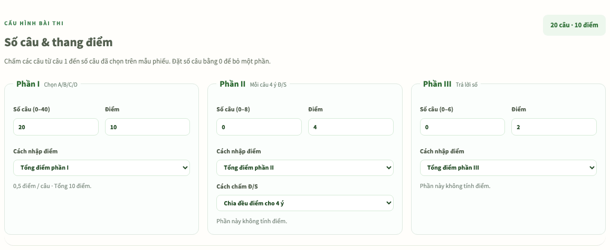
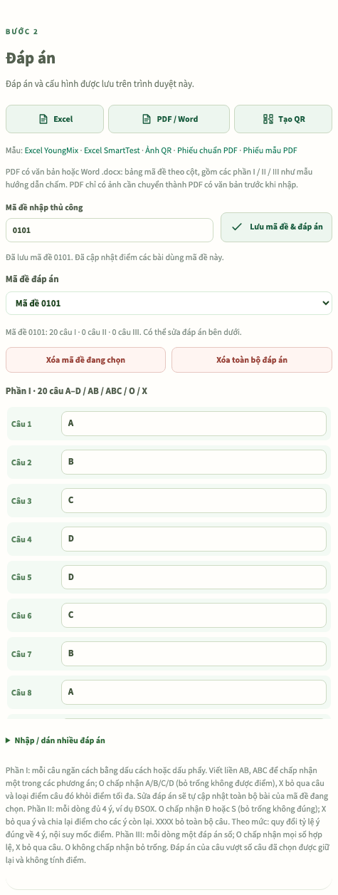
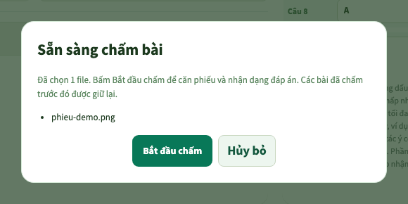
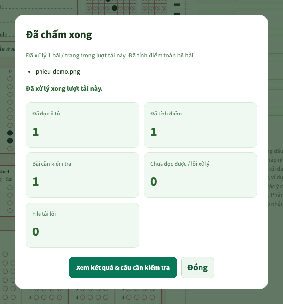
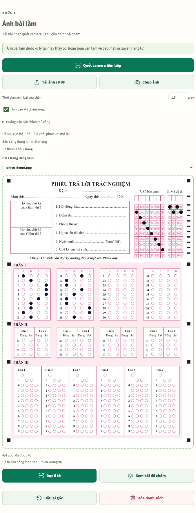
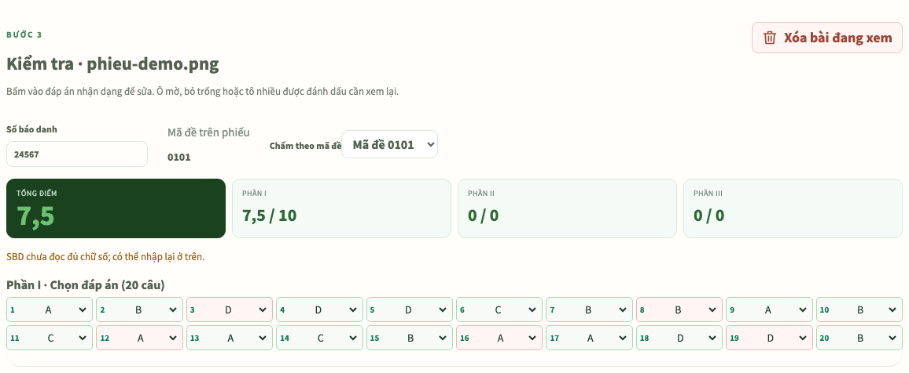
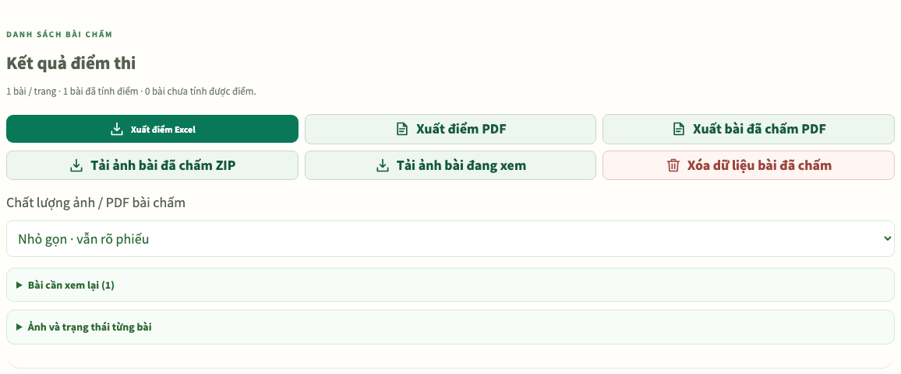

Nếu cần phần mềm chấm trắc nghiệm miễn phí để chấm bài kiểm tra trên giấy, thầy cô có thể mở [Chấm thi trắc nghiệm của giasu.ai.vn](../cham-thi/) bằng trình duyệt trên MacBook, máy tính Windows hoặc điện thoại. Công cụ đọc ô tô từ ảnh, PDF hoặc camera, tính điểm theo đáp án và cho xuất kết quả Excel/PDF.

Quy trình gồm chuẩn bị phiếu đúng mẫu, cấu hình số câu và điểm, nhập đáp án từng mã đề, tải bài rồi kiểm tra kết quả nhận dạng. Công cụ không tự hiểu mọi mẫu phiếu và không tự suy ra đáp án đúng từ nội dung đề.

Ảnh/PDF bài làm được xử lý trên thiết bị. Dữ liệu không tự đồng bộ sang máy khác; nên xuất kết quả ngay sau mỗi lượt. Hướng dẫn trên ứng dụng khuyến nghị chấm khoảng 100 bài mỗi lượt, phù hợp một môn với khoảng 1–2 lớp, vì xuất ảnh/PDF có thể tốn nhiều bộ nhớ.

## Bước 1. Tải phiếu trước khi tổ chức kiểm tra

Mở trang chấm bài và tải [phiếu mẫu PDF](../cham-thi/template/Phieu_TLTN-GIASU.pdf) hoặc [phiếu chuẩn PDF](../cham-thi/template/PHIEU%20TLTN%20CHUAN.pdf). In thử một tờ, giữ đủ mốc định vị và kiểm tra bản in rõ nét trước khi in cả lớp.



Hình 1. Mẫu phiếu có sẵn của ứng dụng, không phải ảnh bài làm học sinh hoặc ảnh màn hình chấm bài.

Mẫu phiếu và cấu hình giao diện hỗ trợ tối đa 40 câu A–D, 8 câu đúng/sai và 6 câu trả lời số. Nếu đề ít câu hơn, chỉ chấm đến số câu đã đặt trong từng phần. Không dùng một phiếu khác bố cục rồi chờ phần mềm tự nhận biết vị trí các ô.

Cho học sinh ghi và tô đúng số báo danh, mã đề, tô rõ ô chọn và tẩy sạch khi đổi đáp án. Các cột số trên phiếu phải tương ứng với mã đề đã nhập vào phần mềm.

## Thực hành với một phiếu demo trước

Có thể [tải ảnh phiếu demo](../word-addin/guide/cham-phieu-demo.png) để thử quy trình dưới đây trước khi chấm bài thật. Đây là phiếu tạo để minh họa, không chứa bài làm của học sinh. Đặt phần I là 20 câu, tổng 10 điểm; phần II và III bằng 0. Lưu mã đề `0101`, giữ nguyên số 0 đầu, rồi dán bộ đáp án sau vào phần I:

```text
A B C D D C B A A B C B A C B D A D A B
```

Phiếu demo có 15/20 câu đúng với bộ đáp án này, tương ứng 7,5 điểm. Các câu sai là 3, 8, 12, 16 và 19. Vùng số báo danh được tô nhiều ô để minh họa cảnh báo: cần kiểm tra thông tin, kể cả khi đã tính được điểm. Không dùng phiếu hoặc bộ đáp án demo cho bài kiểm tra thật.

## Bước 2. Đặt số câu và thang điểm

Trong Số câu & thang điểm, cấu hình riêng từng phần. Đặt số câu bằng `0` để không chấm phần đó.

Ví dụ một bài kiểm tra chỉ có 20 câu A–D, tổng điểm 10:

| Thiết lập | Giá trị |
| --- | --- |
| Số câu phần I | 20 |
| Cách nhập điểm phần I | Tổng điểm phần I |
| Điểm phần I | 10 |
| Số câu phần II | 0 |
| Số câu phần III | 0 |



Hình 2. Chọn Tổng điểm phần I và nhập 10; dòng tổng hợp xác nhận “20 câu · 10 điểm”. Hai phần còn lại không tính điểm vì số câu bằng 0.

Mỗi câu phần I khi đó được 0,5 điểm. Nếu chọn Điểm mỗi câu thì phải nhập `0.5`, không nhập `10`, vì hai chế độ có ý nghĩa khác nhau. Kiểm tra tổng điểm hiển thị trên trang trước khi nạp bài.

Với câu đúng/sai, chọn một trong ba cách chấm: chia đều điểm cho bốn ý, đúng đủ bốn ý mới có điểm, hoặc theo mức 1–4 ý đúng. Khi chọn theo mức, kiểm tra tỷ lệ điểm cho từng mức và điểm tối đa mỗi câu. Không mặc nhiên coi thiết lập mặc định là thang điểm của đề mình đang dùng.

## Bước 3. Nhập đáp án và lưu theo mã đề

Với ít câu, nhập mã ở Mã đề nhập thủ công, chọn đáp án ở các hàng tương ứng rồi bấm Lưu mã đề & đáp án. Có thể mở Nhập / dán nhiều đáp án để dán nhanh.

Nếu đang thử phiếu demo, giữ cấu hình 20/0/0 và bộ đáp án ở trên. Bảng sau là ví dụ riêng cho một đề khác có bốn câu phần I, hai câu phần II và hai câu phần III; chỉ đổi số câu nếu thực hành với đề đó:

| Phần | Nội dung dán | Cách hiểu |
| --- | --- | --- |
| I | `A B C D` | Bốn câu theo thứ tự |
| II | `ĐSĐS` ở dòng 1, `SSĐĐ` ở dòng 2 | Mỗi dòng đủ bốn ý của một câu |
| III | `12` ở dòng 1, `-1,5` ở dòng 2 | Mỗi dòng một đáp án số |

Lưu lần lượt các mã đề và dùng bộ chọn Mã đề đáp án để kiểm tra lại. Đáp án phần III là số; không nhập biểu thức như `1/2` thay cho số thập phân nếu phiếu yêu cầu tô giá trị số.



Hình 3. Mã đề demo 0101 có 20 câu phần I; tám đáp án đầu là A, B, C, D, D, C, B, A. Mở Nhập / dán nhiều đáp án để dán đủ 20 câu, rồi lưu mã đề.

Với nhiều mã đề, dùng Nhập Excel. Tải mẫu Excel YoungMix hoặc SmartTest ngay trong mục Đáp án để xem cấu trúc; không đổi tùy ý vị trí hàng/cột rồi cho rằng vẫn nhập được.

Nếu đã [trộn đề bằng TexCraft](./tron-de-tren-macbook.html), xuất bảng đáp án của đúng bộ mã đề vừa tạo để nhập vào công cụ chấm. Không lấy bảng của một lần trộn khác dù các mã đề giống nhau.

Mục Nhập PDF / Word nhận bảng đáp án dạng văn bản theo cấu trúc được hỗ trợ. PDF chỉ chứa ảnh cần được chuyển thành văn bản và đối chiếu trước; nút này không có nghĩa công cụ sẽ đọc mọi bản scan đáp án.

## Bước 4. Chuyển đáp án sang điện thoại bằng QR

Trên máy tính, có thể dùng Tạo ảnh QR trong ứng dụng chấm bài hoặc Tạo mã QR đáp án trong TexCraft. Trên giao diện điện thoại của trang chấm bài, mở Nhập ảnh QR rồi chọn ảnh hoặc quét bằng camera.


Hình 4. QR mẫu đi kèm ứng dụng. Khi chấm thật, cần dùng QR chứa đáp án của bộ đề đang sử dụng.

Nếu bộ đáp án lớn được chia thành nhiều QR, nhập lần lượt cho đủ. Sau khi nhập, kiểm tra danh sách mã đề, số câu và vài đáp án; QR không thay thế bước đối chiếu.

## Bước 5. Chấm từ ảnh hoặc PDF

1. Bấm Chọn ảnh / PDF hoặc Tải ảnh / PDF, chọn một hoặc nhiều tệp.
2. Trong hộp Sẵn sàng chấm bài, kiểm tra danh sách đã chọn rồi bấm Bắt đầu chấm.
3. Đợi xử lý; theo dõi các cảnh báo và số bài đã nhận.
4. Chọn từng bài trong Bài / trang đang xem để kiểm tra mã đề, số báo danh và ảnh phiếu.
5. Nếu ứng dụng không căn đúng, thực hiện căn góc thủ công và đọc lại ô tô.



Hình 5. Kiểm tra tên và số tệp trước khi bấm Bắt đầu chấm. Với PDF, một tệp có thể chứa nhiều trang.



Hình 6. Phiếu demo đã tính được điểm nhưng vẫn nằm trong nhóm Bài cần kiểm tra. Bấm Xem kết quả & câu cần kiểm tra để xử lý cảnh báo.

Ảnh cần có cả tờ phiếu, các mốc rõ, không bị cắt góc, nhòe hoặc lóa. Với PDF nhiều trang, mỗi trang phải chứa phiếu rõ và đúng bố cục. Nên thử vài bài trước khi đưa cả tập vào.

Khi căn góc thủ công, chọn lần lượt trên trái → trên phải → dưới phải → dưới trái rồi bấm Đọc ô tô. Nếu chọn sai, dùng Đặt lại góc; đừng cố sửa đáp án để bù cho một ảnh đang căn lệch.

## Bước 6. Chấm bằng camera điện thoại

Mở địa chỉ HTTPS của trang, cho phép dùng camera khi trình duyệt hỏi và chọn Quét camera liên tiếp. Đặt phiếu phẳng, đủ sáng, giữ cả tờ cùng các mốc trong khung và chờ ứng dụng nhận ổn định.



Hình 7. Các cách đưa phiếu vào ứng dụng và ảnh phiếu sau khi căn mốc. Đây là ảnh giao diện đã nạp demo, chưa minh họa camera đang quét trực tiếp.

Sau khi chấm một bài, xem phản hồi trước khi thay phiếu mới. Có thể điều chỉnh Thời gian xem bài vừa chấm và Âm báo khi chấm xong trên giao diện. Nếu camera trực tiếp không mở, dùng Chụp ảnh hoặc tải ảnh chụp sẵn.

Không cần kết nối camera của điện thoại với MacBook để thực hiện quy trình này: có thể chấm ngay trên điện thoại rồi xuất tệp kết quả. Dữ liệu phiên trên điện thoại không tự xuất hiện trong trình duyệt của MacBook.

## Bước 7. Đọc cảnh báo và kiểm tra nhận dạng

Xem mã đề trên phiếu có khớp bộ đáp án không. Với bài chưa nhận đúng mã, đối chiếu ảnh và dùng Chấm theo mã đề để chọn đúng mã của bài đang xem.



Hình 8. Điểm 7,5/10 đi cùng cảnh báo “SBD chưa đọc đủ chữ số”. Các câu sai có viền đỏ. Đối chiếu vùng tô trên phiếu trước khi sửa số báo danh hoặc đáp án nhận dạng; số đang hiện là dữ liệu thử.

Mở Xem bài đã chấm và danh sách các bài cần xem lại. Trên ảnh đánh dấu, vòng xanh biểu thị phương án tô đúng, vòng đỏ biểu thị phương án tô sai và vòng vàng chỉ đáp án đúng. Cần phân biệt dấu chấm của ứng dụng với nét tô thật trên phiếu.

Kiểm tra đặc biệt các câu bỏ trống, tô nhiều ô hoặc tẩy chưa sạch. Sửa ô nhận dạng theo đúng phiếu gốc, không sửa theo đáp án mong đợi. Sau khi sửa, xem lại tổng điểm và điểm từng phần.

Nếu chính bộ đáp án có sai sót, sửa đáp án của đúng mã đề; các bài thuộc mã đề đó được tính lại. Trước khi dùng bảng điểm, đối chiếu vài bài bằng tay, gồm cả một bài có tô mờ hoặc sửa đáp án.

## Bước 8. Xuất Excel, PDF và ảnh bài đã chấm

Trong Kết quả điểm thi, các lựa chọn gồm:

| Nút | Tệp dùng để lưu |
| --- | --- |
| Xuất điểm Excel | Bảng điểm để tổng hợp |
| Xuất điểm PDF | Bảng điểm để xem hoặc in |
| Xuất bài đã chấm PDF | Ảnh các bài kèm kết quả chấm |
| Tải ảnh bài đã chấm ZIP | Tập ảnh chấm để lưu riêng |
| Tải ảnh bài đang xem | Một bài cần xem lại hoặc lưu riêng |



Hình 9. Màn hình xuất kết quả của một bài demo. Mục Bài cần xem lại vẫn báo một bài; xử lý cảnh báo trước khi dùng bảng điểm chính thức.

Chọn chất lượng xuất phù hợp. Với nhiều ảnh, xuất PDF ảnh có thể lâu và tốn bộ nhớ, nhất là trên điện thoại. Sau khi tải, mở tệp để kiểm tra số bài, mã đề và điểm; chỉ bắt đầu lượt mới sau khi đã lưu đủ kết quả cần giữ.

Ứng dụng lưu phiên trong trình duyệt đang dùng. Xóa dữ liệu trình duyệt, đổi thiết bị hoặc dùng chế độ riêng tư có thể khiến không còn phiên cũ. Không dùng bản lưu phiên thay cho tệp kết quả đã xuất.

## Các ký hiệu O và X trong đáp án

Chỉ dùng khi chủ động điều chỉnh quy tắc chấm và đã kiểm tra điểm:

| Phần | O | X |
| --- | --- | --- |
| I | Chấp nhận A/B/C/D; bỏ trống không được điểm | Bỏ qua câu, loại điểm câu khỏi điểm tối đa |
| II | Chấp nhận Đ hoặc S cho ý đó; bỏ trống không đúng | Bỏ qua ý, chia lại điểm cho các ý còn lại |
| III | Chấp nhận mọi số hợp lệ; bỏ trống không được điểm | Bỏ qua câu |

Ở phần I, `AB` hoặc `ABC` chấp nhận một trong các phương án ghi liền. Khi nhập nhiều câu, cần dùng dấu cách hoặc dấu phẩy giữa các câu để không nhầm một nhóm phương án với nhiều đáp án liên tiếp.

## Câu hỏi thường gặp

### Công cụ có miễn phí và dùng được trên MacBook không?

Tính năng chấm trên giasu.ai.vn được chia sẻ miễn phí và chạy trong trình duyệt, không yêu cầu cài một ứng dụng Windows. Cần tải trang và tài nguyên lần đầu bằng kết nối mạng.

### Có dùng được khi mất mạng không?

Chờ ứng dụng báo sẵn sàng dùng khi mất mạng sau khi lưu các tài nguyên cần thiết. Nên thử với một phiếu mẫu trên chính thiết bị sẽ dùng trước buổi chấm. Không mặc nhiên coi việc từng mở trang là đã tải đủ thư viện.

### Có chấm được mọi phiếu và mọi dạng câu hỏi không?

Không. Quy trình này đọc ô tô ở mẫu được hỗ trợ, gồm A–D, đúng/sai và trả lời số. Nó không chấm lời giải tự luận hoặc tự đọc mọi biểu thức toán viết tay.

### Vì sao điểm khác cách chấm bằng tay?

Kiểm tra lần lượt mã đề, đáp án, số câu, chế độ tổng điểm/điểm mỗi câu, quy tắc đúng/sai và ô nhận dạng trên ảnh. Chỉ sửa kết quả sau khi tìm đúng nguyên nhân.

Nguồn đối chiếu: [hướng dẫn ngay trong ứng dụng chấm thi](../cham-thi/#huong-dan), giao diện cấu hình, nhập đáp án và xuất kết quả trong dự án. Cập nhật ngày 22/10/2026. Hình 1 và 4 là mẫu công khai đi kèm ứng dụng; Hình 2, 3, 5–9 là ảnh chụp giao diện chấm bài với phiếu demo. Ảnh camera minh họa vị trí nút, không phải một lượt quét camera đã được kiểm thử trên điện thoại.
