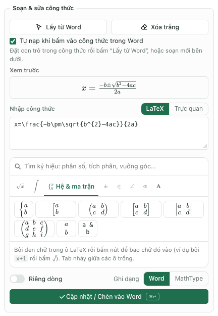
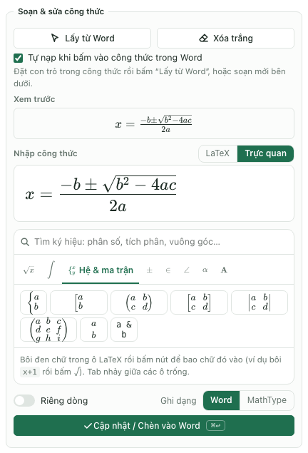
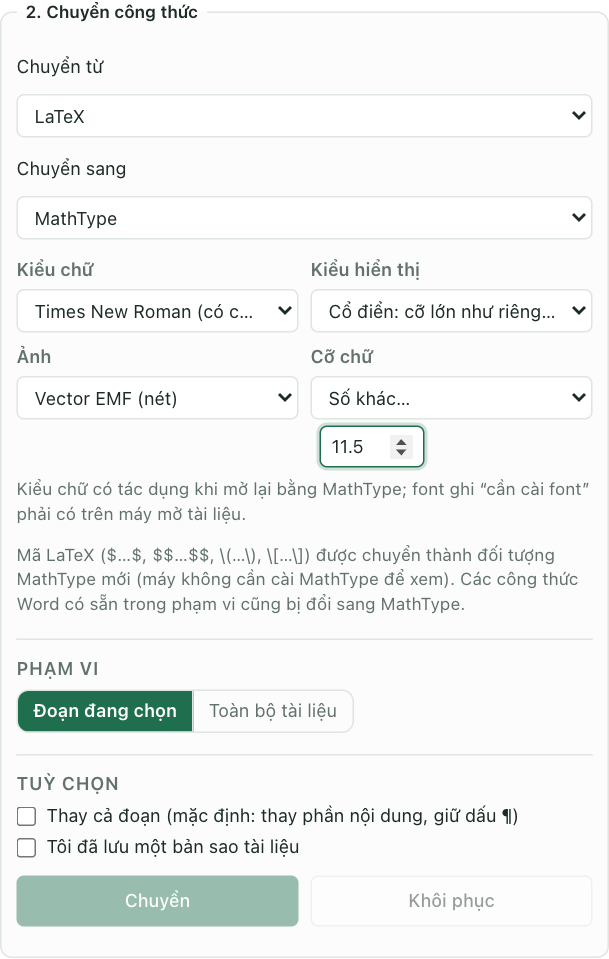
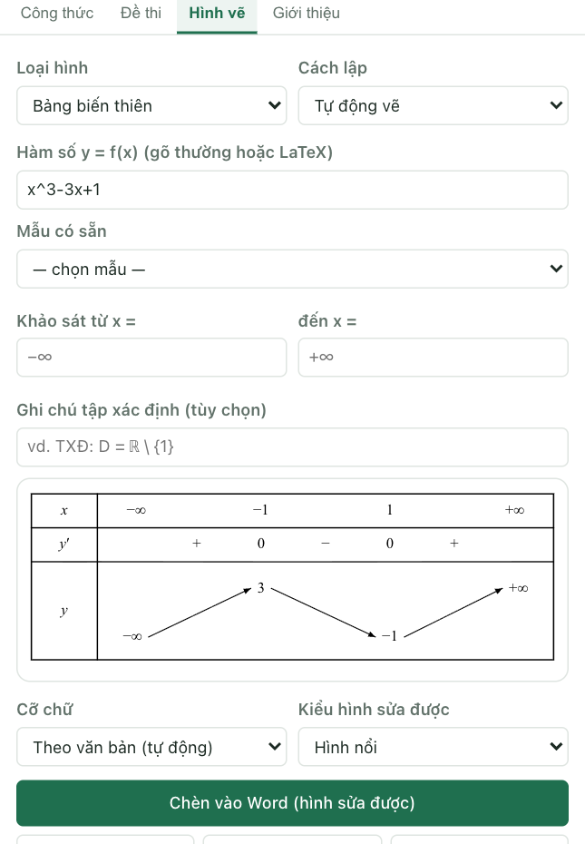

Để soạn công thức toán trên MacBook, có thể dùng công cụ Equation của Word hoặc tiện ích TexCraft. Với tài liệu có nhiều công thức, TexCraft bổ sung ô nhập LaTeX, chế độ soạn trực quan, chuyển đổi công thức và các hình phục vụ soạn đề. Bài này đi theo một quy trình: soạn công thức, kiểm tra, đưa vào Word rồi đồng bộ tài liệu.

Nếu chưa cài tiện ích, bắt đầu tại [hướng dẫn cài TexCraft](../word-addin/huong-dan.html). TexCraft được chia sẻ miễn phí; Microsoft Word là sản phẩm riêng và cần quyền sử dụng phù hợp.

## Chọn công cụ theo việc cần làm

| Việc cần làm | Công cụ trong quy trình |
| --- | --- |
| Viết vài công thức ngay trong Word | Insert → Equation của Word |
| Gõ công thức bằng mã, xem trước trước khi chèn | TexCraft → Soạn thảo → LaTeX |
| Nhập bằng các ô phân số, căn, số mũ | TexCraft → Soạn thảo → Trực quan |
| Chuyển nhiều công thức cũ hoặc mã LaTeX trong văn bản | TexCraft → Công thức |
| Chèn bảng biến thiên, đồ thị và hình học | TexCraft → Hình vẽ |
| Căn lại câu hỏi, phương án và cỡ chữ trong đề | TexCraft → Đề thi |

[Microsoft mô tả khả năng chuyển đổi LaTeX và Office Math](https://learn.microsoft.com/en-us/office/math/latex). Cú pháp và thao tác được hỗ trợ phụ thuộc phiên bản ứng dụng; Word không phải một hệ thống biên dịch tài liệu LaTeX đầy đủ. Các ví dụ bên dưới dùng trong ô LaTeX của TexCraft.

## Bước 1. Nhập phân số, căn và chỉ số

Mở tab Soạn thảo, chọn cách nhập LaTeX. Nhập từng ví dụ, xem phần Xem trước rồi mới chèn vào Word.

| Dạng công thức | Mã nhập trong TexCraft |
| --- | --- |
| Phân số | `\frac{a+b}{c}` |
| Căn bậc hai | `\sqrt{x+1}` |
| Căn bậc ba | `\sqrt[3]{x}` |
| Số mũ | `x^{n+1}` |
| Chỉ số dưới | `a_{n+1}` |
| Vectơ | `\vec{AB}` |

Dấu ngoặc nhọn gom nhiều ký tự vào cùng một thành phần. Ví dụ `x^{n+1}` đặt cả `n+1` lên số mũ; nếu viết `x^n+1`, chỉ `n` là số mũ.

Thử một công thức có nhiều cấu trúc:

```latex
u_n=\frac{\sqrt{n+1}-\sqrt{n}}{n^2+1}
```


Hình 1. Vị trí ô LaTeX và khung Xem trước. Ảnh đang nhập công thức nghiệm bậc hai; thay mã trong ô bằng ví dụ vừa chọn để thực hành.

Khi kết quả đúng, đặt con trỏ trong tài liệu, chọn Ghi dạng Word và bấm Cập nhật / Chèn vào Word. Nếu cần đứng riêng dòng, bật Riêng dòng trước khi chèn.

## Bước 2. Soạn tích phân, giới hạn, hệ và ma trận

Các ví dụ này có thể sao chép vào ô soạn thảo, mỗi lần một công thức:

```latex
\int_0^1 x^2\,dx
```

```latex
\lim\limits_{x\to 0}\frac{\sin x}{x}
```

```latex
\begin{cases}x+y=3\\x-y=1\end{cases}
```

```latex
\begin{pmatrix}1&2\\3&4\end{pmatrix}
```

Trong hệ và ma trận, hai dấu gạch chéo ngược liên tiếp tạo hàng mới; ký tự `&` tách các cột của ma trận. Kiểm tra khung Xem trước để tránh dán nhầm một dấu gạch chéo hoặc bỏ dấu đóng môi trường.

Bảng ký hiệu có nhóm Hệ & ma trận, giúp chèn nhanh hệ phương trình, ma trận và định thức mà không phải nhớ tên môi trường.



Hình 2. Chọn nhóm Hệ & ma trận, bấm nút tương ứng rồi điền số liệu vào các ô trống; dùng Tab để nhảy giữa các ô.

Chỉ nhập một biểu thức hoặc môi trường toán. Không đưa cả `\documentclass`, `\usepackage` hay một tài liệu LaTeX hoàn chỉnh vào ô công thức.

## Bước 3. Dùng chế độ Trực quan khi chưa quen mã

Trong tab Soạn thảo, chuyển Nhập công thức từ LaTeX sang Trực quan. Dùng bảng ký hiệu để thêm phân số, căn, tích phân hoặc ma trận, rồi điền nội dung vào các vị trí tương ứng. Ô trực quan và mã LaTeX được đồng bộ để có thể chuyển cách nhập khi cần.



Hình 3. Chế độ Trực quan: công thức được dựng ngay trong ô nhập, các ô trống bấm để điền.

Một cách luyện nhanh là nhập `\frac{1}{2}` ở chế độ LaTeX, đổi sang Trực quan và sửa tử số thành `x+1`. Sau đó xem lại mã để hiểu cách cấu trúc được biểu diễn.

Khi sửa công thức có sẵn, chọn công thức trong Word rồi bấm Lấy từ Word. Kiểm tra đã nạp đúng công thức trước khi bấm cập nhật, nhất là khi vừa chuyển con trỏ sang vị trí khác.

## Bước 4. Chuyển mã LaTeX nằm trong văn bản thành công thức

Ô Soạn thảo dùng phần mã công thức; còn chức năng chuyển đổi trong tab Công thức cần nhận biết ranh giới LaTeX trong văn bản. Ví dụ, trong một đoạn Word có thể viết:

```text
Cho hàm số $f(x)=x^2-2x+1$. Tính $f(2)$.
```

1. Chọn đoạn có mã cần chuyển trong Word.
2. Mở tab Công thức; chọn Chuyển từ LaTeX, Chuyển sang Công thức Word.
3. Chọn phạm vi Đoạn đang chọn.
4. Lưu bản sao, tích xác nhận rồi bấm Chuyển.
5. Kiểm tra văn bản xung quanh và hai công thức vừa tạo.



Hình 4. Bảng chuyển đổi có sẵn trong hướng dẫn. Ảnh đang chọn đích MathType; khi thực hành bước này, đặt nguồn LaTeX, đích Công thức Word và phạm vi Đoạn đang chọn trước khi bấm Chuyển.

Nếu chọn đích MathType, các công thức Word có sẵn trong phạm vi cũng có thể được chuyển sang MathType. Vì vậy cần đọc dòng giải thích của tiện ích và chỉ chọn đúng phần muốn xử lý.

## Bước 5. Kiểm tra công thức trong tài liệu nhiều nguồn

Khi ghép đề từ đồng nghiệp hoặc tài liệu cũ, mở tab Công thức và bấm Quét toàn bộ tài liệu. Bật Chỉ hiện công thức không đọc được để kiểm tra các đối tượng cần sửa riêng.


Hình 5. Quét trước khi quyết định chuyển toàn bộ tài liệu.

Quét công thức không phải nhận dạng ảnh. Nếu công thức thực chất là ảnh chụp, cần gõ lại hoặc dùng một quy trình nhận dạng khác rồi đối chiếu kết quả. Xem [bài chuẩn hóa MathType](./chuan-hoa-cong-thuc-mathtype-macbook.html) khi cần đồng nhất font và cỡ công thức cũ.

## Bước 6. Chèn bảng biến thiên và hình vẽ

Mở tab Hình vẽ, chọn loại Bảng biến thiên và cách lập Tự động vẽ. Nhập thử `x^3-3x+1`, kiểm tra khoảng khảo sát và bảng xem trước. Với hàm này, hai điểm tới hạn là `-1` và `1`; giá trị hàm tương ứng là `3` và `-1`.



Hình 6. Ảnh hướng dẫn cũ của tab Hình vẽ; các nút chọn tab ở phiên bản mới có thể nhiều hơn.

Chọn cỡ chữ phù hợp, xem kỹ giá trị, mũi tên và miền xác định trước khi chèn. Tùy loại đầu ra, có thể chèn hình vẽ chỉnh sửa được hoặc ảnh. Đừng coi hình xem trước là bằng chứng thay cho việc kiểm tra khảo sát hàm số.

## Bước 7. Đồng bộ bố cục đề

Nếu tài liệu là đề kiểm tra, mở tab Đề thi, bấm Phân tích tài liệu. Khi số câu đã đúng, chọn kiểu đánh số, bố cục phương án, phông chữ, cỡ chữ và cỡ công thức trong mục Chuẩn hóa câu hỏi.


Hình 7. Chuẩn hóa bố cục câu hỏi sau khi đã xử lý công thức.

Cỡ công thức trong bước chuẩn hóa đề không thay thế chức năng làm lại đối tượng MathType. Nếu công thức MathType vẫn khác cỡ, xử lý riêng trong tab Công thức. Sau đó kiểm tra ngắt trang và dùng [hướng dẫn trộn đề trên MacBook](./tron-de-tren-macbook.html) nếu cần tạo nhiều mã.

## Câu hỏi thường gặp

### Công thức nhìn đẹp trong xem trước nhưng khi vào Word lại khác?

Xem trước và công thức trong Word dùng các cơ chế hiển thị khác nhau. Kiểm tra định dạng đầu ra, font và cấu trúc sau khi chèn. Với biểu thức phức tạp, thử từng công thức trước khi xử lý số lượng lớn.

### Có nên dùng ảnh cho mọi công thức?

Ảnh thuận tiện để giữ hình thức hiển thị nhưng khó sửa nội dung toán. Với tài liệu cần tái sử dụng, ưu tiên công thức Word hoặc đối tượng MathType phù hợp với quy trình làm việc.

### Có dùng được hoàn toàn khi mất mạng không?

Lần đầu cần mạng để tải tiện ích. Chỉ dùng offline sau khi các tài nguyên cần thiết đã được lưu trên máy; phần Tính toán dùng SymPy cần tải trước riêng. Không mặc định mọi chức năng đã sẵn sàng chỉ vì đã mở trang một lần.

Nguồn đối chiếu: tài liệu Microsoft liên kết trong bài và mã nguồn giao diện TexCraft. Cập nhật ngày 22/10/2026. Các Hình 1, 2, 3 và 5 chụp giao diện TexCraft ở chế độ thử trong trình duyệt (không có Word) với tài liệu mẫu; Hình 7 cũng chụp giao diện thử; Hình 4 và 6 lấy từ hướng dẫn TexCraft hiện có. Trong Word cho Mac, bảng có cùng nội dung nhưng khung ngoài là của Word.
