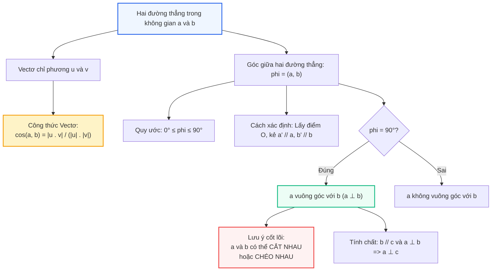

# Toán 11 Bài 22: Hai đường thẳng vuông góc

Quan hệ vuông góc là một trong những nền tảng quan trọng nhất của hình học không gian và kết cấu kỹ thuật hiện đại. Từ các dầm cầu vượt đan chéo trên không trung đến khung chịu lực của những toà tháp chọc trời, việc xác định chính xác góc tạo bởi các thanh dầm giúp các kỹ sư tính toán chuẩn xác ứng suất và độ vững chãi của công trình.

Điểm thú vị và bất ngờ nhất khi bước từ hình học phẳng lên không gian là: **Hai đường thẳng vuông góc với nhau không nhất thiết phải cắt nhau!** Chúng có thể chéo nhau mà vẫn tạo thành một góc $90^\circ$. Trong bài học này, chúng ta sẽ làm chủ công cụ vectơ và phương pháp dựng đường thẳng song song để chinh phục mọi bài toán về góc và quan hệ vuông góc trong không gian.

---

## Sơ đồ Tư duy: Quan hệ Vuông góc giữa Hai Đường thẳng

---

## Khởi động Nhanh: 5 Câu Hỏi Kiểm tra Kiến thức Đầu Giờ

<h3 style="margin-top: 0; color: #2563eb;">Khởi động: Thử thách Tư duy Không gian</h3>

  
<strong>Câu 1:</strong> Trong không gian, cho hai đường thẳng $a$ và $b$ cùng vuông góc với đường thẳng $c$. Khẳng định nào sau đây là <strong>đúng</strong>?

  

    <label><input type="radio" name="kd1" value="A"> A. $a$ luôn song song với $b$.</label> 
    <label><input type="radio" name="kd1" value="B"> B. $a$ luôn trùng với $b$.</label> 
    <label><input type="radio" name="kd1" value="C"> C. $a$ và $b$ có thể song song, cắt nhau hoặc chéo nhau.</label> 
    <label><input type="radio" name="kd1" value="D"> D. $a$ và $b$ bắt buộc phải chéo nhau.</label>
  

  

    ✓ <strong>Đáp án đúng: C</strong>. Khác với hình học phẳng, trong không gian hai đường thẳng cùng vuông góc với một đường thẳng thứ ba có thể cắt nhau (ví dụ trục $Ox$ và $Oy$ cùng vuông góc với $Oz$), song song với nhau, hoặc chéo nhau.
  

  
<strong>Câu 2:</strong> Góc giữa hai đường thẳng trong không gian có thể nhận giá trị trong khoảng nào?

  

    <label><input type="radio" name="kd2" value="A"> A. $[0^\circ; 180^\circ]$.</label> 
    <label><input type="radio" name="kd2" value="B"> B. $[0^\circ; 90^\circ]$.</label> 
    <label><input type="radio" name="kd2" value="C"> C. $(0^\circ; 90^\circ)$.</label> 
    <label><input type="radio" name="kd2" value="D"> D. $[0^\circ; 360^\circ]$.</label>
  

  

    ✓ <strong>Đáp án đúng: B</strong>. Theo định nghĩa, góc giữa hai đường thẳng trong không gian là góc không tù, nghĩa là nằm trong đoạn $[0^\circ; 90^\circ]$. Khi hai đường thẳng song song hoặc trùng nhau thì góc bằng $0^\circ$.
  

  
<strong>Câu 3:</strong> Cho $\vec{u}$ và $\vec{v}$ lần lượt là vectơ chỉ phương của hai đường thẳng $a$ và $b$. Công thức xác định $\cos(a, b)$ là:

  

    <label><input type="radio" name="kd3" value="A"> A. $\cos(a, b) = \dfrac{\vec{u} \cdot \vec{v}}{|\vec{u}| \cdot |\vec{v}|}$.</label> 
    <label><input type="radio" name="kd3" value="B"> B. $\cos(a, b) = \dfrac{|\vec{u} \cdot \vec{v}|}{|\vec{u}| \cdot |\vec{v}|}$.</label> 
    <label><input type="radio" name="kd3" value="C"> C. $\cos(a, b) = \dfrac{|\vec{u}| \cdot |\vec{v}|}{|\vec{u} \cdot \vec{v}|}$.</label> 
    <label><input type="radio" name="kd3" value="D"> D. $\cos(a, b) = -\dfrac{\vec{u} \cdot \vec{v}}{|\vec{u}| \cdot |\vec{v}|}$.</label>
  

  

    ✓ <strong>Đáp án đúng: B</strong>. Do góc giữa hai đường thẳng không tù nên $\cos(a, b) \ge 0$, do đó trên tử số bắt buộc phải có dấu giá trị tuyệt đối $|\vec{u} \cdot \vec{v}|$.
  

  
<strong>Câu 4:</strong> Cho hình lập phương $ABCD.A'B'C'D'$. Góc giữa hai đường thẳng $AB$ và $B'C'$ bằng bao nhiêu?

  

    <label><input type="radio" name="kd4" value="A"> A. $0^\circ$.</label> 
    <label><input type="radio" name="kd4" value="B"> B. $45^\circ$.</label> 
    <label><input type="radio" name="kd4" value="C"> C. $60^\circ$.</label> 
    <label><input type="radio" name="kd4" value="D"> D. $90^\circ$.</label>
  

  

    ✓ <strong>Đáp án đúng: D</strong>. Vì $B'C' \parallel BC$ nên $(AB, B'C') = (AB, BC) = \widehat{ABC} = 90^\circ$ (do $ABCD$ là hình vuông).
  

  
<strong>Câu 5:</strong> Điều kiện cần và đủ để hai đường thẳng $a$ và $b$ có vectơ chỉ phương lần lượt là $\vec{u}$ và $\vec{v}$ vuông góc với nhau là:

  

    <label><input type="radio" name="kd5" value="A"> A. $\vec{u} = k\vec{v}$ với $k \neq 0$.</label> 
    <label><input type="radio" name="kd5" value="B"> B. $\vec{u} \cdot \vec{v} = 0$.</label> 
    <label><input type="radio" name="kd5" value="C"> C. $\vec{u} + \vec{v} = \vec{0}$.</label> 
    <label><input type="radio" name="kd5" value="D"> D. $|\vec{u}| = |\vec{v}|$.</label>
  

  

    ✓ <strong>Đáp án đúng: B</strong>. $a \perp b \Leftrightarrow (a, b) = 90^\circ \Leftrightarrow \cos(a, b) = 0 \Leftrightarrow \vec{u} \cdot \vec{v} = 0$.
  

<button id="btnCheckKD" style="background:#2563eb; color:#fff; border:none; padding:8px 18px; border-radius:6px; font-weight:bold; cursor:pointer;">Kiểm tra đáp án Khởi động</button>

---

## I. Lý thuyết Trọng tâm

### 1. Vectơ chỉ phương của đường thẳng trong không gian
> **Định nghĩa:** Vectơ $\vec{u} \neq \vec{0}$ được gọi là vectơ chỉ phương của đường thẳng $d$ nếu giá của $\vec{u}$ song song hoặc trùng với $d$.

- Nếu $\vec{u}$ là một vectơ chỉ phương của $d$ thì mọi vectơ $k\vec{u}$ ($k \neq 0$) cũng là vectơ chỉ phương của $d$.
- Một đường thẳng hoàn toàn được xác định nếu biết một điểm nó đi qua và một vectơ chỉ phương của nó.
- Hai đường thẳng song song hoặc trùng nhau khi và chỉ khi hai vectơ chỉ phương của chúng cùng phương.

---

### 2. Góc giữa hai đường thẳng trong không gian

> **Định nghĩa:** Góc giữa hai đường thẳng $a$ và $b$ trong không gian là góc giữa hai đường thẳng $a'$ và $b'$ cùng đi qua một điểm $O$ bất kì và lần lượt song song (hoặc trùng) với $a$ và $b$.

Kí hiệu góc giữa hai đường thẳng $a$ và $b$ là $(a, b)$ hoặc $\widehat{(a, b)}$.
- Độ lớn của góc: $0^\circ \le (a, b) \le 90^\circ$.
- Điểm $O$ có thể lấy tuỳ ý trong không gian. Trong thực hành tính toán, ta thường chọn $O$ nằm ngay trên một trong hai đường thẳng (chẳng hạn lấy $O \in a$, khi đó chỉ cần qua $O$ kẻ $b' \parallel b$).
- Khi $a \parallel b$ hoặc $a \equiv b$, ta quy ước góc giữa chúng bằng $0^\circ$.

#### Công thức tính góc theo vectơ chỉ phương:
Giả sử $\vec{u}$ là vectơ chỉ phương của $a$ và $\vec{v}$ là vectơ chỉ phương của $b$. Khi đó:
$$\cos(a, b) = |\cos(\vec{u}, \vec{v})| = \frac{|\vec{u} \cdot \vec{v}|}{|\vec{u}| \cdot |\vec{v}|}$$

> **Cảnh báo sai lầm:** Góc giữa hai vectơ $(\vec{u}, \vec{v})$ có thể là góc tù ($0^\circ \le (\vec{u}, \vec{v}) \le 180^\circ$). Nhưng góc giữa hai đường thẳng $(a, b)$ **không bao giờ vượt quá $90^\circ$**. Nếu tính tích vô hướng ra góc $120^\circ$, góc giữa hai đường thẳng sẽ là $180^\circ - 120^\circ = 60^\circ$.

---

### 3. Hai đường thẳng vuông góc

> **Định nghĩa:** Hai đường thẳng $a$ và $b$ được gọi là vuông góc với nhau nếu góc giữa chúng bằng $90^\circ$. Kí hiệu: $a \perp b$.

#### Điều kiện vuông góc:
$$a \perp b \iff \vec{u} \cdot \vec{v} = 0$$
trong đó $\vec{u}, \vec{v}$ lần lượt là vectơ chỉ phương của $a$ và $b$.

#### Các tính chất quan trọng:
1. Cho hai đường thẳng song song $b \parallel c$. Nếu $a \perp b$ thì $a \perp c$.
2. Hai đường thẳng vuông góc trong không gian **có thể cắt nhau hoặc chéo nhau**.
3. Một đường thẳng vuông góc với hai đường thẳng cắt nhau trong một mặt phẳng thì vuông góc với mọi đường thẳng nằm trong mặt phẳng đó (đây là cầu nối sang Bài 23).

---

## II. Phòng thí nghiệm 3D Tương tác: Góc giữa Hai Đường thẳng Chéo nhau

Dưới đây là mô hình không gian của hình chóp tứ giác đều $S.ABCD$ (hoặc tứ diện đều $ABCD$). Em có thể **dùng chuột hoặc ngón tay để kéo và xoay khối hình 3D** quanh mọi góc độ. Hãy quan sát hai đường thẳng chéo nhau $AB$ và $CD$ hoặc $SA$ và $BC$: dù không bao giờ gặp nhau, ta vẫn dịch chuyển song song để đo chính xác góc của chúng!

  <h3 style="margin-top: 0; color: #2563eb;">PHÒNG THÍ NGHIỆM 3D: HAI ĐƯỜNG THẲNG VUÔNG GÓC TRONG TỨ DIỆN</h3>
  

    <em>Rê chuột/vuốt màn hình trên khung hình 3D hoặc dùng thanh trượt để xoay khối tứ diện đều $ABCD$.</em>
  

  

    <button id="btnHighlightPair" style="padding: 6px 14px; border-radius: 6px; border: 1px solid #2563eb; background: #2563eb; color: #fff; font-weight: bold; cursor: pointer;">Tô đậm cặp cạnh chéo AB & CD (Vuông góc)</button>
    <button id="btnParallelShift" style="padding: 6px 14px; border-radius: 6px; border: 1px solid #10b981; background: #ecfdf5; color: #047857; font-weight: bold; cursor: pointer;">Hiện đường dời song song</button>
    <button id="btnReset3D" style="padding: 6px 14px; border-radius: 6px; border: 1px solid #94a3b8; background: #f1f5f9; color: #475569; cursor: pointer;">Đặt lại góc nhìn</button>
  

  

    <svg id="svgSpace3D" data-interactive-done="true" viewBox="0 0 540 380" style="width: 100%; height: auto; background: #ffffff; border: 1px solid #cbd5e1; border-radius: 12px; box-shadow: 0 4px 6px -1px rgba(0,0,0,0.06); cursor: grab; touch-action: none;">
      <defs>
        <marker id="arrow" viewBox="0 0 10 10" refX="5" refY="5" markerWidth="6" markerHeight="6" orient="auto-start-reverse">
          <path d="M 0 0 L 10 5 L 0 10 z" fill="#ef4444"/>
        </marker>
      </defs>
      <g id="gFaces"></g>
      <g id="gEdges"></g>
      <g id="gExtra"></g>
      <g id="gVertices"></g>
      <g id="gLabels"></g>
    </svg>
    

      

        <label style="font-weight: bold; color: #334155;">Góc xoay ngang (Yaw): 35°</label>
        <input id="sliderYaw" type="range" min="-180" max="180" value="35" style="width: 100%; margin-top: 4px;">
      

      

        <label style="font-weight: bold; color: #334155;">Góc nghiêng đứng (Pitch): 20°</label>
        <input id="sliderPitch" type="range" min="-60" max="60" value="20" style="width: 100%; margin-top: 4px;">
      

    

  

  

    Khối tứ diện đều $ABCD$: Cặp cạnh đối diện $AB$ (đỏ) và $CD$ (xanh dương) chéo nhau nhưng <strong>vuông góc $90^\circ$</strong> với nhau!
  

---

## III. Các Dạng Toán Điển Hình và Phương Pháp Giải

### Dạng 1: Xác định góc giữa hai đường thẳng bằng phép tịnh tiến song song

**Phương pháp giải:**
1. Để tính góc giữa hai đường thẳng chéo nhau $a$ và $b$:
   - Chọn điểm $A \in a$, kẻ đường thẳng $b' \parallel b$ đi qua $A$.
   - Khi đó: $(a, b) = (a, b')$.
2. Đưa về tam giác chứa hai đường thẳng cắt nhau $a$ và $b'$.
3. Sử dụng hệ thức lượng trong tam giác (định lí côsin):
   $$\cos \widehat{BAC} = \frac{AB^2 + AC^2 - BC^2}{2 \cdot AB \cdot AC}$$
4. Kết luận góc giữa hai đường thẳng:
   - Nếu $\widehat{BAC} \le 90^\circ$ thì $(a, b) = \widehat{BAC}$.
   - Nếu $\widehat{BAC} > 90^\circ$ thì $(a, b) = 180^\circ - \widehat{BAC}$.

---

#### Ví dụ 1:
Cho hình lăng trụ tam giác $ABC.A'B'C'$ có đáy $ABC$ là tam giác đều cạnh $a$, $AA' \perp (ABC)$ và $AA' = a$. Tính góc giữa hai đường thẳng $AB$ và $B'C'$.

**Lời giải chi tiết:**
1. Do lăng trụ đứng có các mặt bên là hình chữ nhật nên $B'C' \parallel BC$.
2. Ta có:
   $$(AB, B'C') = (AB, BC) = \widehat{ABC}$$
3. Vì đáy $ABC$ là tam giác đều cạnh $a$ nên $\widehat{ABC} = 60^\circ$.
4. Do $60^\circ \le 90^\circ$ nên góc giữa hai đường thẳng $AB$ và $B'C'$ bằng $60^\circ$.

---

### Dạng 2: Tính góc giữa hai đường thẳng bằng phương pháp vectơ

**Phương pháp giải:**
1. Chọn các vectơ chỉ phương $\vec{u}$ của $a$ và $\vec{v}$ của $b$.
2. Biểu diễn $\vec{u}$ và $\vec{v}$ qua một hệ vectơ cơ sở (thường là ba vectơ xuất phát từ một đỉnh của khối tứ diện, hình chóp hoặc hình hộp chữ nhật).
3. Tính tích vô hướng $\vec{u} \cdot \vec{v}$ và độ dài $|\vec{u}|, |\vec{v}|$.
4. Áp dụng công thức:
   $$\cos(a, b) = \frac{|\vec{u} \cdot \vec{v}|}{|\vec{u}| \cdot |\vec{v}|}$$

---

#### Ví dụ 2:
Cho tứ diện $ABCD$ có $AB = CD = a$. Gọi $M, N$ lần lượt là trung điểm của $BC$ và $AD$. Biết $MN = \dfrac{a\sqrt{3}}{2}$. Tính góc giữa hai đường thẳng $AB$ và $CD$.

**Lời giải chi tiết:**
1. Lấy $P$ là trung điểm của $AC$.
2. Trong $\triangle ABC$, $MP$ là đường trung bình nên $MP \parallel AB$ và $MP = \dfrac{AB}{2} = \dfrac{a}{2}$.
3. Trong $\triangle ACD$, $NP$ là đường trung bình nên $NP \parallel CD$ và $NP = \dfrac{CD}{2} = \dfrac{a}{2}$.
4. Do đó, $(AB, CD) = (MP, NP)$. Ta xét $\triangle MNP$:
   $$\cos \widehat{MPN} = \frac{MP^2 + NP^2 - MN^2}{2 \cdot MP \cdot NP} = \frac{\left(\frac{a}{2}\right)^2 + \left(\frac{a}{2}\right)^2 - \left(\frac{a\sqrt{3}}{2}\right)^2}{2 \cdot \frac{a}{2} \cdot \frac{a}{2}} = \frac{\frac{a^2}{4} + \frac{a^2}{4} - \frac{3a^2}{4}}{2 \cdot \frac{a^2}{4}} = \frac{-\frac{a^2}{4}}{\frac{a^2}{2}} = -\frac{1}{2}$$
5. Vì $\cos \widehat{MPN} = -\dfrac{1}{2}$ nên $\widehat{MPN} = 120^\circ$.
6. Vì góc giữa hai đường thẳng không tù nên:
   $$(AB, CD) = 180^\circ - 120^\circ = 60^\circ .$$

---

### Dạng 3: Chứng minh hai đường thẳng vuông góc

**Phương pháp giải:**
Có 3 con đường phổ biến nhất để chứng minh $a \perp b$:
- **Cách 1 (Vectơ):** Chứng minh tích vô hướng $\vec{u} \cdot \vec{v} = 0$.
- **Cách 2 (Đường thẳng song song):** Tìm đường thẳng $c \parallel b$ rồi chứng minh $a \perp c$.
- **Cách 3 (Định lí hình học phẳng):** Đưa về một tam giác và dùng định lí Pythagoras đảo hoặc tính chất trực tâm, đường cao.

---

#### Ví dụ 3 (Bài toán kinh điển):
Cho tứ diện đều $ABCD$. Chứng minh rằng các cặp cạnh đối diện vuông góc từng đôi một, nghĩa là: $AB \perp CD$, $AC \perp BD$, $AD \perp BC$.

**Lời giải chi tiết:**
1. Gọi cạnh của tứ diện đều là $a$. Đặt $\vec{AB} = \vec{b}$, $\vec{AC} = \vec{c}$, $\vec{AD} = \vec{d}$.
2. Khi đó $|\vec{b}| = |\vec{c}| = |\vec{d}| = a$ và góc giữa từng cặp vectơ này đều bằng $60^\circ$ vì các mặt là tam giác đều:
   $$\vec{b} \cdot \vec{c} = \vec{c} \cdot \vec{d} = \vec{d} \cdot \vec{b} = a \cdot a \cdot \cos 60^\circ = \frac{a^2}{2}$$
3. Ta có $\vec{CD} = \vec{AD} - \vec{AC} = \vec{d} - \vec{c}$.
4. Xét tích vô hướng của $\vec{AB}$ và $\vec{CD}$:
   $$\vec{AB} \cdot \vec{CD} = \vec{b} \cdot (\vec{d} - \vec{c}) = \vec{b} \cdot \vec{d} - \vec{b} \cdot \vec{c} = \frac{a^2}{2} - \frac{a^2}{2} = 0$$
5. Vì $\vec{AB} \cdot \vec{CD} = 0$ nên $AB \perp CD$.
6. Hoàn toàn tương tự, ta có $AC \perp BD$ và $AD \perp BC$.

---

## IV. Bài tập Trắc nghiệm Tự luyện (Có Chấm điểm Tức thì)

<h3 style="margin-top: 0; color: #2563eb;">Luyện tập Trắc nghiệm Toàn diện Bài 22</h3>

  
<strong>Câu 1:</strong> Khẳng định nào sau đây là <strong>sai</strong>?

  

    <label><input type="radio" name="tn1" value="A"> A. Góc giữa hai đường thẳng trong không gian luôn nằm trong đoạn $[0^\circ; 90^\circ]$.</label> 
    <label><input type="radio" name="tn1" value="B"> B. Nếu $a \parallel b$ và $c \perp a$ thì $c \perp b$.</label> 
    <label><input type="radio" name="tn1" value="C"> C. Hai đường thẳng cùng vuông góc với một đường thẳng thứ ba thì song song với nhau.</label> 
    <label><input type="radio" name="tn1" value="D"> D. Hai đường thẳng vuông góc với nhau có thể cắt nhau hoặc chéo nhau.</label>
  

  

    ✓ <strong>Đáp án đúng: C</strong>. Hai đường thẳng cùng vuông góc với đường thẳng thứ ba có thể cắt nhau hoặc chéo nhau trong không gian.
  

  
<strong>Câu 2:</strong> Cho hình lập phương $ABCD.A'B'C'D'$. Góc giữa hai đường thẳng $A'C'$ và $BD$ bằng:

  

    <label><input type="radio" name="tn2" value="A"> A. $90^\circ$.</label> 
    <label><input type="radio" name="tn2" value="B"> B. $45^\circ$.</label> 
    <label><input type="radio" name="tn2" value="C"> C. $60^\circ$.</label> 
    <label><input type="radio" name="tn2" value="D"> D. $30^\circ$.</label>
  

  

    ✓ <strong>Đáp án đúng: A</strong>. Ta có $A'C' \parallel AC$. Do $ABCD$ là hình vuông nên hai đường chéo vuông góc: $AC \perp BD$. Vậy $(A'C', BD) = (AC, BD) = 90^\circ$.
  

  
<strong>Câu 3:</strong> Cho hình chóp $S.ABC$ có $SA = SB = SC$ và $\widehat{ASB} = \widehat{BSC} = \widehat{CSA} = 60^\circ$. Góc giữa hai đường thẳng $SA$ và $BC$ bằng:

  

    <label><input type="radio" name="tn3" value="A"> A. $30^\circ$.</label> 
    <label><input type="radio" name="tn3" value="B"> B. $45^\circ$.</label> 
    <label><input type="radio" name="tn3" value="C"> C. $60^\circ$.</label> 
    <label><input type="radio" name="tn3" value="D"> D. $90^\circ$.</label>
  

  

    ✓ <strong>Đáp án đúng: D</strong>. $S.ABC$ có ba cạnh bên bằng nhau và các góc ở đỉnh bằng $60^\circ$ nên $S.ABC$ là tứ diện đều. Theo tính chất tứ diện đều, các cặp cạnh đối diện luôn vuông góc với nhau, suy ra $SA \perp BC$, tức góc bằng $90^\circ$.
  

  
<strong>Câu 4:</strong> Cho hình chóp $S.ABCD$ có đáy $ABCD$ là hình chữ nhật, $AB = a, AD = a\sqrt{3}$. Cạnh bên $SA \perp (ABCD)$. Góc giữa hai đường thẳng $SB$ và $CD$ là:

  

    <label><input type="radio" name="tn4" value="A"> A. Góc $\widehat{SBA}$.</label> 
    <label><input type="radio" name="tn4" value="B"> B. Góc $\widehat{SAB}$.</label> 
    <label><input type="radio" name="tn4" value="C"> C. Góc $\widehat{SBC}$.</label> 
    <label><input type="radio" name="tn4" value="D"> D. Góc $\widehat{ASB}$.</label>
  

  

    ✓ <strong>Đáp án đúng: A</strong>. Vì $CD \parallel AB$ nên $(SB, CD) = (SB, AB) = \widehat{SBA}$ (vì $\triangle SAB$ vuông tại $A$ nên $\widehat{SBA} < 90^\circ$).
  

  
<strong>Câu 5:</strong> Cho hình lập phương $ABCD.A'B'C'D'$. Góc giữa hai đường thẳng $AC$ và $DA'$ bằng:

  

    <label><input type="radio" name="tn5" value="A"> A. $90^\circ$.</label> 
    <label><input type="radio" name="tn5" value="B"> B. $60^\circ$.</label> 
    <label><input type="radio" name="tn5" value="C"> C. $45^\circ$.</label> 
    <label><input type="radio" name="tn5" value="D"> D. $120^\circ$.</label>
  

  

    ✓ <strong>Đáp án đúng: B</strong>. Do $DA' \parallel CB'$ nên $(AC, DA') = (AC, CB')$. Xét tam giác $ACB'$, tam giác này có $AC = CB' = B'A$ (đều là đường chéo của các mặt hình vuông bằng nhau) $\Rightarrow \triangle ACB'$ đều $\Rightarrow \widehat{ACB'} = 60^\circ$.
  

  
<strong>Câu 6:</strong> Cho hai vectơ $\vec{u}$ và $\vec{v}$ lần lượt là vectơ chỉ phương của hai đường thẳng $a$ và $b$. Biết $\vec{u} \cdot \vec{v} = -\dfrac{1}{2} |\vec{u}| |\vec{v}|$. Góc giữa $a$ và $b$ bằng:

  

    <label><input type="radio" name="tn6" value="A"> A. $120^\circ$.</label> 
    <label><input type="radio" name="tn6" value="B"> B. $60^\circ$.</label> 
    <label><input type="radio" name="tn6" value="C"> C. $30^\circ$.</label> 
    <label><input type="radio" name="tn6" value="D"> D. $150^\circ$.</label>
  

  

    ✓ <strong>Đáp án đúng: B</strong>. $\cos(a, b) = \dfrac{|\vec{u} \cdot \vec{v}|}{|\vec{u}| |\vec{v}|} = \dfrac{\frac{1}{2}|\vec{u}||\vec{v}|}{|\vec{u}||\vec{v}|} = \dfrac{1}{2} \Rightarrow (a, b) = 60^\circ$.
  

  
<strong>Câu 7:</strong> Cho hình lập phương $ABCD.A'B'C'D'$. Khẳng định nào sau đây <strong>sai</strong>?

  

    <label><input type="radio" name="tn7" value="A"> A. $AB \perp B'C'$.</label> 
    <label><input type="radio" name="tn7" value="B"> B. $AC \perp B'D'$.</label> 
    <label><input type="radio" name="tn7" value="C"> C. $AA' \perp BD$.</label> 
    <label><input type="radio" name="tn7" value="D"> D. $AC \perp A'D$.</label>
  

  

    ✓ <strong>Đáp án đúng: D</strong>. Theo câu 5 ta đã tính $(AC, DA') = 60^\circ \neq 90^\circ$.
  

  
<strong>Câu 8:</strong> Cho hình chóp $S.ABC$ có $SA \perp SB$ và $SB \perp SC$, $SC \perp SA$. Gọi $M$ là trung điểm của $AB$. Khẳng định nào sau đây đúng?

  

    <label><input type="radio" name="tn8" value="A"> A. $SC \perp AB$.</label> 
    <label><input type="radio" name="tn8" value="B"> B. $SC \parallel AB$.</label> 
    <label><input type="radio" name="tn8" value="C"> C. $(SC, AB) = 45^\circ$.</label> 
    <label><input type="radio" name="tn8" value="D"> D. $(SC, AB) = 60^\circ$.</label>
  

  

    ✓ <strong>Đáp án đúng: A</strong>. $\vec{SC} \cdot \vec{AB} = \vec{SC} \cdot (\vec{SB} - \vec{SA}) = \vec{SC} \cdot \vec{SB} - \vec{SC} \cdot \vec{SA} = 0 - 0 = 0$. Suy ra $SC \perp AB$.
  

  
<strong>Câu 9:</strong> Cho tứ diện $ABCD$ có $AB \perp CD$ và $AC \perp BD$. Khẳng định nào sau đây chắc chắn đúng?

  

    <label><input type="radio" name="tn9" value="A"> A. $AD \perp BC$.</label> 
    <label><input type="radio" name="tn9" value="B"> B. $AD \parallel BC$.</label> 
    <label><input type="radio" name="tn9" value="C"> C. $ABCD$ là tứ diện đều.</label> 
    <label><input type="radio" name="tn9" value="D"> D. $AB = CD$.</label>
  

  

    ✓ <strong>Đáp án đúng: A</strong>. Đây là định lí tứ diện gần đều / trực tâm: nếu tứ diện có hai cặp cạnh đối vuông góc thì cặp cạnh đối thứ ba cũng vuông góc với nhau ($\vec{AD} \cdot \vec{BC} = (\vec{AC} + \vec{CD}) \cdot \vec{BC} = 0$).
  

  
<strong>Câu 10:</strong> Trong không gian, cho ba đường thẳng phân biệt $a, b, c$. Mệnh đề nào sau đây là <strong>đúng</strong>?

  

    <label><input type="radio" name="tn10" value="A"> A. Nếu $a \perp b$ và $b \perp c$ thì $a \parallel c$.</label> 
    <label><input type="radio" name="tn10" value="B"> B. Nếu $a \perp b$ và $b \perp c$ thì $a \perp c$.</label> 
    <label><input type="radio" name="tn10" value="C"> C. Nếu $a \parallel b$ và $c \perp a$ thì $c \perp b$.</label> 
    <label><input type="radio" name="tn10" value="D"> D. Nếu $a$ và $b$ cùng chéo với $c$ thì $a \parallel b$.</label>
  

  

    ✓ <strong>Đáp án đúng: C</strong>. Tính chất bắc cầu của quan hệ vuông góc qua quan hệ song song: một đường thẳng vuông góc với một trong hai đường thẳng song song thì cũng vuông góc với đường thẳng còn lại.
  

<button id="btnCheckTN" style="background:#2563eb; color:#fff; border:none; padding:8px 18px; border-radius:6px; font-weight:bold; cursor:pointer;">Nộp bài & Xem điểm</button>

---

## V. Ứng dụng Thực tiễn: Thiết kế Khung Giàn Thép Không gian

Trong kỹ thuật kết cấu hiện đại, các vòm không gian (Space Frame) ở các sân vận động hoặc nhà ga sân bay (như sân bay Quốc tế Long Thành hay Nội Bài) được tạo nên từ hàng nghìn thanh thép liên kết tại các quả cầu nút (node).

Các thanh giàn chịu lực thường được bố trí sao cho góc giữa các thanh chéo triệt tiêu mô-men uốn và biến toàn bộ tải trọng thành lực nén hoặc kéo dọc trục. Khi hai thanh chịu lực chéo nhau được thiết kế vuông góc trong không gian, lực truyền giữa chúng qua hệ giằng trung gian đạt hiệu suất phân tán lực tối ưu nhất mà không gây hiện tượng trượt biến dạng!
