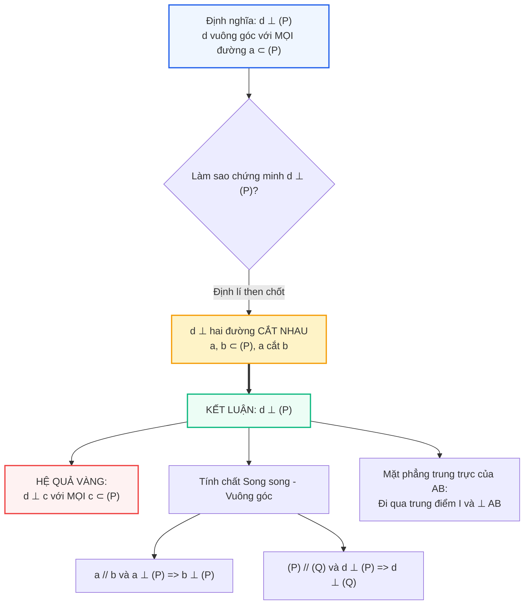

# Toán 11 Bài 23: Đường thẳng vuông góc với mặt phẳng

Khi dựng một ngôi nhà, người thợ xây dùng dây dọi (quả dọi) để đảm bảo cột trụ thẳng đứng tuyệt đối so với mặt đất. Trong toán học, "thẳng đứng so với mặt đất" chính là hình ảnh trực quan của một **đường thẳng vuông góc với mặt phẳng**.

Quan hệ đường thẳng vuông góc với mặt phẳng là "trục xương sống" của toàn bộ chương hình học không gian. Một khi một đường thẳng vuông góc với mặt phẳng, nó sẽ vuông góc với **tất cả mọi đường thẳng** nằm trong mặt phẳng đó! Hãy cùng khám phá quy tắc vàng này cùng mô hình 3D xoay trực quan dưới đây.

---

## Sơ đồ Tư duy: Đường thẳng Vuông góc với Mặt phẳng

---

## Khởi động Nhanh: 5 Câu Hỏi Trắc nghiệm Đầu Giờ

<h3 style="margin-top: 0; color: #2563eb;">Khởi động: Thử thách Độ chuẩn xác Khái niệm</h3>

  
<strong>Câu 1:</strong> Đường thẳng $d$ vuông góc với mặt phẳng $(\alpha)$ khi nào?

  

    <label><input type="radio" name="kd1" value="A"> A. $d$ vuông góc với ít nhất hai đường thẳng phân biệt nằm trong $(\alpha)$.</label> 
    <label><input type="radio" name="kd1" value="B"> B. $d$ vuông góc với mọi đường thẳng nằm trong $(\alpha)$.</label> 
    <label><input type="radio" name="kd1" value="C"> C. $d$ cắt mặt phẳng $(\alpha)$ tại một điểm duy nhất.</label> 
    <label><input type="radio" name="kd1" value="D"> D. $d$ vuông góc với đường chéo của một đa giác nằm trong $(\alpha)$.</label>
  

  

    ✓ <strong>Đáp án đúng: B</strong>. Theo định nghĩa, đường thẳng vuông góc với mặt phẳng nếu nó vuông góc với mọi đường thẳng nằm trong mặt phẳng đó.
  

  
<strong>Câu 2:</strong> Để chứng minh đường thẳng $d \perp (\alpha)$, ta cần chứng minh $d$ vuông góc với:

  

    <label><input type="radio" name="kd2" value="A"> A. Hai đường thẳng bất kì trong $(\alpha)$.</label> 
    <label><input type="radio" name="kd2" value="B"> B. Hai đường thẳng song song trong $(\alpha)$.</label> 
    <label><input type="radio" name="kd2" value="C"> C. Hai đường thẳng cắt nhau cùng nằm trong $(\alpha)$.</label> 
    <label><input type="radio" name="kd2" value="D"> D. Một đường thẳng duy nhất nằm trong $(\alpha)$.</label>
  

  

    ✓ <strong>Đáp án đúng: C</strong>. Điều kiện đủ: nếu đường thẳng vuông góc với hai đường thẳng <strong>cắt nhau</strong> cùng nằm trong một mặt phẳng thì nó vuông góc với mặt phẳng đó.
  

  
<strong>Câu 3:</strong> Cho $a \parallel b$ và $a \perp (\alpha)$. Khẳng định nào sau đây là đúng?

  

    <label><input type="radio" name="kd3" value="A"> A. $b \parallel (\alpha)$.</label> 
    <label><input type="radio" name="kd3" value="B"> B. $b \subset (\alpha)$.</label> 
    <label><input type="radio" name="kd3" value="C"> C. $b \perp (\alpha)$.</label> 
    <label><input type="radio" name="kd3" value="D"> D. $b$ tạo với $(\alpha)$ một góc nhọn.</label>
  

  

    ✓ <strong>Đáp án đúng: C</strong>. Một trong hai đường thẳng song song vuông góc với mặt phẳng thì đường thẳng còn lại cũng vuông góc với mặt phẳng đó.
  

  
<strong>Câu 4:</strong> Tập hợp tất cả các điểm trong không gian cách đều hai đầu mút của đoạn thẳng $AB$ là:

  

    <label><input type="radio" name="kd4" value="A"> A. Đường trung trực của $AB$.</label> 
    <label><input type="radio" name="kd4" value="B"> B. Mặt phẳng trung trực của đoạn thẳng $AB$.</label> 
    <label><input type="radio" name="kd4" value="C"> C. Đường tròn đi qua $A$ và $B$.</label> 
    <label><input type="radio" name="kd4" value="D"> D. Mặt cầu đường kính $AB$.</label>
  

  

    ✓ <strong>Đáp án đúng: B</strong>. Trong không gian, tập hợp các điểm cách đều hai mút của đoạn thẳng $AB$ là mặt phẳng trung trực của $AB$ (mặt phẳng đi qua trung điểm của $AB$ và vuông góc với đường thẳng $AB$).
  

  
<strong>Câu 5:</strong> Cho hình chóp $S.ABC$ có $SA \perp (ABC)$. Tam giác $ABC$ vuông tại $B$. Khẳng định nào sau đây là <strong>sai</strong>?

  

    <label><input type="radio" name="kd5" value="A"> A. $SA \perp BC$.</label> 
    <label><input type="radio" name="kd5" value="B"> B. $SA \perp AB$.</label> 
    <label><input type="radio" name="kd5" value="C"> C. $BC \perp (SAB)$.</label> 
    <label><input type="radio" name="kd5" value="D"> D. $AC \perp (SAB)$.</label>
  

  

    ✓ <strong>Đáp án đúng: D</strong>. Vì $SA \perp (ABC)$ nên $SA \perp AB, SA \perp AC, SA \perp BC$. Do $BC \perp AB$ và $BC \perp SA$ nên $BC \perp (SAB)$. Khẳng định $AC \perp (SAB)$ là sai.
  

<button id="btnCheckKD" style="background:#2563eb; color:#fff; border:none; padding:8px 18px; border-radius:6px; font-weight:bold; cursor:pointer;">Kiểm tra đáp án Khởi động</button>

---

## I. Lý thuyết Trọng tâm

### 1. Định nghĩa đường thẳng vuông góc với mặt phẳng
> **Định nghĩa:** Đường thẳng $d$ được gọi là vuông góc với mặt phẳng $(P)$ nếu $d$ vuông góc với mọi đường thẳng $a$ nằm trong $(P)$.

Kí hiệu: $d \perp (P)$ hoặc $(P) \perp d$.
Khi $d \perp (P)$, nếu điểm $M \in d$ và $M \in (P)$ thì $M$ được gọi là chân đường vuông góc (hay hình chiếu) hạ từ các điểm của $d$ xuống $(P)$.

---

### 2. Điều kiện để đường thẳng vuông góc với mặt phẳng

Làm thế nào để chứng minh $d \perp (P)$ mà không phải đi kiểm tra vô số đường thẳng trong $(P)$? Định lí dưới đây cung cấp điều kiện cần và đủ cực kì thuận lợi:

> **Định lí nhận biết:** Nếu một đường thẳng $d$ vuông góc với hai đường thẳng **cắt nhau** cùng nằm trong mặt phẳng $(P)$ thì đường thẳng $d$ vuông góc với mặt phẳng $(P)$.

$$\begin{cases} d \perp a \\ d \perp b \\ a, b \subset (P) \\ a \cap b = \{O\} \end{cases} \implies d \perp (P)$$

> **Cực kì lưu ý:** Nếu hai đường thẳng $a$ và $b$ **song song** với nhau trong $(P)$ thì dù $d \perp a$ và $d \perp b$, ta **chưa thể** kết luận $d \perp (P)$! (Ví dụ: đặt thước kẻ nằm ngang nghiêng nghiêng vuông góc với hai đường ray tàu hoả song song, thước không hề vuông góc với mặt đất).

---

### 3. Các tính chất quan trọng

#### Tính chất 1 (Sự tồn tại và duy nhất):
- Có duy nhất một mặt phẳng đi qua một điểm cho trước và vuông góc với một đường thẳng cho trước.
- Có duy nhất một đường thẳng đi qua một điểm cho trước và vuông góc với một mặt phẳng cho trước.

#### Tính chất 2 (Liên hệ giữa quan hệ song song và quan hệ vuông góc):
- Cho hai đường thẳng song song:
  $$\begin{cases} a \parallel b \\ a \perp (P) \end{cases} \implies b \perp (P)$$
- Cho hai đường thẳng phân biệt cùng vuông góc với một mặt phẳng:
  $$\begin{cases} a \perp (P) \\ b \perp (P) \\ a \neq b \end{cases} \implies a \parallel b$$
- Cho hai mặt phẳng song song:
  $$\begin{cases} (P) \parallel (Q) \\ d \perp (P) \end{cases} \implies d \perp (Q)$$
- Hai mặt phẳng phân biệt cùng vuông góc với một đường thẳng thì song song với nhau:
  $$\begin{cases} (P) \perp d \\ (Q) \perp d \\ (P) \neq (Q) \end{cases} \implies (P) \parallel (Q)$$

#### Tính chất 3 (Mặt phẳng trung trực):
> Mặt phẳng đi qua trung điểm của đoạn thẳng $AB$ và vuông góc với đường thẳng $AB$ được gọi là **mặt phẳng trung trực** của đoạn thẳng $AB$.
> 
> Điểm $M$ thuộc mặt phẳng trung trực của đoạn thẳng $AB$ khi và chỉ khi $M$ cách đều hai đầu mút $A$ và $B$ ($MA = MB$).

---

## II. Phòng thí nghiệm 3D Tương tác: Cột Dựng $SA \perp (ABC)$

Trong hình học không gian, mô hình chóp $S.ABC$ có cạnh bên $SA \perp (ABC)$ đáy tam giác vuông tại $B$ là **"mô hình kinh điển nhất"**. 
Từ việc $SA \perp (ABC)$, ta dễ dàng suy ra $BC \perp (SAB)$, kéo theo một góc vuông gián tiếp cực kì ảo diệu: **$\triangle SBC$ vuông tại $B$** ($SB \perp BC$).

Hãy **kéo chuột hoặc ngón tay để xoay khối hình 3D**, và bấm các nút công cụ để quan sát các góc vuông được làm nổi bật!

  <h3 style="margin-top: 0; color: #2563eb;">PHÒNG THÍ NGHIỆM 3D: MÔ HÌNH CHÓP KINH ĐIỂN SA ⊥ (ABC)</h3>
  

    <em>Rê chuột/vuốt màn hình để xoay quanh khối chóp trong không gian 3D.</em>
  

  

    <button id="btnHighlightSA" style="padding: 6px 14px; border-radius: 6px; border: 1px solid #2563eb; background: #2563eb; color: #fff; font-weight: bold; cursor: pointer;">Hiện góc vuông tại chân cột A</button>
    <button id="btnHighlightProof" style="padding: 6px 14px; border-radius: 6px; border: 1px solid #10b981; background: #ecfdf5; color: #047857; font-weight: bold; cursor: pointer;">Hiện chứng minh: BC ⊥ SB</button>
    <button id="btnResetPyramid" style="padding: 6px 14px; border-radius: 6px; border: 1px solid #94a3b8; background: #f1f5f9; color: #475569; cursor: pointer;">Đặt lại góc nhìn</button>
  

  

    <svg id="svgPyramid3D" data-interactive-done="true" viewBox="0 0 540 380" style="width: 100%; height: auto; background: #ffffff; border: 1px solid #cbd5e1; border-radius: 12px; box-shadow: 0 4px 6px -1px rgba(0,0,0,0.06); cursor: grab; touch-action: none;">
      <g id="gPyramidFaces"></g>
      <g id="gPyramidEdges"></g>
      <g id="gPyramidMarks"></g>
      <g id="gPyramidVertices"></g>
      <g id="gPyramidLabels"></g>
    </svg>

    

      

        <label style="font-weight: bold; color: #334155;">Góc xoay ngang (Yaw): 40°</label>
        <input id="sliderPyramidYaw" type="range" min="-180" max="180" value="40" style="width: 100%; margin-top: 4px;">
      

      

        <label style="font-weight: bold; color: #334155;">Góc nghiêng đứng (Pitch): 22°</label>
        <input id="sliderPyramidPitch" type="range" min="-60" max="60" value="22" style="width: 100%; margin-top: 4px;">
      

    

  

  

    Trụ thẳng đứng $SA$ (đỏ) vuông góc với mặt phẳng đáy $(ABC)$.
  

---

## III. Các Dạng Toán Điển Hình và Phương Pháp Giải

### Dạng 1: Chứng minh đường thẳng vuông góc với mặt phẳng

**Phương pháp giải:**
Muốn chứng minh đường thẳng $d \perp (P)$, ta thực hiện theo 3 bước chuẩn mực:
1. Xác định hai đường thẳng $a$ và $b$ cắt nhau cùng nằm trong $(P)$.
2. Chứng minh $d \perp a$ (dùng hình học phẳng: tam giác vuông, tam giác cân có trung tuyến, hình chữ nhật...).
3. Chứng minh $d \perp b$ (thường đường thứ hai được suy ra từ một quan hệ vuông góc có sẵn trước đó).
4. Kết luận $d \perp (P)$.

---

#### Ví dụ 1:
Cho hình chóp $S.ABCD$ có đáy $ABCD$ là hình vuông tâm $O$. Cạnh bên $SA$ vuông góc với mặt phẳng đáy $(ABCD)$.
1. Chứng minh rằng $BC \perp (SAB)$ và $CD \perp (SAD)$.
2. Chứng minh rằng $BD \perp (SAC)$.

**Lời giải chi tiết:**
1. **Chứng minh $BC \perp (SAB)$:**
   - Vì $ABCD$ là hình vuông nên $BC \perp AB$ (1).
   - Vì $SA \perp (ABCD)$ và $BC \subset (ABCD)$ nên $SA \perp BC$, hay $BC \perp SA$ (2).
   - Từ (1) và (2), do $AB$ và $SA$ là hai đường thẳng cắt nhau cùng nằm trong $(SAB)$, suy ra $BC \perp (SAB)$.
   - Hoàn toàn tương tự, ta có $CD \perp AD$ và $CD \perp SA \implies CD \perp (SAD)$.

2. **Chứng minh $BD \perp (SAC)$:**
   - Vì $ABCD$ là hình vuông nên hai đường chéo vuông góc: $BD \perp AC$ (3).
   - Vì $SA \perp (ABCD)$ mà $BD \subset (ABCD)$ nên $BD \perp SA$ (4).
   - Trong mặt phẳng $(SAC)$, $AC$ và $SA$ cắt nhau tại $A$.
   - Từ (3) và (4) suy ra $BD \perp (SAC)$.

---

### Dạng 2: Chứng minh hai đường thẳng vuông góc (Bắc cầu qua mặt phẳng)

**Phương pháp giải:**
Để chứng minh $a \perp b$, thay vì tính tích vô hướng hay dựng đường song song phức tạp, ta có thể:
1. Tìm một mặt phẳng $(P)$ chứa đường thẳng $b$.
2. Chứng minh $a \perp (P)$.
3. Suy ra ngay $a \perp b$ (vì $b \subset (P)$).

---

#### Ví dụ 2:
Tiếp tục với hình chóp $S.ABCD$ ở Ví dụ 1 ($SA \perp (ABCD)$, đáy $ABCD$ là hình vuông tâm $O$). Kẻ đường cao $AH$ của tam giác $SAB$ ($H \in SB$).
Chứng minh rằng:
1. $AH \perp SC$.
2. $SC \perp (AHK)$ với $K$ là hình chiếu của $A$ lên $SD$.

**Lời giải chi tiết:**
1. Ở Ví dụ 1, ta đã chứng minh $BC \perp (SAB)$.
   - Vì $AH \subset (SAB)$ nên $BC \perp AH$, hay $AH \perp BC$.
   - Theo giả thiết, $AH$ là đường cao của $\triangle SAB$ nên $AH \perp SB$.
   - Như vậy, $AH \perp BC$ và $AH \perp SB$. Mà $BC$ và $SB$ cắt nhau tại $B$ trong $(SBC)$.
   - Suy ra $AH \perp (SBC)$.
   - Do $SC \subset (SBC)$, ta có ngay $AH \perp SC$.

2. Tương tự, kẻ $AK \perp SD$ thì ta chứng minh được $AK \perp (SCD) \implies AK \perp SC$.
   - Khi đó đường thẳng $SC$ vuông góc với cả hai đường thẳng cắt nhau $AH$ và $AK$ cùng nằm trong $(AHK)$.
   - Suy ra $SC \perp (AHK)$.

---

### Dạng 3: Dựng mặt phẳng trung trực và tính khoảng cách cách đều

**Phương pháp giải:**
1. Mặt phẳng trung trực của đoạn thẳng $AB$ đi qua trung điểm $I$ của $AB$ và vuông góc với $AB$.
2. Tâm mặt cầu ngoại tiếp tứ diện $ABCD$ chính là giao điểm của các mặt phẳng trung trực của các cạnh $AB, BC, CD...$.

---

#### Ví dụ 3:
Cho tam giác $ABC$ vuông tại $A$ nằm trong mặt phẳng $(P)$. Trên đường thẳng $d$ vuông góc với $(P)$ tại $A$, lấy điểm $S$ khác $A$. Tìm tập hợp các điểm trong không gian cách đều ba điểm $A, B, C$.

**Lời giải chi tiết:**
1. Trong mặt phẳng $(P)$, vì tam giác $ABC$ vuông tại $A$ nên tâm đường tròn ngoại tiếp $\triangle ABC$ là trung điểm $M$ của cạnh huyền $BC$.
2. Tập hợp các điểm cách đều ba đỉnh $A, B, C$ trong mặt phẳng $(P)$ là điểm $M$.
3. Trong không gian, tập hợp tất cả các điểm cách đều ba đỉnh $A, B, C$ là đường thẳng $\Delta$ đi qua $M$ và vuông góc với mặt phẳng $(ABC)$. Đường thẳng này được gọi là **trục đường tròn ngoại tiếp** tam giác $ABC$.
4. Vì $d \perp (P)$ tại $A$ nên $\Delta \parallel d$.

---

## IV. Bài tập Trắc nghiệm Tự luyện (Chấm điểm Tức thì)

<h3 style="margin-top: 0; color: #2563eb;">Luyện tập Trắc nghiệm Toàn diện Bài 23</h3>

  
<strong>Câu 1:</strong> Cho đường thẳng $d \perp (P)$. Khẳng định nào sau đây là <strong>sai</strong>?

  

    <label><input type="radio" name="tn1" value="A"> A. $d$ vuông góc với mọi đường thẳng nằm trong $(P)$.</label> 
    <label><input type="radio" name="tn1" value="B"> B. Nếu $a \parallel (P)$ thì $d \perp a$.</label> 
    <label><input type="radio" name="tn1" value="C"> C. Nếu $b \subset (P)$ thì $d \perp b$.</label> 
    <label><input type="radio" name="tn1" value="D"> D. Tồn tại một đường thẳng $c \subset (P)$ sao cho góc giữa $d$ và $c$ bằng $45^\circ$.</label>
  

  

    ✓ <strong>Đáp án đúng: D</strong>. Vì $d \perp (P)$ nên $d$ vuông góc với mọi đường thẳng trong $(P)$, góc luôn bằng $90^\circ$, không thể bằng $45^\circ$.
  

  
<strong>Câu 2:</strong> Cho hình chóp $S.ABCD$ có đáy $ABCD$ là hình thoi tâm $O$. Biết $SA = SC$ và $SB = SD$. Khẳng định nào sau đây đúng?

  

    <label><input type="radio" name="tn2" value="A"> A. $SO \perp (ABCD)$.</label> 
    <label><input type="radio" name="tn2" value="B"> B. $SA \perp (ABCD)$.</label> 
    <label><input type="radio" name="tn2" value="C"> C. $SB \perp (ABCD)$.</label> 
    <label><input type="radio" name="tn2" value="D"> D. $SD \perp (ABCD)$.</label>
  

  

    ✓ <strong>Đáp án đúng: A</strong>. $\triangle SAC$ cân tại $S$ có $O$ là trung điểm $AC \implies SO \perp AC$. $\triangle SBD$ cân tại $S$ có $O$ là trung điểm $BD \implies SO \perp BD$. Do đó $SO \perp (ABCD)$.
  

  
<strong>Câu 3:</strong> Cho tứ diện $OABC$ có ba cạnh $OA, OB, OC$ đôi một vuông góc. Gọi $H$ là chân đường vuông góc kẻ từ $O$ đến mặt phẳng $(ABC)$. Điểm $H$ là gì của tam giác $ABC$?

  

    <label><input type="radio" name="tn3" value="A"> A. Trọng tâm tam giác $ABC$.</label> 
    <label><input type="radio" name="tn3" value="B"> B. Trực tâm tam giác $ABC$.</label> 
    <label><input type="radio" name="tn3" value="C"> C. Tâm đường tròn ngoại tiếp tam giác $ABC$.</label> 
    <label><input type="radio" name="tn3" value="D"> D. Tâm đường tròn nội tiếp tam giác $ABC$.</label>
  

  

    ✓ <strong>Đáp án đúng: B</strong>. Vì $OA \perp (OBC) \implies OA \perp BC$. Mặt khác $OH \perp (ABC) \implies OH \perp BC$. Do đó $BC \perp (OAH) \implies BC \perp AH$. Tương tự $AC \perp BH$. Vậy $H$ là trực tâm của $\triangle ABC$.
  

  
<strong>Câu 4:</strong> Cho hình lăng trụ tam giác $ABC.A'B'C'$ có các mặt bên là hình chữ nhật. Cạnh bên $AA'$ vuông góc với:

  

    <label><input type="radio" name="tn4" value="A"> A. Chỉ duy nhất cạnh $AB$.</label> 
    <label><input type="radio" name="tn4" value="B"> B. Chỉ duy nhất cạnh $AC$.</label> 
    <label><input type="radio" name="tn4" value="C"> C. Cả hai mặt phẳng đáy $(ABC)$ và $(A'B'C')$.</label> 
    <label><input type="radio" name="tn4" value="D"> D. Mặt phẳng $(A'BC)$.</label>
  

  

    ✓ <strong>Đáp án đúng: C</strong>. Lăng trụ đứng có các mặt bên là hình chữ nhật nên $AA' \perp AB$ và $AA' \perp AC \implies AA' \perp (ABC)$. Do $(ABC) \parallel (A'B'C')$ nên $AA' \perp (A'B'C')$.
  

  
<strong>Câu 5:</strong> Trong không gian, cho điểm $A$ và mặt phẳng $(P)$. Có bao nhiêu đường thẳng đi qua $A$ và vuông góc với $(P)$?

  

    <label><input type="radio" name="tn5" value="A"> A. Vô số.</label> 
    <label><input type="radio" name="tn5" value="B"> B. Đúng $1$.</label> 
    <label><input type="radio" name="tn5" value="C"> C. Đúng $2$.</label> 
    <label><input type="radio" name="tn5" value="D"> D. Không có.</label>
  

  

    ✓ <strong>Đáp án đúng: B</strong>. Theo tính chất duy nhất, có một và chỉ một đường thẳng đi qua điểm cho trước và vuông góc với mặt phẳng cho trước.
  

  
<strong>Câu 6:</strong> Cho tam giác $ABC$ có cạnh $BC = a$. Mặt phẳng $(\alpha)$ đi qua $BC$ và vuông góc với mặt phẳng $(ABC)$ khi và chỉ khi:

  

    <label><input type="radio" name="tn6" value="A"> A. $(\alpha)$ chứa đường cao kẻ từ $A$ của tam giác $ABC$.</label> 
    <label><input type="radio" name="tn6" value="B"> B. Trong $(\alpha)$ có một đường thẳng vuông góc với $BC$.</label> 
    <label><input type="radio" name="tn6" value="C"> C. Trong $(\alpha)$ có một đường thẳng vuông góc với mặt phẳng $(ABC)$.</label> 
    <label><input type="radio" name="tn6" value="D"> D. Điểm $A$ thuộc $(\alpha)$.</label>
  

  

    ✓ <strong>Đáp án đúng: C</strong>. Theo điều kiện hai mặt phẳng vuông góc, một mặt phẳng chứa một đường thẳng vuông góc với mặt phẳng kia thì hai mặt phẳng vuông góc với nhau.
  

  
<strong>Câu 7:</strong> Cho hình chóp $S.ABCD$ có đáy $ABCD$ là hình vuông cạnh $a$, $SA \perp (ABCD)$ và $SA = a\sqrt{2}$. Tam giác $SBD$ là tam giác gì?

  

    <label><input type="radio" name="tn7" value="A"> A. Tam giác đều.</label> 
    <label><input type="radio" name="tn7" value="B"> B. Tam giác vuông cân.</label> 
    <label><input type="radio" name="tn7" value="C"> C. Tam giác cân không đều.</label> 
    <label><input type="radio" name="tn7" value="D"> D. Tam giác vuông có một góc $30^\circ$.</label>
  

  

    ✓ <strong>Đáp án đúng: A</strong>. Ta có $BD = a\sqrt{2}$. Vì $\triangle SAB$ vuông tại $A$ nên $SB = \sqrt{SA^2 + AB^2} = \sqrt{2a^2 + a^2} = a\sqrt{3}$... Ồ hãy kiểm tra lại: $SA = a\sqrt{2}, AB = a \implies SB = \sqrt{2a^2 + a^2} = a\sqrt{3}$, tương tự $SD = a\sqrt{3}$. Hai cạnh bên bằng nhau $SB = SD = a\sqrt{3}$, đáy $BD = a\sqrt{2} \implies \triangle SBD$ là tam giác cân tại $S$ không đều.
  

  
<strong>Câu 8:</strong> Cho hình chóp $S.ABC$ có $SA \perp (ABC)$ và $H$ là hình chiếu vuông góc của $A$ lên $BC$. Khi đó hình chiếu vuông góc của $S$ lên $BC$ là điểm nào?

  

    <label><input type="radio" name="tn8" value="A"> A. Điểm $A$.</label> 
    <label><input type="radio" name="tn8" value="B"> B. Chính điểm $H$.</label> 
    <label><input type="radio" name="tn8" value="C"> C. Trung điểm của $BC$.</label> 
    <label><input type="radio" name="tn8" value="D"> D. Điểm $C$.</label>
  

  

    ✓ <strong>Đáp án đúng: B</strong>. Ta có $BC \perp AH$ và $BC \perp SA \implies BC \perp (SAH) \implies BC \perp SH$. Do đó hình chiếu của $S$ lên $BC$ chính là điểm $H$.
  

  
<strong>Câu 9:</strong> Cho hình hộp chữ nhật $ABCD.A'B'C'D'$. Đường thẳng $B'D$ vuông góc với mặt phẳng nào sau đây nếu đáy $ABCD$ là hình vuông?

  

    <label><input type="radio" name="tn9" value="A"> A. Mặt phẳng $(A'C'C)$.</label> 
    <label><input type="radio" name="tn9" value="B"> B. Mặt phẳng $(ABCD)$.</label> 
    <label><input type="radio" name="tn9" value="C"> C. Đường thẳng $AC$.</label> 
    <label><input type="radio" name="tn9" value="D"> D. Mặt phẳng $(A'B'C'D')$.</label>
  

  

    ✓ <strong>Đáp án đúng: C</strong>. Vì $AC \perp BD$ (hai đường chéo hình vuông) và $AC \perp BB' \implies AC \perp (BB'D'D) \implies AC \perp B'D$.
  

  
<strong>Câu 10:</strong> Cho đoạn thẳng $AB$ có độ dài bằng $6\text{ cm}$. Điểm $M$ thay đổi trong không gian sao cho $MA = MB$. Tập hợp tất cả các điểm $M$ là:

  

    <label><input type="radio" name="tn10" value="A"> A. Mặt cầu tâm là trung điểm của $AB$, bán kính $3\text{ cm}$.</label> 
    <label><input type="radio" name="tn10" value="B"> B. Mặt phẳng trung trực của đoạn thẳng $AB$.</label> 
    <label><input type="radio" name="tn10" value="C"> C. Đường tròn đường kính $AB$.</label> 
    <label><input type="radio" name="tn10" value="D"> D. Đoạn thẳng vuông góc với $AB$ tại trung điểm của $AB$.</label>
  

  

    ✓ <strong>Đáp án đúng: B</strong>. Tập hợp các điểm cách đều hai mút của đoạn thẳng $AB$ trong không gian là mặt phẳng trung trực của đoạn thẳng $AB$.
  

<button id="btnCheckTN" style="background:#2563eb; color:#fff; border:none; padding:8px 18px; border-radius:6px; font-weight:bold; cursor:pointer;">Nộp bài & Xem điểm</button>

---

## V. Ứng dụng Thực tiễn: Cột Hải đăng và Trục Tuabin Gió Ngoài khơi

Trụ tháp tuabin gió ngoài khơi (Offshore Wind Turbine) có chiều cao lên đến hơn $150\text{ m}$ và nâng đỡ một rotor nặng hàng trăm tấn. Để chân đế tuabin đứng vững trước sóng to gió lớn của đại dương, các kỹ sư cần đảm bảo trục tháp thẳng đứng tuyệt đối, vuông góc với mặt phẳng móng cọc ngầm dưới đáy biển.

Nếu trục tháp lệch chỉ $0,5^\circ$ so với phương vuông góc của mặt sàn, trọng tâm của máy phát điện trên đỉnh sẽ tạo ra một mô-men uốn khổng lồ ở chân tháp, làm giảm tuổi thọ móng cọc từ 25 năm xuống chỉ còn dưới 5 năm! Khái niệm đường thẳng vuông góc với mặt phẳng chính là nguyên lí cốt lõi trong máy quét laser cân bằng tự động trong thi công hiện đại.
