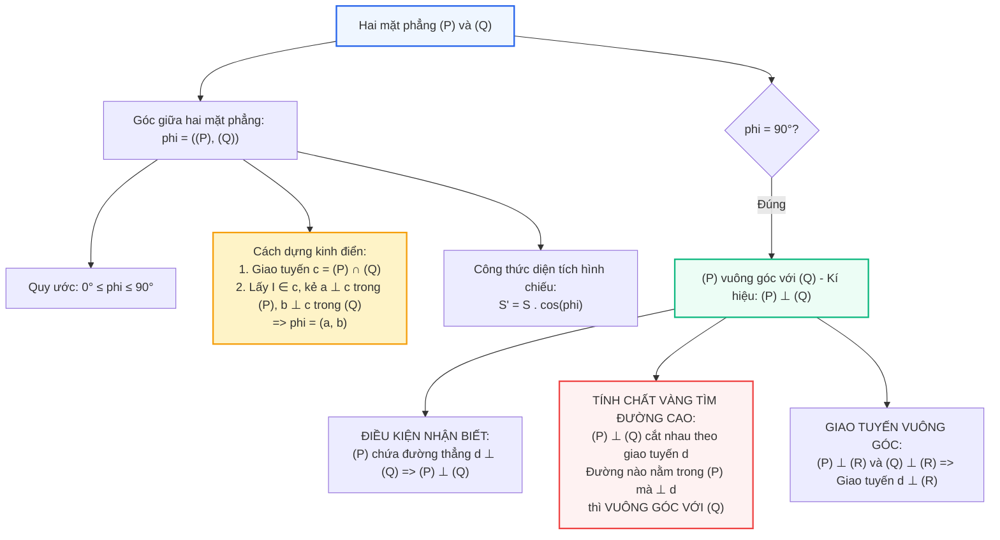

# Toán 11 Bài 25: Hai mặt phẳng vuông góc

Hãy nhìn vào góc tường của căn phòng em đang ngồi: hai bức tường kề nhau hoặc bức tường và sàn nhà luôn tạo thành một góc $90^\circ$ hoàn hảo. Nếu các mặt phẳng này không vuông góc với nhau, trần nhà sẽ bị vẹo và kết cấu tòa nhà sẽ chịu biến dạng nguy hiểm.

Trong chương trình hình học 11, **Hai mặt phẳng vuông góc** là một trong những chủ đề xuất hiện với tần suất dày đặc nhất trong các bài thi. Đặc biệt, định lí về đường cao nằm trong mặt phẳng bên vuông góc với đáy chính là "chìa khóa vàng" giúp giải quyết nhanh gọn hơn 80% các bài toán thể tích và khoảng cách!

---

## Sơ đồ Tư duy: Góc giữa Hai Mặt phẳng & Quan hệ Vuông góc

---

## Khởi động Nhanh: 5 Câu Hỏi Trắc nghiệm Đầu Giờ

<h3 style="margin-top: 0; color: #2563eb;">Khởi động: Nhận diện Nhanh Góc và Tính chất</h3>

  
<strong>Câu 1:</strong> Góc giữa hai mặt phẳng có thể nhận giá trị trong khoảng nào?

  

    <label><input type="radio" name="kd1" value="A"> A. $[0^\circ; 180^\circ]$.</label> 
    <label><input type="radio" name="kd1" value="B"> B. $[0^\circ; 90^\circ]$.</label> 
    <label><input type="radio" name="kd1" value="C"> C. $(0^\circ; 90^\circ)$.</label> 
    <label><input type="radio" name="kd1" value="D"> D. $[0^\circ; 360^\circ]$.</label>
  

  

    ✓ <strong>Đáp án đúng: B</strong>. Tương tự như góc giữa hai đường thẳng, góc giữa hai mặt phẳng luôn là góc không tù: $0^\circ \le ((P), (Q)) \le 90^\circ$. Khi hai mặt phẳng song song hoặc trùng nhau thì góc bằng $0^\circ$.
  

  
<strong>Câu 2:</strong> Điều kiện để mặt phẳng $(P)$ vuông góc với mặt phẳng $(Q)$ là:

  

    <label><input type="radio" name="kd2" value="A"> A. $(P)$ chứa một đường thẳng vuông góc với $(Q)$.</label> 
    <label><input type="radio" name="kd2" value="B"> B. Mọi đường thẳng trong $(P)$ đều vuông góc với $(Q)$.</label> 
    <label><input type="radio" name="kd2" value="C"> C. $(P)$ cắt $(Q)$ theo một góc nhọn.</label> 
    <label><input type="radio" name="kd2" value="D"> D. Có một đường thẳng trong $(P)$ song song với một đường thẳng trong $(Q)$.</label>
  

  

    ✓ <strong>Đáp án đúng: A</strong>. Điều kiện đủ để hai mặt phẳng vuông góc là mặt phẳng này chứa một đường thẳng vuông góc với mặt phẳng kia.
  

  
<strong>Câu 3:</strong> Cho hai mặt phẳng $(P)$ và $(Q)$ vuông góc với nhau và cắt nhau theo giao tuyến $d$. Nếu đường thẳng $a \subset (P)$ và $a \perp d$ thì:

  

    <label><input type="radio" name="kd3" value="A"> A. $a \parallel (Q)$.</label> 
    <label><input type="radio" name="kd3" value="B"> B. $a \perp (Q)$.</label> 
    <label><input type="radio" name="kd3" value="C"> C. $a \subset (Q)$.</label> 
    <label><input type="radio" name="kd3" value="D"> D. $a$ tạo với $(Q)$ góc $45^\circ$.</label>
  

  

    ✓ <strong>Đáp án đúng: B</strong>. Đây là định lí tính chất cốt lõi: một đường thẳng nằm trong một mặt phẳng và vuông góc với giao tuyến thì vuông góc với mặt phẳng còn lại.
  

  
<strong>Câu 4:</strong> Cho đa giác $H$ có diện tích $S$ nằm trong $(P)$ và hình chiếu vuông góc của nó lên $(Q)$ là $H'$ có diện tích $S'$. Gọi $\varphi$ là góc giữa $(P)$ và $(Q)$. Công thức nào sau đây đúng?

  

    <label><input type="radio" name="kd4" value="A"> A. $S = S' \cdot \cos \varphi$.</label> 
    <label><input type="radio" name="kd4" value="B"> B. $S' = S \cdot \cos \varphi$.</label> 
    <label><input type="radio" name="kd4" value="C"> C. $S' = S \cdot \sin \varphi$.</label> 
    <label><input type="radio" name="kd4" value="D"> D. $S' = \dfrac{S}{\cos \varphi}$.</label>
  

  

    ✓ <strong>Đáp án đúng: B</strong>. Công thức diện tích hình chiếu là $S' = S \cdot \cos \varphi$ (vì hình chiếu bị co lại theo phương vuông góc với giao tuyến bởi tỉ số $\cos \varphi \le 1$).
  

  
<strong>Câu 5:</strong> Hình chóp đều là hình chóp có:

  

    <label><input type="radio" name="kd5" value="A"> A. Đáy là đa giác đều và tất cả các cạnh bằng nhau.</label> 
    <label><input type="radio" name="kd5" value="B"> B. Đáy là đa giác đều và chân đường cao trùng với tâm của đáy.</label> 
    <label><input type="radio" name="kd5" value="C"> C. Các mặt bên là tam giác vuông bằng nhau.</label> 
    <label><input type="radio" name="kd5" value="D"> D. Các cạnh bên đôi một vuông góc.</label>
  

  

    ✓ <strong>Đáp án đúng: B</strong>. Định nghĩa hình chóp đều: có đáy là đa giác đều và chân đường cao hạ từ đỉnh trùng với tâm đường tròn ngoại tiếp của đa giác đáy.
  

<button id="btnCheckKD" style="background:#2563eb; color:#fff; border:none; padding:8px 18px; border-radius:6px; font-weight:bold; cursor:pointer;">Kiểm tra đáp án Khởi động</button>

---

## I. Lý thuyết Trọng tâm

### 1. Góc giữa hai mặt phẳng
> **Định nghĩa:** Góc giữa hai mặt phẳng là góc giữa hai đường thẳng lần lượt vuông góc với hai mặt phẳng đó.

#### Cách xác định góc giữa hai mặt phẳng cắt nhau $(P)$ và $(Q)$ (Phương pháp chuẩn 3 bước):
1. **Bước 1 (Tìm giao tuyến):** Xác định giao tuyến $c = (P) \cap (Q)$.
2. **Bước 2 (Dựng hai đường cùng vuông góc giao tuyến):**
   - Lấy một điểm $I \in c$.
   - Trong mặt phẳng $(P)$, kẻ đường thẳng $a \perp c$ tại $I$.
   - Trong mặt phẳng $(Q)$, kẻ đường thẳng $b \perp c$ tại $I$.
3. **Bước 3 (Kết luận góc):**
   $$((P), (Q)) = (a, b) = \varphi \quad (0^\circ \le \varphi \le 90^\circ)$$

---

### 2. Công thức diện tích hình chiếu
> **Định lí:** Cho đa giác $H$ nằm trong mặt phẳng $(P)$ có diện tích $S$. Gọi $H'$ là hình chiếu vuông góc của $H$ lên mặt phẳng $(Q)$ có diện tích $S'$, và $\varphi$ là góc giữa $(P)$ và $(Q)$. Khi đó:
> $$S' = S \cdot \cos \varphi \iff \cos \varphi = \frac{S'}{S}$$

*Ứng dụng:* Thay vì phải dựng hình chiếu và kẻ các đường phụ phức tạp để tìm góc giữa hai mặt phẳng, ta có thể tính diện tích hình gốc $S$ và diện tích hình chiếu phẳng $S'$, sau đó lấy tỉ số $\cos \varphi = \dfrac{S'}{S}$.

---

### 3. Hai mặt phẳng vuông góc

> **Định nghĩa:** Hai mặt phẳng được gọi là vuông góc với nhau nếu góc giữa chúng bằng $90^\circ$. Kí hiệu: $(P) \perp (Q)$.

#### Điều kiện để hai mặt phẳng vuông góc (Định lí nhận biết):
> **Định lí 1:** Nếu một mặt phẳng chứa một đường thẳng vuông góc với một mặt phẳng khác thì hai mặt phẳng đó vuông góc với nhau.
> $$\begin{cases} d \subset (P) \\ d \perp (Q) \end{cases} \implies (P) \perp (Q)$$

#### Các tính chất trọng tâm:
> **Tính chất 1 (Hạ đường cao từ mặt phẳng vuông góc):**
> Nếu hai mặt phẳng $(P)$ và $(Q)$ vuông góc với nhau thì bất kì đường thẳng nào nằm trong $(P)$ mà vuông góc với giao tuyến của chúng thì sẽ vuông góc với $(Q)$.
> $$\begin{cases} (P) \perp (Q) \\ (P) \cap (Q) = d \\ a \subset (P), a \perp d \end{cases} \implies a \perp (Q)$$

> **Tính chất 2 (Giao tuyến của hai mặt phẳng cùng vuông góc):**
> Nếu hai mặt phẳng cắt nhau cùng vuông góc với một mặt phẳng thứ ba thì giao tuyến của chúng cũng vuông góc với mặt phẳng thứ ba đó.
> $$\begin{cases} (P) \perp (R) \\ (Q) \perp (R) \\ (P) \cap (Q) = d \end{cases} \implies d \perp (R)$$

---

### 4. Các khối hình đặc biệt

1. **Hình lăng trụ đứng:** Là hình lăng trụ có các cạnh bên vuông góc với các mặt phẳng đáy.
   - Các mặt bên của lăng trụ đứng là các hình chữ nhật.
   - Các mặt bên luôn vuông góc với mặt phẳng đáy.
2. **Hình lăng trụ đều:** Là hình lăng trụ đứng có đáy là đa giác đều.
3. **Hình hộp chữ nhật & Hình lập phương:**
   - Hình hộp chữ nhật là lăng trụ đứng có đáy là hình chữ nhật (6 mặt là hình chữ nhật).
   - Hình lập phương là hình hộp chữ nhật có tất cả 12 cạnh bằng nhau (6 mặt là hình vuông).
4. **Hình chóp đều:**
   - Đáy là đa giác đều.
   - Chân đường cao trùng với tâm của đáy ($SO \perp (\text{đáy})$ với $O$ là tâm đáy).
   - Các cạnh bên bằng nhau và tạo với đáy các góc bằng nhau.
   - Các mặt bên là các tam giác cân bằng nhau và tạo với đáy các góc bằng nhau.

---

## II. Phòng thí nghiệm 3D Tương tác: Góc giữa Mặt Bên và Mặt Đáy

Khám phá mô hình hình chóp tam giác $S.ABC$ có $SA \perp (ABC)$ đáy tam giác thường.
Giao tuyến giữa mặt bên $(SBC)$ và mặt đáy $(ABC)$ là đường thẳng $BC$. 
- Từ chân đường cao $A$, ta hạ $AH \perp BC$.
- Nối $SH$, theo định lí ba đường vuông góc ta có ngay $SH \perp BC$.
- Góc phẳng nhị diện giữa mặt bên $(SBC)$ và mặt đáy $(ABC)$ chính là góc $\widehat{SHA}$!

  <h3 style="margin-top: 0; color: #2563eb;">PHÒNG THÍ NGHIỆM 3D: DỰNG GÓC GIỮA MẶT BÊN VÀ MẶT ĐÁY</h3>
  

    <em>Kéo rê chuột/ngón tay để xoay quanh khối hình trong không gian 3D.</em>
  

  

    <button id="btnShowAnglePlane" style="padding: 6px 14px; border-radius: 6px; border: 1px solid #2563eb; background: #2563eb; color: #fff; font-weight: bold; cursor: pointer;">Hiện góc nhị diện ∠SHA</button>
    <button id="btnShowCutPlane" style="padding: 6px 14px; border-radius: 6px; border: 1px solid #10b981; background: #ecfdf5; color: #047857; font-weight: bold; cursor: pointer;">Hiện mặt phẳng cắt (SAH) ⊥ BC</button>
    <button id="btnResetDihedral" style="padding: 6px 14px; border-radius: 6px; border: 1px solid #94a3b8; background: #f1f5f9; color: #475569; cursor: pointer;">Đặt lại góc nhìn</button>
  

  

    <svg id="svgDihedral3D" data-interactive-done="true" viewBox="0 0 540 380" style="width: 100%; height: auto; background: #ffffff; border: 1px solid #cbd5e1; border-radius: 12px; box-shadow: 0 4px 6px -1px rgba(0,0,0,0.06); cursor: grab; touch-action: none;">
      <g id="gDihedralFaces"></g>
      <g id="gDihedralCut"></g>
      <g id="gDihedralEdges"></g>
      <g id="gDihedralMarks"></g>
      <g id="gDihedralVertices"></g>
      <g id="gDihedralLabels"></g>
    </svg>
    

      

        <label style="font-weight: bold; color: #334155;">Góc xoay ngang (Yaw): 35°</label>
        <input id="sliderDihedralYaw" type="range" min="-180" max="180" value="35" style="width: 100%; margin-top: 4px;">
      

      

        <label style="font-weight: bold; color: #334155;">Góc nghiêng đứng (Pitch): 25°</label>
        <input id="sliderDihedralPitch" type="range" min="-60" max="60" value="25" style="width: 100%; margin-top: 4px;">
      

    

  

  

    Giao tuyến là $BC$. Kẻ $AH \perp BC$, nối $SH \perp BC \implies$ góc cần tìm là $\widehat{SHA}$!
  

---

## III. Các Dạng Toán Điển Hình và Phương Pháp Giải

### Dạng 1: Xác định và tính góc giữa mặt bên và mặt đáy

**Phương pháp giải:**
Cho hình chóp $S.ABC...$ có đường cao $SA \perp (\text{đáy})$. Cần tính góc giữa mặt bên $(SBC)$ và mặt đáy:
1. Xác định giao tuyến: $(SBC) \cap (\text{đáy}) = BC$.
2. Từ chân đường cao $A$, kẻ $AH \perp BC$ tại $H$.
3. Nối $S$ với $H$, ta có ngay $SH \perp BC$ (theo định lí ba đường vuông góc).
4. Góc cần tìm là $\varphi = \widehat{SHA}$.
5. Tính độ dài $AH$ (đường cao trong tam giác đáy) và tính $\tan \varphi = \dfrac{SA}{AH}$.

---

#### Ví dụ 1:
Cho hình chóp $S.ABCD$ có đáy $ABCD$ là hình vuông cạnh $a$. Cạnh bên $SA \perp (ABCD)$ và $SA = \dfrac{a\sqrt{6}}{3}$. Tính góc giữa mặt phẳng $(SBD)$ và mặt phẳng đáy $(ABCD)$.

**Lời giải chi tiết:**
1. Giao tuyến của mặt phẳng $(SBD)$ và đáy $(ABCD)$ là đường thẳng $BD$.
2. Chân đường cao của hình chóp là đỉnh $A$.
3. Gọi $O$ là tâm hình vuông $ABCD$, ta có $AO \perp BD$ (vì hai đường chéo hình vuông vuông góc).
4. Lại có $SA \perp (ABCD) \implies SA \perp BD$.
   - Do đó $BD \perp (SAO) \implies BD \perp SO$.
5. Hai đường thẳng cùng vuông góc với giao tuyến $BD$ tại $O$ lần lượt là $SO \subset (SBD)$ và $AO \subset (ABCD)$.
6. Vậy góc giữa $(SBD)$ và $(ABCD)$ chính là góc $\widehat{SOA}$.
7. Tính toán:
   - Trong hình vuông cạnh $a$: $AC = a\sqrt{2} \implies AO = \dfrac{a\sqrt{2}}{2}$.
   - Tam giác $SAO$ vuông tại $A$:
     $$\tan \widehat{SOA} = \frac{SA}{AO} = \frac{\frac{a\sqrt{6}}{3}}{\frac{a\sqrt{2}}{2}} = \frac{a\sqrt{6}}{3} \cdot \frac{2}{a\sqrt{2}} = \frac{2\sqrt{3}}{3} = \frac{2}{\sqrt{3}}$$
   - Suy ra góc cần tìm là $\varphi = \arctan\left(\dfrac{2\sqrt{3}}{3}\right) \approx 49^\circ 6'$.

---

### Dạng 2: Chứng minh hai mặt phẳng vuông góc

**Phương pháp giải:**
Muốn chứng minh $(P) \perp (Q)$, cách đơn giản và phổ biến nhất là:
1. Tìm một đường thẳng $d$ nằm trong $(P)$ (hoặc trong $(Q)$).
2. Chứng minh đường thẳng $d$ vuông góc với mặt phẳng còn lại.
3. Kết luận hai mặt phẳng vuông góc.

---

#### Ví dụ 2:
Cho hình chóp $S.ABCD$ có đáy $ABCD$ là hình chữ nhật, $SA \perp (ABCD)$. Chứng minh rằng:
1. $(SAB) \perp (SBC)$.
2. $(SAD) \perp (SCD)$.

**Lời giải chi tiết:**
1. **Chứng minh $(SAB) \perp (SBC)$:**
   - Ta có $BC \perp AB$ (do $ABCD$ là hình chữ nhật).
   - $BC \perp SA$ (vì $SA \perp (ABCD)$).
   - Suy ra $BC \perp (SAB)$.
   - Mặt khác, đường thẳng $BC \subset (SBC)$.
   - Mặt phẳng $(SBC)$ chứa đường thẳng $BC \perp (SAB)$, nên $(SBC) \perp (SAB)$.

2. **Chứng minh $(SAD) \perp (SCD)$:**
   - Hoàn toàn tương tự: $CD \perp AD$ và $CD \perp SA \implies CD \perp (SAD)$.
   - Mà $CD \subset (SCD)$, do đó $(SCD) \perp (SAD)$.

---

### Dạng 3: Tính góc bằng công thức diện tích hình chiếu

---

#### Ví dụ 3:
Cho hình chóp tam giác đều $S.ABC$ có cạnh đáy bằng $a$. Cạnh bên bằng $\dfrac{a\sqrt{21}}{6}$. Tính góc giữa mặt bên và mặt đáy của hình chóp.

**Lời giải chi tiết:**
1. Gọi $H$ là tâm của tam giác đều đáy $ABC$. Vì $S.ABC$ là chóp đều nên $SH \perp (ABC)$.
2. Xét mặt bên $(SBC)$:
   - Hình chiếu vuông góc của đỉnh $S$ lên mặt đáy $(ABC)$ là điểm $H$.
   - Hình chiếu của $B$ và $C$ lên đáy là chính chúng.
   - Do đó, hình chiếu vuông góc của tam giác $SBC$ lên mặt phẳng đáy $(ABC)$ là tam giác $HBC$.
3. Tính diện tích tam giác đáy $ABC$:
   $$S_{\triangle ABC} = \frac{a^2\sqrt{3}}{4}$$
4. Vì $H$ là trọng tâm của tam giác đều $ABC$, diện tích tam giác $HBC$ bằng một phần ba diện tích tam giác $ABC$:
   $$S' = S_{\triangle HBC} = \frac{1}{3} S_{\triangle ABC} = \frac{a^2\sqrt{3}}{12}$$
5. Tính diện tích mặt bên $SBC$:
   - Tam giác $SBC$ cân tại $S$ có $BC = a, SB = SC = \dfrac{a\sqrt{21}}{6}$.
   - Gọi $M$ là trung điểm của $BC \implies BM = \dfrac{a}{2}$.
   - Đường cao $SM = \sqrt{SB^2 - BM^2} = \sqrt{\frac{21a^2}{36} - \frac{a^2}{4}} = \sqrt{\frac{21a^2 - 9a^2}{36}} = \sqrt{\frac{12a^2}{36}} = \frac{a\sqrt{3}}{3}$.
   - Diện tích tam giác $SBC$ là:
     $$S = S_{\triangle SBC} = \frac{1}{2} \cdot BC \cdot SM = \frac{1}{2} \cdot a \cdot \frac{a\sqrt{3}}{3} = \frac{a^2\sqrt{3}}{6}$$
6. Áp dụng công thức diện tích hình chiếu:
   $$\cos \varphi = \frac{S'}{S} = \frac{\frac{a^2\sqrt{3}}{12}}{\frac{a^2\sqrt{3}}{6}} = \frac{1}{2}$$
7. Vì $\cos \varphi = \dfrac{1}{2}$ nên góc giữa mặt bên và mặt đáy bằng $60^\circ$.

---

## IV. Bài tập Trắc nghiệm Tự luyện (Chấm điểm Tức thì)

<h3 style="margin-top: 0; color: #2563eb;">Luyện tập Trắc nghiệm Toàn diện Bài 25</h3>

  
<strong>Câu 1:</strong> Trong các mệnh đề sau, mệnh đề nào <strong>đúng</strong>?

  

    <label><input type="radio" name="tn1" value="A"> A. Hai mặt phẳng phân biệt cùng vuông góc với một mặt phẳng thì vuông góc với nhau.</label> 
    <label><input type="radio" name="tn1" value="B"> B. Hai mặt phẳng phân biệt cùng vuông góc với một mặt phẳng thì song song với nhau.</label> 
    <label><input type="radio" name="tn1" value="C"> C. Hai mặt phẳng cắt nhau cùng vuông góc với mặt phẳng thứ ba thì giao tuyến của chúng vuông góc với mặt phẳng thứ ba đó.</label> 
    <label><input type="radio" name="tn1" value="D"> D. Nếu hai mặt phẳng vuông góc với nhau thì mọi đường thẳng nằm trong mặt phẳng này đều vuông góc với mặt phẳng kia.</label>
  

  

    ✓ <strong>Đáp án đúng: C</strong>. Đây là định lí giao tuyến: hai mặt phẳng cắt nhau cùng vuông góc với mặt phẳng thứ ba thì giao tuyến vuông góc với mặt phẳng đó.
  

  
<strong>Câu 2:</strong> Cho hình chóp $S.ABC$ có đáy $ABC$ là tam giác đều, $(SAB) \perp (ABC)$ và tam giác $SAB$ đều. Gọi $H$ là trung điểm của $AB$. Khẳng định nào sau đây đúng?

  

    <label><input type="radio" name="tn2" value="A"> A. $SH \perp (ABC)$.</label> 
    <label><input type="radio" name="tn2" value="B"> B. $SC \perp (ABC)$.</label> 
    <label><input type="radio" name="tn2" value="C"> C. $SA \perp (ABC)$.</label> 
    <label><input type="radio" name="tn2" value="D"> D. $SB \perp (ABC)$.</label>
  

  

    ✓ <strong>Đáp án đúng: A</strong>. Do $\triangle SAB$ đều nên $SH \perp AB$. Vì $(SAB) \perp (ABC)$ và giao tuyến là $AB$, đường thẳng $SH \subset (SAB)$ vuông góc với giao tuyến nên $SH \perp (ABC)$.
  

  
<strong>Câu 3:</strong> Cho hình lập phương $ABCD.A'B'C'D'$. Góc giữa hai mặt phẳng $(ABCD)$ và $(A'B'C'D')$ bằng:

  

    <label><input type="radio" name="tn3" value="A"> A. $90^\circ$.</label> 
    <label><input type="radio" name="tn3" value="B"> B. $0^\circ$.</label> 
    <label><input type="radio" name="tn3" value="C"> C. $45^\circ$.</label> 
    <label><input type="radio" name="tn3" value="D"> D. $180^\circ$.</label>
  

  

    ✓ <strong>Đáp án đúng: B</strong>. Hai mặt phẳng đối diện của hình lập phương song song với nhau, theo định nghĩa góc giữa hai mặt phẳng song song bằng $0^\circ$.
  

  
<strong>Câu 4:</strong> Cho hình chóp $S.ABCD$ có đáy $ABCD$ là hình vuông cạnh $a$, $SA \perp (ABCD)$ và $SA = a$. Góc giữa mặt phẳng $(SBC)$ và mặt phẳng đáy $(ABCD)$ bằng:

  

    <label><input type="radio" name="tn4" value="A"> A. $30^\circ$.</label> 
    <label><input type="radio" name="tn4" value="B"> B. $45^\circ$.</label> 
    <label><input type="radio" name="tn4" value="C"> C. $60^\circ$.</label> 
    <label><input type="radio" name="tn4" value="D"> D. $90^\circ$.</label>
  

  

    ✓ <strong>Đáp án đúng: B</strong>. Giao tuyến là $BC$. Ta có $AB \perp BC$ và $SB \perp BC$ (định lí ba đường vuông góc) $\implies$ góc là $\widehat{SBA}$. Vì $\triangle SAB$ vuông cân tại $A$ ($SA = AB = a$) nên $\widehat{SBA} = 45^\circ$.
  

  
<strong>Câu 5:</strong> Cho hình lăng trụ đứng $ABC.A'B'C'$. Mặt phẳng $(ABC)$ vuông góc với mặt phẳng nào sau đây?

  

    <label><input type="radio" name="tn5" value="A"> A. Mặt phẳng $(A'B'C')$.</label> 
    <label><input type="radio" name="tn5" value="B"> B. Mặt phẳng $(ABB'A')$.</label> 
    <label><input type="radio" name="tn5" value="C"> C. Mặt phẳng $(A'BC)$.</label> 
    <label><input type="radio" name="tn5" value="D"> D. Mặt phẳng $(AB'C')$.</label>
  

  

    ✓ <strong>Đáp án đúng: B</strong>. Lăng trụ đứng có cạnh bên $AA' \perp (ABC)$. Mặt phẳng $(ABB'A')$ chứa cạnh bên $AA'$ nên $(ABB'A') \perp (ABC)$.
  

  
<strong>Câu 6:</strong> Một tam giác đều $ABC$ cạnh $a$ có hình chiếu vuông góc lên mặt phẳng $(P)$ là tam giác $A'B'C'$ vuông cân tại $A'$ có cạnh huyền bằng $a$. Góc giữa $(ABC)$ và $(P)$ bằng:

  

    <label><input type="radio" name="tn6" value="A"> A. $30^\circ$.</label> 
    <label><input type="radio" name="tn6" value="B"> B. $45^\circ$.</label> 
    <label><input type="radio" name="tn6" value="C"> C. $\arccos\left(\dfrac{1}{\sqrt{3}}\right)$.</label> 
    <label><input type="radio" name="tn6" value="D"> D. $60^\circ$.</label>
  

  

    ✓ <strong>Đáp án đúng: C</strong>. $S_{\triangle ABC} = \dfrac{a^2\sqrt{3}}{4}$. Tam giác $A'B'C'$ vuông cân cạnh huyền $a$ có diện tích $S' = \dfrac{1}{4} a^2$. Khi đó $\cos \varphi = \dfrac{S'}{S} = \dfrac{a^2/4}{a^2\sqrt{3}/4} = \dfrac{1}{\sqrt{3}} \implies \varphi = \arccos\left(\dfrac{1}{\sqrt{3}}\right)$.
  

  
<strong>Câu 7:</strong> Khẳng định nào sau đây là <strong>sai</strong> khi nói về hình chóp tứ giác đều $S.ABCD$?

  

    <label><input type="radio" name="tn7" value="A"> A. Đáy $ABCD$ là hình vuông.</label> 
    <label><input type="radio" name="tn7" value="B"> B. Các mặt bên là các tam giác cân bằng nhau.</label> 
    <label><input type="radio" name="tn7" value="C"> C. Góc giữa các mặt bên với mặt đáy bằng nhau.</label> 
    <label><input type="radio" name="tn7" value="D"> D. Các mặt bên vuông góc với mặt phẳng đáy.</label>
  

  

    ✓ <strong>Đáp án đúng: D</strong>. Các mặt bên của hình chóp đều nghiêng đều trên đáy một góc nhọn $\varphi < 90^\circ$, không bao giờ vuông góc với đáy.
  

  
<strong>Câu 8:</strong> Cho hình lập phương $ABCD.A'B'C'D'$. Mặt phẳng $(ACC'A')$ vuông góc với mặt phẳng nào sau đây?

  

    <label><input type="radio" name="tn8" value="A"> A. $(BDD'B')$.</label> 
    <label><input type="radio" name="tn8" value="B"> B. $(A'B'C'D')$.</label> 
    <label><input type="radio" name="tn8" value="C"> C. Cả A và B đều đúng.</label> 
    <label><input type="radio" name="tn8" value="D"> D. Chỉ duy nhất mặt phẳng $(ABCD)$.</label>
  

  

    ✓ <strong>Đáp án đúng: C</strong>. Vì $AA' \perp (A'B'C'D') \implies (ACC'A') \perp (A'B'C'D')$. Ngoài ra $BD \perp AC$ và $BD \perp AA' \implies BD \perp (ACC'A') \implies (BDD'B') \perp (ACC'A')$. Vậy C đúng.
  

  
<strong>Câu 9:</strong> Cho tứ diện $ABCD$ có $(ABC) \perp (DBC)$. Trong tam giác $DBC$, kẻ đường cao $DH \perp BC$. Khẳng định nào sau đây đúng?

  

    <label><input type="radio" name="tn9" value="A"> A. $DH \perp (ABC)$.</label> 
    <label><input type="radio" name="tn9" value="B"> B. $DH \parallel (ABC)$.</label> 
    <label><input type="radio" name="tn9" value="C"> C. $DH \subset (ABC)$.</label> 
    <label><input type="radio" name="tn9" value="D"> D. Góc giữa $DH$ và $(ABC)$ bằng $45^\circ$.</label>
  

  

    ✓ <strong>Đáp án đúng: A</strong>. Giao tuyến của $(DBC)$ và $(ABC)$ là $BC$. Do hai mặt phẳng vuông góc và $DH \perp BC$ nên $DH \perp (ABC)$.
  

  
<strong>Câu 10:</strong> Cho hình lăng trụ đứng tam giác đều $ABC.A'B'C'$ có tất cả các cạnh bằng $a$. Góc giữa mặt phẳng $(A'BC)$ và mặt phẳng $(ABC)$ có $\tan$ bằng:

  

    <label><input type="radio" name="tn10" value="A"> A. $\dfrac{2\sqrt{3}}{3}$.</label> 
    <label><input type="radio" name="tn10" value="B"> B. $\sqrt{3}$.</label> 
    <label><input type="radio" name="tn10" value="C"> C. $\dfrac{\sqrt{3}}{2}$.</label> 
    <label><input type="radio" name="tn10" value="D"> D. $2$.</label>
  

  

    ✓ <strong>Đáp án đúng: A</strong>. Gọi $M$ là trung điểm $BC \implies AM \perp BC \implies A'M \perp BC$. Góc là $\widehat{A'MA}$. Ta có $AA' = a$, $AM = \dfrac{a\sqrt{3}}{2} \implies \tan \widehat{A'MA} = \dfrac{AA'}{AM} = \dfrac{a}{a\sqrt{3}/2} = \dfrac{2}{\sqrt{3}} = \dfrac{2\sqrt{3}}{3}$.
  

<button id="btnCheckTN" style="background:#2563eb; color:#fff; border:none; padding:8px 18px; border-radius:6px; font-weight:bold; cursor:pointer;">Nộp bài & Xem điểm</button>

---

## V. Ứng dụng Thực tiễn: Kết cấu Mái Dốc Thoát Nước và Chống Bão

Trong kiến trúc truyền thống và hiện đại ở vùng nhiệt đới gió mùa như Việt Nam, góc giữa hai mái nhà dốc (mặt phẳng mái) đóng vai trò quyết định đến độ bền của ngôi nhà.

Nếu góc dốc của mái so với mặt phẳng trần nằm ngang quá nhỏ ($\varphi < 15^\circ$), nước mưa lớn sẽ không thoát kịp, dễ gây thấm dột và đọng rác. Ngược lại, nếu góc dốc quá lớn ($\varphi > 60^\circ$), diện tích hứng gió của mái sẽ tăng vọt, tạo ra lực nâng khí động học cực mạnh có thể bốc tung mái nhà trong các cơn bão mạnh cấp 12. 

Góc mái tiêu chuẩn được các kiến trúc sư tối ưu ở mức **$25^\circ - 35^\circ$**: vừa đủ dốc để thoát nước mưa với tốc độ $2\text{ m/s}$, vừa hạn chế tối đa tiết diện cản gió!
