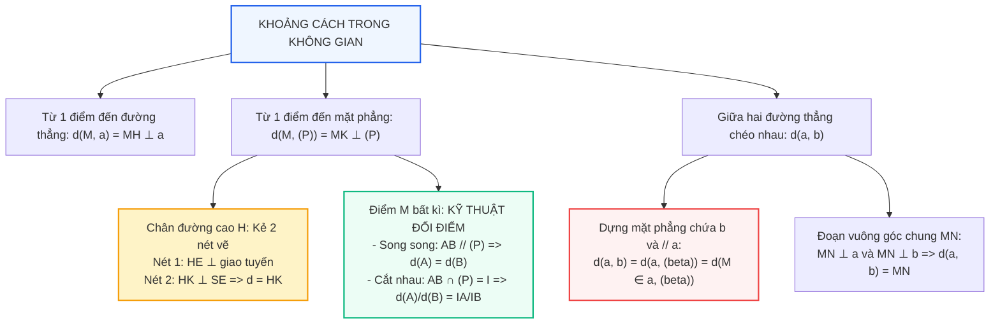

# Toán 11 Bài 26: Khoảng cách trong không gian

Nếu được hỏi chủ đề nào xuất hiện nhiều nhất và thường khiến học sinh "toát mồ hôi" nhất trong các kì thi THPT, câu trả lời chắc chắn là **Khoảng cách trong không gian**.

Khoảng cách thực chất là **độ dài của đoạn vuông góc ngắn nhất**. Bí quyết để biến một bài toán khoảng cách từ "cực khó" thành "cực dễ" gói gọn trong hai tuyệt chiêu: **Phương pháp 2 nét vẽ kẻ từ chân đường vuông góc** và **Kĩ thuật đổi điểm (dời điểm)**. Cùng khám phá mô hình 3D động và các phương pháp giải tối ưu ngay sau đây!

---

## Sơ đồ Tư duy: Hệ thống Khoảng cách trong Không gian

---

## Khởi động Nhanh: 5 Câu Hỏi Trắc nghiệm Đầu Giờ

<h3 style="margin-top: 0; color: #2563eb;">Khởi động: Nhận diện Bản chất Khoảng cách</h3>

  
<strong>Câu 1:</strong> Khoảng cách từ điểm $M$ đến mặt phẳng $(P)$ là:

  

    <label><input type="radio" name="kd1" value="A"> A. Độ dài đoạn nối $M$ với một điểm bất kì thuộc $(P)$.</label> 
    <label><input type="radio" name="kd1" value="B"> B. Độ dài đoạn thẳng $MH$, với $H$ là hình chiếu vuông góc của $M$ lên $(P)$.</label> 
    <label><input type="radio" name="kd1" value="C"> C. Khoảng cách lớn nhất từ $M$ đến một điểm thuộc $(P)$.</label> 
    <label><input type="radio" name="kd1" value="D"> D. Bán kính mặt cầu đi qua $M$ và tiếp xúc với $(P)$.</label>
  

  

    ✓ <strong>Đáp án đúng: B</strong>. Theo định nghĩa, khoảng cách từ $M$ đến $(P)$ là độ dài đoạn vuông góc $MH$ hạ từ $M$ xuống $(P)$.
  

  
<strong>Câu 2:</strong> Cho đường thẳng $AB$ song song với mặt phẳng $(P)$. Tỉ số khoảng cách $\dfrac{d(A, (P))}{d(B, (P))}$ bằng:

  

    <label><input type="radio" name="kd2" value="A"> A. $1$.</label> 
    <label><input type="radio" name="kd2" value="B"> B. $2$.</label> 
    <label><input type="radio" name="kd2" value="C"> C. $\dfrac{1}{2}$.</label> 
    <label><input type="radio" name="kd2" value="D"> D. Tùy thuộc vào độ dài đoạn $AB$.</label>
  

  

    ✓ <strong>Đáp án đúng: A</strong>. Khi đường thẳng song song với mặt phẳng thì mọi điểm trên đường thẳng đều cách đều mặt phẳng, do đó tỉ số bằng 1.
  

  
<strong>Câu 3:</strong> Cho đường thẳng $AB$ cắt mặt phẳng $(P)$ tại điểm $I$, sao cho $IA = 2IB$ ($I$ không nằm giữa $A$ và $B$). Khi đó:

  

    <label><input type="radio" name="kd3" value="A"> A. $d(A, (P)) = d(B, (P))$.</label> 
    <label><input type="radio" name="kd3" value="B"> B. $d(A, (P)) = 2 d(B, (P))$.</label> 
    <label><input type="radio" name="kd3" value="C"> C. $d(A, (P)) = \dfrac{1}{2} d(B, (P))$.</label> 
    <label><input type="radio" name="kd3" value="D"> D. $d(A, (P)) = 4 d(B, (P))$.</label>
  

  

    ✓ <strong>Đáp án đúng: B</strong>. Theo định lí Ta-lét trong không gian: $\dfrac{d(A, (P))}{d(B, (P))} = \dfrac{IA}{IB} = 2 \implies d(A, (P)) = 2d(B, (P))$.
  

  
<strong>Câu 4:</strong> Cho tứ diện $OABC$ có $OA, OB, OC$ đôi một vuông góc tại $O$. Độ dài đoạn vuông góc $OH$ kẻ từ $O$ đến mặt phẳng $(ABC)$ thỏa mãn hệ thức:

  

    <label><input type="radio" name="kd4" value="A"> A. $\dfrac{1}{OH^2} = \dfrac{1}{OA^2} + \dfrac{1}{OB^2} + \dfrac{1}{OC^2}$.</label> 
    <label><input type="radio" name="kd4" value="B"> B. $OH = OA + OB + OC$.</label> 
    <label><input type="radio" name="kd4" value="C"> C. $OH^2 = OA^2 + OB^2 + OC^2$.</label> 
    <label><input type="radio" name="kd4" value="D"> D. $\dfrac{1}{OH} = \dfrac{1}{OA} + \dfrac{1}{OB} + \dfrac{1}{OC}$.</label>
  

  

    ✓ <strong>Đáp án đúng: A</strong>. Đây là hệ thức lượng kinh điển trong tứ diện vuông tại $O$: $\dfrac{1}{OH^2} = \dfrac{1}{OA^2} + \dfrac{1}{OB^2} + \dfrac{1}{OC^2}$.
  

  
<strong>Câu 5:</strong> Khoảng cách giữa hai đường thẳng chéo nhau $a$ và $b$ bằng:

  

    <label><input type="radio" name="kd5" value="A"> A. Khoảng cách giữa hai điểm bất kì trên $a$ và $b$.</label> 
    <label><input type="radio" name="kd5" value="B"> B. Độ dài đoạn vuông góc chung của $a$ và $b$.</label> 
    <label><input type="radio" name="kd5" value="C"> C. Khoảng cách giữa hình chiếu của $a$ và $b$ lên mặt đất.</label> 
    <label><input type="radio" name="kd5" value="D"> D. Nửa tổng độ dài của hai đoạn thẳng $a$ và $b$.</label>
  

  

    ✓ <strong>Đáp án đúng: B</strong>. Đoạn vuông góc chung có hai đầu mút nằm trên hai đường thẳng và vuông góc với cả hai đường; độ dài đoạn này chính là khoảng cách giữa hai đường chéo nhau.
  

<button id="btnCheckKD" style="background:#2563eb; color:#fff; border:none; padding:8px 18px; border-radius:6px; font-weight:bold; cursor:pointer;">Kiểm tra đáp án Khởi động</button>

---

## I. Lý thuyết Trọng tâm

### 1. Khoảng cách từ một điểm đến đường thẳng và mặt phẳng
- **Khoảng cách từ điểm $M$ đến đường thẳng $\Delta$:** Là độ dài đoạn thẳng $MH$, với $H$ là hình chiếu vuông góc của $M$ lên $\Delta$. Kí hiệu: $d(M, \Delta) = MH$.
- **Khoảng cách từ điểm $M$ đến mặt phẳng $(P)$:** Là độ dài đoạn thẳng $MK$, với $K$ là hình chiếu vuông góc của $M$ lên $(P)$. Kí hiệu: $d(M, (P)) = MK$.

> **Tính chất:** $MK \le MA$ với mọi điểm $A \in (P)$. Dấu bằng xảy ra khi và chỉ khi $A \equiv K$. (Hình chiếu vuông góc luôn là đoạn thẳng ngắn nhất).

---

### 2. Kỹ thuật "2 Nét Vẽ Vàng" tính khoảng cách từ chân đường cao

Khi tính khoảng cách từ chân đường cao $A$ ($SA \perp (\text{đáy})$) đến một mặt phẳng bên $(SBC)$ có giao tuyến $BC$ với đáy:
- **Nét 1:** Từ $A$, kẻ $AH \perp BC$ tại $H$ ($H \in BC$).
- **Nét 2:** Nối $SH$. Từ $A$, kẻ $AK \perp SH$ tại $K$ ($K \in SH$).

> **Chứng minh:** 
> Ta có $BC \perp AH$ và $BC \perp SA \implies BC \perp (SAH) \implies BC \perp AK$.
> Lại có $AK \perp SH$. Do đó $AK \perp (SBC)$.
> Vậy **$d(A, (SBC)) = AK$**!
> 
> Công thức tính nhanh độ dài $AK$:
> $$\frac{1}{AK^2} = \frac{1}{SA^2} + \frac{1}{AH^2} \implies AK = \frac{SA \cdot AH}{\sqrt{SA^2 + AH^2}}$$

---

### 3. Kỹ thuật Đổi Điểm (Dời điểm về Chân đường cao)

Trong thực tế thi cử, điểm cần tính khoảng cách thường là điểm bất kì $M$ chứ không phải chân đường cao $A$. Ta dùng 2 quy tắc đổi điểm sau:

#### Trường hợp 1: Đường thẳng nối hai điểm song song với mặt phẳng
Nếu $MN \parallel (P)$ thì:
$$d(M, (P)) = d(N, (P))$$

#### Trường hợp 2: Đường thẳng nối hai điểm cắt mặt phẳng
Nếu đường thẳng $MN$ cắt mặt phẳng $(P)$ tại điểm $I$ thì:
$$\frac{d(M, (P))}{d(N, (P))} = \frac{IM}{IN}$$
*(Khoảng cách tỉ lệ thuận với độ dài từ điểm đến giao điểm).*

---

### 4. Khoảng cách giữa các đối tượng song song
- **Giữa hai đường thẳng song song $a$ và $b$:** $d(a, b) = d(M, b)$ với $M$ là một điểm bất kì trên $a$.
- **Giữa đường thẳng $a$ và mặt phẳng $(P)$ song song với nhau:** $d(a, (P)) = d(M, (P))$ với $M \in a$.
- **Giữa hai mặt phẳng song song $(P)$ và $(Q)$:** $d((P), (Q)) = d(M, (Q))$ với $M \in (P)$.

---

### 5. Khoảng cách giữa hai đường thẳng chéo nhau

Cho hai đường thẳng chéo nhau $a$ và $b$:
> **Đoạn vuông góc chung:** Là đoạn thẳng $MN$ có hai đầu mút $M \in a, N \in b$ và $MN \perp a, MN \perp b$.
> Độ dài $MN$ chính là khoảng cách giữa $a$ và $b$: $d(a, b) = MN$.

#### Phương pháp đưa về khoảng cách từ điểm đến mặt phẳng (Phổ biến nhất):
1. Dựng mặt phẳng $(P)$ chứa đường thẳng $b$ và song song với đường thẳng $a$.
2. Khi đó:
   $$d(a, b) = d(a, (P)) = d(M, (P)) \quad (\text{với } M \text{ là điểm thuận lợi trên } a)$$

---

## II. Phòng thí nghiệm 3D Tương tác: 2 Nét Vẽ & Đoạn Vuông Góc $AK$

Quan sát khối chóp $S.ABC$ có $SA \perp (ABC)$. Bài toán yêu cầu tính khoảng cách từ chân đường cao $A$ đến mặt bên $(SBC)$.
- Nhấp nút **"Nét 1"** để kẻ $AH \perp BC$.
- Nhấp nút **"Nét 2"** để kẻ $AK \perp SH$.
- Hãy xoay 3D để thấy rõ $AK$ vuông góc với toàn bộ mặt phẳng $(SBC)$!

  <h3 style="margin-top: 0; color: #2563eb;">PHÒNG THÍ NGHIỆM 3D: QUY TẮC 2 NÉT VẼ TÌM ĐOẠN VUÔNG GÓC AK</h3>
  

    <em>Rê chuột/vuốt màn hình để xoay quanh khối hình 3D.</em>
  

  

    <button id="btnStep1" style="padding: 6px 14px; border-radius: 6px; border: 1px solid #2563eb; background: #2563eb; color: #fff; font-weight: bold; cursor: pointer;">Nét 1: AH ⊥ BC</button>
    <button id="btnStep2" style="padding: 6px 14px; border-radius: 6px; border: 1px solid #10b981; background: #ecfdf5; color: #047857; font-weight: bold; cursor: pointer;">Nét 2: AK ⊥ SH (Khoảng cách d)</button>
    <button id="btnResetDist3D" style="padding: 6px 14px; border-radius: 6px; border: 1px solid #94a3b8; background: #f1f5f9; color: #475569; cursor: pointer;">Đặt lại góc nhìn</button>
  

  

    <svg id="svgDist3D" data-interactive-done="true" viewBox="0 0 540 380" style="width: 100%; height: auto; background: #ffffff; border: 1px solid #cbd5e1; border-radius: 12px; box-shadow: 0 4px 6px -1px rgba(0,0,0,0.06); cursor: grab; touch-action: none;">
      <g id="gDistFaces"></g>
      <g id="gDistEdges"></g>
      <g id="gDistSteps"></g>
      <g id="gDistVertices"></g>
      <g id="gDistLabels"></g>
    </svg>
    

      

        <label style="font-weight: bold; color: #334155;">Góc xoay ngang (Yaw): 38°</label>
        <input id="sliderDistYaw" type="range" min="-180" max="180" value="38" style="width: 100%; margin-top: 4px;">
      

      

        <label style="font-weight: bold; color: #334155;">Góc nghiêng đứng (Pitch): 20°</label>
        <input id="sliderDistPitch" type="range" min="-60" max="60" value="20" style="width: 100%; margin-top: 4px;">
      

    

  

  

    Nét 1: Từ chân đường cao $A$, kẻ $AH \perp BC$ (giao tuyến với mặt đáy).
  

---

## III. Các Dạng Toán Điển Hình và Tuyệt Chiêu Giải Nhanh

### Dạng 1: Khoảng cách từ chân đường vuông góc đến mặt phẳng bên

---

#### Ví dụ 1:
Cho hình chóp $S.ABCD$ có đáy $ABCD$ là hình vuông cạnh $a$. Cạnh bên $SA \perp (ABCD)$ và $SA = a\sqrt{2}$. Tính khoảng cách từ điểm $A$ đến mặt phẳng $(SBD)$.

**Lời giải chi tiết:**
1. **Tìm giao tuyến:** Mặt phẳng $(SBD)$ cắt mặt phẳng đáy $(ABCD)$ theo giao tuyến $BD$.
2. **Nét 1:** Từ chân đường vuông góc $A$, hạ vuông góc xuống giao tuyến $BD$:
   - Do $ABCD$ là hình vuông tâm $O$ nên $AC \perp BD$ tại $O$.
   - Do đó $AO \perp BD$ (chính là nét 1, với $H \equiv O$).
3. **Nét 2:** Nối $SO$. Trong tam giác vuông $SAO$ (vuông tại $A$), kẻ $AK \perp SO$ tại $K$.
4. **Chứng minh $AK \perp (SBD)$:**
   - Ta có $BD \perp AO$ và $BD \perp SA \implies BD \perp (SAO) \implies BD \perp AK$.
   - Mặt khác $AK \perp SO$.
   - Vậy $AK \perp (SBD) \implies d(A, (SBD)) = AK$.
5. **Tính độ dài $AK$:**
   - Vì $ABCD$ là hình vuông cạnh $a$ nên $AC = a\sqrt{2} \implies AO = \dfrac{a\sqrt{2}}{2}$.
   - Áp dụng hệ thức lượng trong tam giác vuông $SAO$:
     $$\frac{1}{AK^2} = \frac{1}{SA^2} + \frac{1}{AO^2} = \frac{1}{(a\sqrt{2})^2} + \frac{1}{\left(\frac{a\sqrt{2}}{2}\right)^2} = \frac{1}{2a^2} + \frac{2}{a^2} = \frac{5}{2a^2}$$
     $$\implies AK = \sqrt{\frac{2a^2}{5}} = \frac{a\sqrt{10}}{5}$$
6. Vậy khoảng cách cần tìm là $d(A, (SBD)) = \dfrac{a\sqrt{10}}{5}$.

---

### Dạng 2: Khoảng cách từ một điểm bất kì (Kỹ thuật đổi điểm)

---

#### Ví dụ 2:
Cho hình chóp $S.ABC$ có đáy $ABC$ là tam giác vuông tại $B$, $AB = a, BC = a\sqrt{3}$. Cạnh bên $SA \perp (ABC)$ và $SA = 2a$. Gọi $M$ là trung điểm của cạnh $AC$. Tính khoảng cách từ điểm $M$ đến mặt phẳng $(SBC)$.

**Lời giải chi tiết:**
1. **Bước 1: Tính khoảng cách từ chân đường cao $A$ đến $(SBC)$:**
   - Ta có $BC \perp AB$ và $BC \perp SA \implies BC \perp (SAB)$.
   - Do đó $(SBC) \perp (SAB)$ theo giao tuyến $SB$.
   - Trong tam giác vuông $SAB$, kẻ $AH \perp SB$ tại $H$.
   - Khi đó $AH \perp (SBC) \implies d(A, (SBC)) = AH$.
   - Tính $AH$:
     $$\frac{1}{AH^2} = \frac{1}{SA^2} + \frac{1}{AB^2} = \frac{1}{(2a)^2} + \frac{1}{a^2} = \frac{1}{4a^2} + \frac{1}{a^2} = \frac{5}{4a^2} \implies AH = \frac{2a}{\sqrt{5}} = \frac{2a\sqrt{5}}{5}$$

2. **Bước 2: Dùng kĩ thuật đổi điểm từ $M$ về $A$:**
   - Nối $M$ với $A$, đường thẳng $MA$ chính là đường thẳng $AC$.
   - Đường thẳng $AC$ cắt mặt phẳng $(SBC)$ tại điểm $C$.
   - Tỉ số khoảng cách:
     $$\frac{d(M, (SBC))}{d(A, (SBC))} = \frac{MC}{AC}$$
   - Vì $M$ là trung điểm của $AC$ nên $\dfrac{MC}{AC} = \dfrac{1}{2}$.
   - Do đó:
     $$d(M, (SBC)) = \frac{1}{2} d(A, (SBC)) = \frac{1}{2} \cdot \frac{2a\sqrt{5}}{5} = \frac{a\sqrt{5}}{5} .$$

---

### Dạng 3: Khoảng cách giữa hai đường thẳng chéo nhau

---

#### Ví dụ 3:
Cho hình chóp $S.ABCD$ có đáy $ABCD$ là hình vuông cạnh $a$, $SA \perp (ABCD)$ và $SA = a$. Tính khoảng cách giữa hai đường thẳng chéo nhau $SC$ và $BD$.

**Lời giải chi tiết:**
1. **Dựng mặt phẳng chứa $BD$ và song song với $SC$:**
   - Gọi $O$ là tâm hình vuông $ABCD$. Trong $\triangle SAC$, gọi $O$ là trung điểm $AC$.
   - Lấy $I$ là trung điểm của $SA$. Khi đó $OI$ là đường trung bình của $\triangle SAC \implies OI \parallel SC$.
   - Mặt phẳng $(IBD)$ chứa $BD$ và $OI \parallel SC$, do đó $SC \parallel (IBD)$.
2. **Chuyển khoảng cách hai đường về khoảng cách từ điểm đến mặt phẳng:**
   $$d(SC, BD) = d(SC, (IBD)) = d(C, (IBD))$$
3. **Đổi điểm từ $C$ về $A$:**
   - Đường thẳng $CA$ cắt mặt phẳng $(IBD)$ tại tâm $O$.
   - Vì $O$ là trung điểm của $AC$ nên $d(C, (IBD)) = d(A, (IBD))$.
4. **Tính $d(A, (IBD))$:**
   - Tứ diện $A.IBD$ có $AB, AD, AI$ đôi một vuông góc tại $A$!
   - Thật vậy: $AB \perp AD$, $AI \perp AB$ và $AI \perp AD$ (do $I \in SA \perp (ABCD)$).
   - Độ dài: $AB = AD = a$, $AI = \dfrac{SA}{2} = \dfrac{a}{2}$.
   - Áp dụng hệ thức lượng tứ diện vuông cho đường cao $h = d(A, (IBD))$:
     $$\frac{1}{h^2} = \frac{1}{AI^2} + \frac{1}{AB^2} + \frac{1}{AD^2} = \frac{1}{\left(\frac{a}{2}\right)^2} + \frac{1}{a^2} + \frac{1}{a^2} = \frac{4}{a^2} + \frac{1}{a^2} + \frac{1}{a^2} = \frac{6}{a^2}$$
     $$\implies h = \frac{a}{\sqrt{6}} = \frac{a\sqrt{6}}{6}$$
5. Vậy khoảng cách giữa $SC$ và $BD$ bằng $\dfrac{a\sqrt{6}}{6}$.

---

## IV. Bài tập Trắc nghiệm Tự luyện (Chấm điểm Tức thì)

<h3 style="margin-top: 0; color: #2563eb;">Luyện tập Trắc nghiệm Toàn diện Bài 26</h3>

  
<strong>Câu 1:</strong> Cho hình lập phương $ABCD.A'B'C'D'$ cạnh $a$. Khoảng cách từ điểm $A$ đến mặt phẳng $(A'B'C'D')$ bằng:

  

    <label><input type="radio" name="tn1" value="A"> A. $a\sqrt{2}$.</label> 
    <label><input type="radio" name="tn1" value="B"> B. $a$.</label> 
    <label><input type="radio" name="tn1" value="C"> C. $a\sqrt{3}$.</label> 
    <label><input type="radio" name="tn1" value="D"> D. $\dfrac{a}{2}$.</label>
  

  

    ✓ <strong>Đáp án đúng: B</strong>. Vì $AA' \perp (A'B'C'D')$ nên $d(A, (A'B'C'D')) = AA' = a$.
  

  
<strong>Câu 2:</strong> Cho hình chóp $S.ABC$ có $SA \perp (ABC)$, đáy $ABC$ vuông tại $B$. Cạnh $SA = a, AB = a$. Khoảng cách từ $A$ đến mặt phẳng $(SBC)$ bằng:

  

    <label><input type="radio" name="tn2" value="A"> A. $\dfrac{a\sqrt{2}}{2}$.</label> 
    <label><input type="radio" name="tn2" value="B"> B. $a\sqrt{2}$.</label> 
    <label><input type="radio" name="tn2" value="C"> C. $a$.</label> 
    <label><input type="radio" name="tn2" value="D"> D. $\dfrac{a}{2}$.</label>
  

  

    ✓ <strong>Đáp án đúng: A</strong>. Vì $BC \perp (SAB)$ nên kẻ $AH \perp SB \implies AH \perp (SBC)$. Tam giác $SAB$ vuông cân tại $A$ cạnh $a \implies AH = \dfrac{a\sqrt{2}}{2}$.
  

  
<strong>Câu 3:</strong> Cho hình lập phương $ABCD.A'B'C'D'$ cạnh $a$. Khoảng cách giữa hai mặt phẳng $(ABCD)$ và $(A'B'C'D')$ bằng:

  

    <label><input type="radio" name="tn3" value="A"> A. $a$.</label> 
    <label><input type="radio" name="tn3" value="B"> B. $a\sqrt{2}$.</label> 
    <label><input type="radio" name="tn3" value="C"> C. $a\sqrt{3}$.</label> 
    <label><input type="radio" name="tn3" value="D"> D. $2a$.</label>
  

  

    ✓ <strong>Đáp án đúng: A</strong>. Đoạn vuông góc chung nối hai đáy chính là cạnh bên $AA' = a$.
  

  
<strong>Câu 4:</strong> Cho hình chóp $S.ABCD$ có đáy $ABCD$ là hình vuông cạnh $a$, $SA \perp (ABCD)$. Gọi $M$ là trung điểm của $CD$. Khoảng cách từ $M$ đến mặt phẳng $(SAB)$ bằng:

  

    <label><input type="radio" name="tn4" value="A"> A. $a$.</label> 
    <label><input type="radio" name="tn4" value="B"> B. $\dfrac{a}{2}$.</label> 
    <label><input type="radio" name="tn4" value="C"> C. $a\sqrt{2}$.</label> 
    <label><input type="radio" name="tn4" value="D"> D. $\dfrac{a\sqrt{2}}{2}$.</label>
  

  

    ✓ <strong>Đáp án đúng: A</strong>. Vì $CD \parallel AB \subset (SAB) \implies CD \parallel (SAB)$. Do đó $d(M, (SAB)) = d(D, (SAB)) = DA = a$.
  

  
<strong>Câu 5:</strong> Cho hình chóp $S.ABC$ có $SA \perp (ABC)$, tam giác $ABC$ đều cạnh $a$, $SA = a$. Khoảng cách từ $A$ đến đường thẳng $BC$ bằng:

  

    <label><input type="radio" name="tn5" value="A"> A. $\dfrac{a\sqrt{3}}{2}$.</label> 
    <label><input type="radio" name="tn5" value="B"> B. $\dfrac{a}{2}$.</label> 
    <label><input type="radio" name="tn5" value="C"> C. $a$.</label> 
    <label><input type="radio" name="tn5" value="D"> D. $a\sqrt{3}$.</label>
  

  

    ✓ <strong>Đáp án đúng: A</strong>. Vì $A, B, C$ cùng nằm trong mặt phẳng $(ABC)$, khoảng cách từ $A$ đến $BC$ chính là độ dài đường cao trong tam giác đều cạnh $a$, bằng $\dfrac{a\sqrt{3}}{2}$.
  

  
<strong>Câu 6:</strong> Cho tam giác $ABC$ có diện tích bằng $S$ và nằm trong mặt phẳng $(P)$. Điểm $S$ không thuộc $(P)$ có khoảng cách đến $(P)$ là $h$. Thể tích khối chóp $S.ABC$ tính theo $S$ và $h$ là:

  

    <label><input type="radio" name="tn6" value="A"> A. $V = S \cdot h$.</label> 
    <label><input type="radio" name="tn6" value="B"> B. $V = \dfrac{1}{3} S \cdot h$.</label> 
    <label><input type="radio" name="tn6" value="C"> C. $V = \dfrac{1}{2} S \cdot h$.</label> 
    <label><input type="radio" name="tn6" value="D"> D. $V = \dfrac{1}{6} S \cdot h$.</label>
  

  

    ✓ <strong>Đáp án đúng: B</strong>. Thể tích hình chóp bằng một phần ba diện tích đáy nhân chiều cao (chiều cao chính là khoảng cách từ đỉnh đến đáy).
  

  
<strong>Câu 7:</strong> Cho hình hộp chữ nhật $ABCD.A'B'C'D'$ có $AB = 3, AD = 4, AA' = 5$. Khoảng cách giữa hai đường thẳng $AB$ và $C'D'$ bằng:

  

    <label><input type="radio" name="tn7" value="A"> A. $5$.</label> 
    <label><input type="radio" name="tn7" value="B"> B. $\sqrt{41}$.</label> 
    <label><input type="radio" name="tn7" value="C"> C. $4$.</label> 
    <label><input type="radio" name="tn7" value="D"> D. $3$.</label>
  

  

    ✓ <strong>Đáp án đúng: B</strong>. Vì $AB \parallel CD \parallel C'D'$, ta xét mặt phẳng $(ABC'D')$ chứa cả $AB$ và $C'D'$. Khoảng cách giữa hai đường thẳng song song này bằng độ dài $AD' = \sqrt{AD^2 + DD'^2} = \sqrt{4^2 + 5^2} = \sqrt{41}$.
  

  
<strong>Câu 8:</strong> Cho hình lập phương $ABCD.A'B'C'D'$ cạnh $a$. Khoảng cách giữa hai đường thẳng $AA'$ và $BD$ bằng:

  

    <label><input type="radio" name="tn8" value="A"> A. $a$.</label> 
    <label><input type="radio" name="tn8" value="B"> B. $\dfrac{a\sqrt{2}}{2}$.</label> 
    <label><input type="radio" name="tn8" value="C"> C. $a\sqrt{2}$.</label> 
    <label><input type="radio" name="tn8" value="D"> D. $\dfrac{a}{2}$.</label>
  

  

    ✓ <strong>Đáp án đúng: B</strong>. Ta có $AA' \perp (ABCD)$. Kẻ từ tâm $O$ của hình vuông $ABCD$: $AO \perp BD$ và $AO \subset (ABCD) \implies AO \perp AA'$. Vậy $AO$ chính là đoạn vuông góc chung, có độ dài bằng $\dfrac{a\sqrt{2}}{2}$.
  

  
<strong>Câu 9:</strong> Cho tứ diện đều $ABCD$ cạnh $a$. Khoảng cách giữa hai cạnh đối diện bất kì (ví dụ $AB$ và $CD$) bằng:

  

    <label><input type="radio" name="tn9" value="A"> A. $\dfrac{a\sqrt{2}}{2}$.</label> 
    <label><input type="radio" name="tn9" value="B"> B. $\dfrac{a\sqrt{3}}{2}$.</label> 
    <label><input type="radio" name="tn9" value="C"> C. $\dfrac{a\sqrt{6}}{3}$.</label> 
    <label><input type="radio" name="tn9" value="D"> D. $\dfrac{a}{2}$.</label>
  

  

    ✓ <strong>Đáp án đúng: A</strong>. Gọi $M, N$ lần lượt là trung điểm của $AB$ và $CD$. Đoạn $MN$ là đoạn vuông góc chung. Ta có $AN = \dfrac{a\sqrt{3}}{2}, AM = \dfrac{a}{2} \implies MN = \sqrt{AN^2 - AM^2} = \sqrt{\frac{3a^2}{4} - \frac{a^2}{4}} = \frac{a\sqrt{2}}{2}$.
  

  
<strong>Câu 10:</strong> Cho điểm $M$ cách mặt phẳng $(P)$ một khoảng bằng $4$. Điểm $A \in (P)$. Độ dài đoạn thẳng $MA$ không thể nhận giá trị nào sau đây?

  

    <label><input type="radio" name="tn10" value="A"> A. $3$.</label> 
    <label><input type="radio" name="tn10" value="B"> B. $4$.</label> 
    <label><input type="radio" name="tn10" value="C"> C. $5$.</label> 
    <label><input type="radio" name="tn10" value="D"> D. $10$.</label>
  

  

    ✓ <strong>Đáp án đúng: A</strong>. Khoảng cách là độ dài đoạn vuông góc ngắn nhất ($MA \ge d(M, (P)) = 4$), do đó $MA$ không thể bằng 3.
  

<button id="btnCheckTN" style="background:#2563eb; color:#fff; border:none; padding:8px 18px; border-radius:6px; font-weight:bold; cursor:pointer;">Nộp bài & Xem điểm</button>

---

## V. Ứng dụng Thực tiễn: Hành lang An toàn Lưới điện Cao thế 500kV

Trong ngành điện lực, đường dây tải điện 500kV Bắc - Nam chạy qua nhiều đồi núi hiểm trở và khu dân cư. Hiện tượng phóng điện đánh thủng không khí có thể xảy ra ngay cả khi không chạm trực tiếp vào dây điện nếu khoảng cách nhỏ hơn ngưỡng an toàn.

Nghị định quy định nghiêm ngặt: khoảng cách tối thiểu từ điểm võng thấp nhất của dây dẫn cao thế đến mặt đất hoặc ngọn cây cao nhất trong hành lang an toàn không được nhỏ hơn $6\text{ m}$ (đối với cấp điện áp 500kV). Các kỹ sư truyền tải điện sử dụng máy bay không người lái (drone) trang bị cảm biến LiDAR 3D để quét đám mây điểm (Point Cloud), liên tục đo khoảng cách từ đường dây cong trên không đến các vật cản bên dưới nhằm kịp thời chặt tỉa cây cối và phòng ngừa sự cố chập điện.
