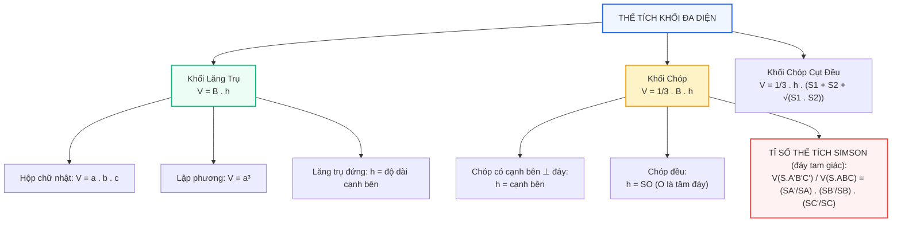

# Toán 11 Bài 27: Thể tích của một số khối đa diện

Từ thời cổ đại, khi người Ai Cập xây dựng Đại Kim tự tháp Giza với hơn 2,3 triệu khối đá vôi, nhu cầu đo lường lượng không gian chiếm chỗ của một vật thể đã khai sinh ra khái niệm **Thể tích**. 

Trong kỹ thuật xây dựng ngày nay, việc tính toán chính xác thể tích bê tông tươi cần đổ cho móng cọc, thể tích đất cần đào đắp cho hầm đường bộ, hay dung tích của các bể chứa dầu hình khối chữ nhật là nhiệm vụ thiết yếu của mọi kỹ sư. Trong bài học này, chúng ta sẽ làm chủ hệ thống công thức thể tích của các khối đa diện kinh điển!

---

## Sơ đồ Tư duy: Bản đồ Công thức Thể tích Khối Đa diện

---

## Khởi động Nhanh: 5 Câu Hỏi Trắc nghiệm Đầu Giờ

<h3 style="margin-top: 0; color: #2563eb;">Khởi động: Kiểm tra Nhớ nhanh Công thức</h3>

  
<strong>Câu 1:</strong> Khối chóp có diện tích đáy bằng $B$ và chiều cao bằng $h$ có thể tích là:

  

    <label><input type="radio" name="kd1" value="A"> A. $V = B \cdot h$.</label> 
    <label><input type="radio" name="kd1" value="B"> B. $V = \dfrac{1}{3} B \cdot h$.</label> 
    <label><input type="radio" name="kd1" value="C"> C. $V = \dfrac{1}{2} B \cdot h$.</label> 
    <label><input type="radio" name="kd1" value="D"> D. $V = \dfrac{1}{6} B \cdot h$.</label>
  

  

    ✓ <strong>Đáp án đúng: B</strong>. Thể tích khối chóp luôn bằng một phần ba tích diện tích đáy và chiều cao: $V = \dfrac{1}{3} Bh$.
  

  
<strong>Câu 2:</strong> Khối lập phương có cạnh bằng $2a$ thì thể tích bằng bao nhiêu?

  

    <label><input type="radio" name="kd2" value="A"> A. $2a^3$.</label> 
    <label><input type="radio" name="kd2" value="B"> B. $4a^3$.</label> 
    <label><input type="radio" name="kd2" value="C"> C. $8a^3$.</label> 
    <label><input type="radio" name="kd2" value="D"> D. $6a^2$.</label>
  

  

    ✓ <strong>Đáp án đúng: C</strong>. Thể tích hình lập phương cạnh $x$ là $x^3 \implies (2a)^3 = 8a^3$.
  

  
<strong>Câu 3:</strong> Một khối hộp chữ nhật có ba kích thước lần lượt là $a, 2a, 3a$. Thể tích của khối hộp đó là:

  

    <label><input type="radio" name="kd3" value="A"> A. $6a^3$.</label> 
    <label><input type="radio" name="kd3" value="B"> B. $2a^3$.</label> 
    <label><input type="radio" name="kd3" value="C"> C. $a^3$.</label> 
    <label><input type="radio" name="kd3" value="D"> D. $12a^3$.</label>
  

  

    ✓ <strong>Đáp án đúng: A</strong>. $V = a \cdot b \cdot c = a \cdot 2a \cdot 3a = 6a^3$.
  

  
<strong>Câu 4:</strong> Cho khối chóp $S.ABC$. Lấy $M$ là trung điểm của $SA$. Tỉ số thể tích $\dfrac{V_{S.MBC}}{V_{S.ABC}}$ bằng:

  

    <label><input type="radio" name="kd4" value="A"> A. $\dfrac{1}{2}$.</label> 
    <label><input type="radio" name="kd4" value="B"> B. $\dfrac{1}{4}$.</label> 
    <label><input type="radio" name="kd4" value="C"> C. $\dfrac{1}{8}$.</label> 
    <label><input type="radio" name="kd4" value="D"> D. $\dfrac{1}{3}$.</label>
  

  

    ✓ <strong>Đáp án đúng: A</strong>. Áp dụng tỉ số thể tích Simson: $\dfrac{V_{S.MBC}}{V_{S.ABC}} = \dfrac{SM}{SA} \cdot \dfrac{SB}{SB} \cdot \dfrac{SC}{SC} = \dfrac{1}{2} \cdot 1 \cdot 1 = \dfrac{1}{2}$.
  

  
<strong>Câu 5:</strong> Cho hình lăng trụ có diện tích đáy $B = 10\text{ cm}^2$ và chiều cao $h = 6\text{ cm}$. Thể tích của lăng trụ đó là:

  

    <label><input type="radio" name="kd5" value="A"> A. $20\text{ cm}^3$.</label> 
    <label><input type="radio" name="kd5" value="B"> B. $30\text{ cm}^3$.</label> 
    <label><input type="radio" name="kd5" value="C"> C. $60\text{ cm}^3$.</label> 
    <label><input type="radio" name="kd5" value="D"> D. $120\text{ cm}^3$.</label>
  

  

    ✓ <strong>Đáp án đúng: C</strong>. Thể tích khối lăng trụ là $V = B \cdot h = 10 \cdot 6 = 60\text{ cm}^3$. (Lưu ý: Không có hệ số $\frac{1}{3}$).
  

<button id="btnCheckKD" style="background:#2563eb; color:#fff; border:none; padding:8px 18px; border-radius:6px; font-weight:bold; cursor:pointer;">Kiểm tra đáp án Khởi động</button>

---

## I. Lý thuyết Trọng tâm

### 1. Thể tích khối lăng trụ
> **Công thức chung:** Thể tích của khối lăng trụ có diện tích đáy $B$ và chiều cao $h$ là:
> $$V = B \cdot h$$

- **Khối hộp chữ nhật:** Có ba kích thước $a, b, c$:
  $$V = a \cdot b \cdot c$$
- **Khối lập phương:** Có cạnh bằng $a$:
  $$V = a^3$$
- **Lăng trụ đứng:** Chiều cao $h$ chính là độ dài của cạnh bên. Do đó $V = S_{\text{đáy}} \cdot (\text{cạnh bên})$.

---

### 2. Thể tích khối chóp
> **Công thức chung:** Thể tích của khối chóp có diện tích đáy $B$ và chiều cao $h$ là:
> $$V = \frac{1}{3} B \cdot h$$

- Chiều cao $h = d(S, (\text{đáy}))$ là khoảng cách từ đỉnh $S$ đến mặt phẳng đáy.
- **Tứ diện vuông $OABC$:** (có $OA, OB, OC$ đôi một vuông góc tại $O$):
  $$V = \frac{1}{6} OA \cdot OB \cdot OC$$
- **Tứ diện đều cạnh $a$:**
  $$V = \frac{a^3\sqrt{2}}{12}$$

---

### 3. Thể tích khối chóp cụt đều
> **Công thức:** Thể tích khối chóp cụt đều có chiều cao $h$, diện tích hai đáy lần lượt là $S_1$ và $S_2$:
> $$V = \frac{1}{3} h \left( S_1 + S_2 + \sqrt{S_1 \cdot S_2} \right)$$

---

### 4. Công thức tỉ số thể tích Simson (Dành riêng cho chóp tam giác)
> Cho hình chóp $S.ABC$. Trên các tia $SA, SB, SC$ lần lượt lấy các điểm $A', B', C'$ (khác $S$). Khi đó:
> $$\frac{V_{S.A'B'C'}}{V_{S.ABC}} = \frac{SA'}{SA} \cdot \frac{SB'}{SB} \cdot \frac{SC'}{SC}$$

> **Cảnh báo cực kì quan trọng:** Định lí Simson **chỉ đúng cho khối chóp đáy tam giác**. Tuyệt đối **không được áp dụng trực tiếp** cho khối chóp đáy tứ giác $S.ABCD$! Đối với chóp đáy tứ giác, bắt buộc phải chia đôi đáy bằng đường chéo $AC$ hoặc $BD$ thành hai khối chóp tam giác $S.ABC$ và $S.ACD$ rồi mới áp dụng Simson cho từng nửa.

---

## II. Phòng thí nghiệm 3D Tương tác: Thể tích Khối Chóp Biến thiên

Hãy kéo thanh trượt để thay đổi **Chiều cao $h$** và **Độ rộng đáy $a$** của khối chóp tứ giác $S.ABCD$. Khối hình 3D sẽ co giãn trực tiếp và máy tính sẽ tính ngay thể tích thực theo thời gian thực! Em cũng có thể kéo chuột để xoay khối hình 3D trong không gian.

  <h3 style="margin-top: 0; color: #2563eb;">PHÒNG THÍ NGHIỆM 3D: THỂ TÍCH KHỐI CHÓP THEO KÍCH THƯỚC</h3>
  

    <em>Điều chỉnh thanh trượt chiều cao và cạnh đáy để quan sát sự thay đổi thể tích.</em>
  

  

    <svg id="svgVol3D" data-interactive-done="true" viewBox="0 0 540 380" style="width: 100%; height: auto; background: #ffffff; border: 1px solid #cbd5e1; border-radius: 12px; box-shadow: 0 4px 6px -1px rgba(0,0,0,0.06); cursor: grab; touch-action: none;">
      <g id="gVolFaces"></g>
      <g id="gVolEdges"></g>
      <g id="gVolVertices"></g>
      <g id="gVolLabels"></g>
    </svg>

    

      

        <label style="font-weight: bold; color: #334155;">Cạnh đáy $a$: 6 cm</label>
        <input id="sliderSide" type="range" min="3" max="10" step="0.5" value="6" style="width: 100%; margin-top: 4px;">
      

      

        <label style="font-weight: bold; color: #334155;">Chiều cao $h$: 8 cm</label>
        <input id="sliderHeight" type="range" min="3" max="12" step="0.5" value="8" style="width: 100%; margin-top: 4px;">
      

    

  

  

    <strong>Tính toán tức thì:</strong> 
    Diện tích đáy: $B = a^2 = $ 36.00 $\text{cm}^2$ 
    Thể tích khối chóp: $V = \frac{1}{3} B \cdot h = \frac{1}{3} \times $ 36.00 $\times$ 8.00 = <strong id="outVol" style="color:#dc2626; font-size:1.15em;">96.00</strong> $\text{cm}^3$
  

---

## III. Các Dạng Toán Điển Hình và Phương Pháp Giải

### Dạng 1: Tính thể tích khối chóp có cạnh bên vuông góc với đáy

---

#### Ví dụ 1:
Cho hình chóp $S.ABCD$ có đáy $ABCD$ là hình vuông cạnh $a$. Cạnh bên $SA \perp (ABCD)$. Cạnh bên $SC$ tạo với mặt phẳng đáy một góc $60^\circ$. Tính theo $a$ thể tích của khối chóp $S.ABCD$.

**Lời giải chi tiết:**
1. **Tính diện tích đáy:**
   Đáy $ABCD$ là hình vuông cạnh $a$ nên:
   $$B = S_{ABCD} = a^2$$
2. **Xác định và tính chiều cao $SA$:**
   - Vì $SA \perp (ABCD)$ nên $A$ là hình chiếu của $S$ lên $(ABCD)$.
   - Hình chiếu của $SC$ lên mặt phẳng đáy là đoạn thẳng $AC$.
   - Do đó, góc giữa $SC$ và đáy là góc $\widehat{SCA} = 60^\circ$.
   - Vì $ABCD$ là hình vuông cạnh $a$ nên độ dài đường chéo $AC = a\sqrt{2}$.
   - Xét tam giác $SAC$ vuông tại $A$:
     $$SA = AC \cdot \tan 60^\circ = a\sqrt{2} \cdot \sqrt{3} = a\sqrt{6}$$
3. **Tính thể tích:**
   $$V = \frac{1}{3} \cdot B \cdot SA = \frac{1}{3} \cdot a^2 \cdot a\sqrt{6} = \frac{a^3\sqrt{6}}{3}$$

---

### Dạng 2: Tính thể tích khối chóp đều

---

#### Ví dụ 2:
Cho hình chóp tứ giác đều $S.ABCD$ có cạnh đáy bằng $a$, góc giữa mặt bên và mặt phẳng đáy bằng $45^\circ$. Tính thể tích khối chóp $S.ABCD$.

**Lời giải chi tiết:**
1. **Diện tích đáy:** $B = S_{ABCD} = a^2$.
2. **Xác định tâm đáy và góc giữa mặt bên với đáy:**
   - Gọi $O$ là giao điểm của $AC$ và $BD$. Vì $S.ABCD$ là chóp đều nên $SO \perp (ABCD)$. Chiều cao của chóp là $h = SO$.
   - Gọi $M$ là trung điểm của cạnh $CD$.
   - Vì $\triangle OCD$ vuông cân tại $O$ nên $OM \perp CD$ và $OM = \dfrac{AD}{2} = \dfrac{a}{2}$.
   - Theo định lí ba đường vuông góc, $SM \perp CD$.
   - Do đó, góc giữa mặt bên $(SCD)$ và đáy $(ABCD)$ là góc $\widehat{SMO} = 45^\circ$.
3. **Tính chiều cao $SO$:**
   - Xét tam giác vuông $SOM$ vuông tại $O$:
     $$SO = OM \cdot \tan 45^\circ = \frac{a}{2} \cdot 1 = \frac{a}{2}$$
4. **Tính thể tích khối chóp:**
   $$V = \frac{1}{3} \cdot B \cdot SO = \frac{1}{3} \cdot a^2 \cdot \frac{a}{2} = \frac{a^3}{6}$$

---

### Dạng 3: Bài toán Tỉ số Thể tích (Định lí Simson)

---

#### Ví dụ 3:
Cho khối chóp $S.ABC$ có thể tích $V = 36\text{ cm}^3$. Trên các cạnh $SA, SB, SC$ lần lượt lấy các điểm $M, N, P$ sao cho $SM = \dfrac{1}{3} SA$, $SN = \dfrac{1}{2} SB$, và $SP = \dfrac{2}{3} SC$. 
1. Tính thể tích khối chóp $S.MNP$.
2. Tính thể tích khối đa diện $ABCPNM$.

**Lời giải chi tiết:**
1. **Tính thể tích $S.MNP$:**
   - Áp dụng công thức tỉ số thể tích Simson cho chóp tam giác:
     $$\frac{V_{S.MNP}}{V_{S.ABC}} = \frac{SM}{SA} \cdot \frac{SN}{SB} \cdot \frac{SP}{SC} = \frac{1}{3} \cdot \frac{1}{2} \cdot \frac{2}{3} = \frac{2}{18} = \frac{1}{9}$$
   - Do đó:
     $$V_{S.MNP} = \frac{1}{9} V_{S.ABC} = \frac{1}{9} \cdot 36 = 4\text{ cm}^3$$
2. **Tính thể tích khối đa diện $ABCPNM$:**
   - Khối chóp $S.ABC$ được phân chia thành hai phần: khối chóp chóp đỉnh $S.MNP$ và khối chóp đa diện phía dưới $ABCPNM$.
   - Do đó:
     $$V_{ABCPNM} = V_{S.ABC} - V_{S.MNP} = 36 - 4 = 32\text{ cm}^3 .$$

---

## IV. Bài tập Trắc nghiệm Tự luyện (Chấm điểm Tức thì)

<h3 style="margin-top: 0; color: #2563eb;">Luyện tập Trắc nghiệm Toàn diện Bài 27</h3>

  
<strong>Câu 1:</strong> Thể tích của khối tứ diện vuông $OABC$ có $OA = 3, OB = 4, OC = 5$ là:

  

    <label><input type="radio" name="tn1" value="A"> A. $60$.</label> 
    <label><input type="radio" name="tn1" value="B"> B. $20$.</label> 
    <label><input type="radio" name="tn1" value="C"> C. $10$.</label> 
    <label><input type="radio" name="tn1" value="D"> D. $30$.</label>
  

  

    ✓ <strong>Đáp án đúng: C</strong>. $V = \dfrac{1}{6} OA \cdot OB \cdot OC = \dfrac{1}{6} \cdot 3 \cdot 4 \cdot 5 = 10$.
  

  
<strong>Câu 2:</strong> Cho hình lăng trụ đứng $ABC.A'B'C'$ có đáy $ABC$ là tam giác vuông cân tại $B$, $AB = a$, cạnh bên $AA' = a\sqrt{2}$. Thể tích của khối lăng trụ đó là:

  

    <label><input type="radio" name="tn2" value="A"> A. $\dfrac{a^3\sqrt{2}}{2}$.</label> 
    <label><input type="radio" name="tn2" value="B"> B. $\dfrac{a^3\sqrt{2}}{6}$.</label> 
    <label><input type="radio" name="tn2" value="C"> C. $a^3\sqrt{2}$.</label> 
    <label><input type="radio" name="tn2" value="D"> D. $\dfrac{a^3}{2}$.</label>
  

  

    ✓ <strong>Đáp án đúng: A</strong>. $S_{\triangle ABC} = \dfrac{1}{2} a^2$. Chiều cao $h = AA' = a\sqrt{2} \implies V = B \cdot h = \dfrac{1}{2} a^2 \cdot a\sqrt{2} = \dfrac{a^3\sqrt{2}}{2}$.
  

  
<strong>Câu 3:</strong> Cho hình chóp tam giác đều có cạnh đáy bằng $a$ và chiều cao $h = a\sqrt{3}$. Thể tích khối chóp đó là:

  

    <label><input type="radio" name="tn3" value="A"> A. $\dfrac{a^3}{4}$.</label> 
    <label><input type="radio" name="tn3" value="B"> B. $\dfrac{a^3\sqrt{3}}{4}$.</label> 
    <label><input type="radio" name="tn3" value="C"> C. $\dfrac{a^3}{12}$.</label> 
    <label><input type="radio" name="tn3" value="D"> D. $\dfrac{a^3\sqrt{3}}{12}$.</label>
  

  

    ✓ <strong>Đáp án đúng: A</strong>. $S_{\text{đáy}} = \dfrac{a^2\sqrt{3}}{4}$. Chiều cao $h = a\sqrt{3} \implies V = \dfrac{1}{3} B h = \dfrac{1}{3} \cdot \dfrac{a^2\sqrt{3}}{4} \cdot a\sqrt{3} = \dfrac{a^3}{4}$.
  

  
<strong>Câu 4:</strong> Nếu tăng cạnh của một khối lập phương lên $3$ lần thì thể tích của nó sẽ tăng lên bao nhiêu lần?

  

    <label><input type="radio" name="tn4" value="A"> A. $3$ lần.</label> 
    <label><input type="radio" name="tn4" value="B"> B. $9$ lần.</label> 
    <label><input type="radio" name="tn4" value="C"> C. $27$ lần.</label> 
    <label><input type="radio" name="tn4" value="D"> D. $6$ lần.</label>
  

  

    ✓ <strong>Đáp án đúng: C</strong>. Thể tích tỉ lệ với lập phương của kích thước: $V' = (3a)^3 = 27 a^3 = 27 V$.
  

  
<strong>Câu 5:</strong> Cho khối chóp $S.ABC$ có đáy $ABC$ là tam giác đều cạnh $a$. Mặt bên $(SAB)$ là tam giác cân tại $S$ và nằm trong mặt phẳng vuông góc với đáy. Biết $SA = a$. Thể tích khối chóp $S.ABC$ bằng:

  

    <label><input type="radio" name="tn5" value="A"> A. $\dfrac{a^3}{8}$.</label> 
    <label><input type="radio" name="tn5" value="B"> B. $\dfrac{a^3\sqrt{3}}{8}$.</label> 
    <label><input type="radio" name="tn5" value="C"> C. $\dfrac{a^3}{12}$.</label> 
    <label><input type="radio" name="tn5" value="D"> D. $\dfrac{a^3\sqrt{3}}{24}$.</label>
  

  

    ✓ <strong>Đáp án đúng: A</strong>. Gọi $H$ là trung điểm $AB \implies SH \perp AB \implies SH \perp (ABC)$. Vì $\triangle SAB$ đều cạnh $a$ ($SA = SB = AB = a$) nên $SH = \dfrac{a\sqrt{3}}{2}$. $S_{\triangle ABC} = \dfrac{a^2\sqrt{3}}{4} \implies V = \dfrac{1}{3} \cdot \dfrac{a^2\sqrt{3}}{4} \cdot \dfrac{a\sqrt{3}}{2} = \dfrac{3a^3}{24} = \dfrac{a^3}{8}$.
  

  
<strong>Câu 6:</strong> Một hình chóp cụt tứ giác đều có chiều cao $h = 3\text{ cm}$, cạnh đáy lớn $a = 4\text{ cm}$ và cạnh đáy nhỏ $b = 2\text{ cm}$. Thể tích khối chóp cụt đó bằng:

  

    <label><input type="radio" name="tn6" value="A"> A. $28\text{ cm}^3$.</label> 
    <label><input type="radio" name="tn6" value="B"> B. $84\text{ cm}^3$.</label> 
    <label><input type="radio" name="tn6" value="C"> C. $24\text{ cm}^3$.</label> 
    <label><input type="radio" name="tn6" value="D"> D. $36\text{ cm}^3$.</label>
  

  

    ✓ <strong>Đáp án đúng: A</strong>. $S_1 = 4^2 = 16, S_2 = 2^2 = 4 \implies \sqrt{S_1 S_2} = 8$. $V = \dfrac{1}{3} \cdot 3 \cdot (16 + 4 + 8) = 28\text{ cm}^3$.
  

  
<strong>Câu 7:</strong> Khối tứ diện đều cạnh $a$ có thể tích bằng:

  

    <label><input type="radio" name="tn7" value="A"> A. $\dfrac{a^3\sqrt{2}}{12}$.</label> 
    <label><input type="radio" name="tn7" value="B"> B. $\dfrac{a^3\sqrt{3}}{12}$.</label> 
    <label><input type="radio" name="tn7" value="C"> C. $\dfrac{a^3\sqrt{2}}{6}$.</label> 
    <label><input type="radio" name="tn7" value="D"> D. $\dfrac{a^3}{12}$.</label>
  

  

    ✓ <strong>Đáp án đúng: A</strong>. Công thức chuẩn tính thể tích khối tứ diện đều cạnh $a$ là $V = \dfrac{a^3\sqrt{2}}{12}$.
  

  
<strong>Câu 8:</strong> Cho hình lăng trụ tam giác $ABC.A'B'C'$ có thể tích bằng $V$. Thể tích của khối chóp $A'.ABC$ bằng:

  

    <label><input type="radio" name="tn8" value="A"> A. $\dfrac{V}{3}$.</label> 
    <label><input type="radio" name="tn8" value="B"> B. $\dfrac{V}{2}$.</label> 
    <label><input type="radio" name="tn8" value="C"> C. $\dfrac{2V}{3}$.</label> 
    <label><input type="radio" name="tn8" value="D"> D. $\dfrac{V}{4}$.</label>
  

  

    ✓ <strong>Đáp án đúng: A</strong>. Khối chóp $A'.ABC$ có cùng đáy $ABC$ và cùng chiều cao hạ từ $A'$ với khối lăng trụ $ABC.A'B'C'$, nên $V_{A'.ABC} = \dfrac{1}{3} V_{\text{lăng trụ}} = \dfrac{V}{3}$.
  

  
<strong>Câu 9:</strong> Cho hình chóp $S.ABCD$ có đáy $ABCD$ là hình thoi có hai đường chéo $AC = 2a, BD = a\sqrt{3}$. Chiều cao $h = 2a$. Thể tích khối chóp là:

  

    <label><input type="radio" name="tn9" value="A"> A. $\dfrac{2a^3\sqrt{3}}{3}$.</label> 
    <label><input type="radio" name="tn9" value="B"> B. $2a^3\sqrt{3}$.</label> 
    <label><input type="radio" name="tn9" value="C"> C. $\dfrac{a^3\sqrt{3}}{3}$.</label> 
    <label><input type="radio" name="tn9" value="D"> D. $a^3\sqrt{3}$.</label>
  

  

    ✓ <strong>Đáp án đúng: A</strong>. Diện tích đáy hình thoi: $B = \dfrac{1}{2} d_1 d_2 = \dfrac{1}{2} \cdot 2a \cdot a\sqrt{3} = a^2\sqrt{3}$. Thể tích: $V = \dfrac{1}{3} B h = \dfrac{1}{3} a^2\sqrt{3} \cdot 2a = \dfrac{2a^3\sqrt{3}}{3}$.
  

  
<strong>Câu 10:</strong> Cho hình chóp $S.ABC$. Gọi $M, N$ lần lượt là trung điểm của $SA, SB$. Tỉ số thể tích $\dfrac{V_{S.MNC}}{V_{S.ABC}}$ là:

  

    <label><input type="radio" name="tn10" value="A"> A. $\dfrac{1}{4}$.</label> 
    <label><input type="radio" name="tn10" value="B"> B. $\dfrac{1}{2}$.</label> 
    <label><input type="radio" name="tn10" value="C"> C. $\dfrac{1}{8}$.</label> 
    <label><input type="radio" name="tn10" value="D"> D. $\dfrac{3}{4}$.</label>
  

  

    ✓ <strong>Đáp án đúng: A</strong>. $\dfrac{V_{S.MNC}}{V_{S.ABC}} = \dfrac{SM}{SA} \cdot \dfrac{SN}{SB} \cdot \dfrac{SC}{SC} = \dfrac{1}{2} \cdot \dfrac{1}{2} \cdot 1 = \dfrac{1}{4}$.
  

<button id="btnCheckTN" style="background:#2563eb; color:#fff; border:none; padding:8px 18px; border-radius:6px; font-weight:bold; cursor:pointer;">Nộp bài & Xem điểm</button>

---

## V. Ứng dụng Thực tiễn: Tính Khối lượng Bê tông và Chi phí Xây dựng

Trong dự án thi công hố ga hoặc bể phốt ngầm bằng bê tông cốt thép, việc tính toán chuẩn xác thể tích cấu kiện giúp dự trù vật tư, tránh lãng phí hàng chục mét khối bê tông thương phẩm hoặc thiếu hụt gây ngừng trệ thi công.

Giả sử một bồn nước chữa cháy dạng khối hộp chữ nhật có kích thước phủ bì: dài $8\text{ m}$, rộng $5\text{ m}$, cao $3\text{ m}$. Bề dày thành bê tông và đáy bồn là $0,25\text{ m}$. 
1. **Thể tích dung tích chứa nước (lọt lòng):**
   - Chiều dài bên trong: $8 - 2 \times 0,25 = 7,5\text{ m}$.
   - Chiều rộng bên trong: $5 - 2 \times 0,25 = 4,5\text{ m}$.
   - Chiều cao bên trong: $3 - 0,25 = 2,75\text{ m}$.
   - Thể tích chứa nước: $V_{\text{nước}} = 7,5 \times 4,5 \times 2,75 = 92,8125\text{ m}^3$ (gần $93.000\text{ lít}$ nước).
2. **Thể tích bê tông cần dùng:**
   - Thể tích khối phủ bì: $V_{\text{ngoài}} = 8 \times 5 \times 3 = 120\text{ m}^3$.
   - Thể tích bê tông đổ thành và đáy: $V_{\text{bê tông}} = 120 - 92,8125 = 27,1875\text{ m}^3$.

Với đơn giá bê tông thương phẩm Mác 300 khoảng $1.400.000\text{ đ/m}^3$, kỹ sư có thể dự toán chính xác chi phí vật liệu là hơn $38$ triệu đồng một cách nhanh chóng!
