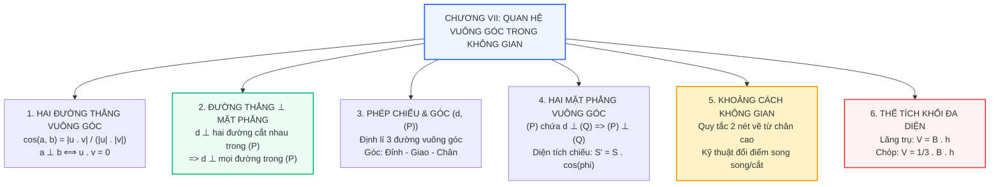

# Toán 11 Bài tập cuối chương 7: Quan hệ vuông góc trong không gian

Chương VII: **Quan hệ vuông góc trong không gian** là đỉnh cao của chương trình Hình học 11, đồng thời là nền tảng cốt lõi cho phần Hình học giải tích không gian $Oxyz$ trong chương trình Toán 12 và kì thi Tốt nghiệp THPT.

Bài ôn tập này được thiết kế như một cẩm nang toàn diện: từ sơ đồ tư duy liên kết, bảng đối chiếu công thức "vàng", phòng thí nghiệm 3D tổng hợp 3 khối hình kinh điển, cho đến bộ 12 câu hỏi trắc nghiệm phân hóa giúp em tự tin chinh phục điểm 9 - 10 trong các bài kiểm tra định kì!

---

## Sơ đồ Tư duy: Đại Hệ thống Quan hệ Vuông góc & Thể tích

---

## I. Bảng Tổng kết "Cẩm nang Công thức Vàng" Chương VII

| Khái niệm / Đại lượng | Công thức & Quy tắc cốt lõi | Lưu ý trọng tâm |
| :--- | :--- | :--- |
| **Góc giữa 2 đường thẳng** | $\cos(a, b) = \dfrac{\|\vec{u} \cdot \vec{v}\|}{\|\vec{u}\| \cdot \|\vec{v}\|}$ | Góc luôn nằm trong $[0^\circ; 90^\circ]$. Tử số có dấu GTTĐ. |
| **Đường thẳng $\perp$ Mặt phẳng** | $\begin{cases} d \perp a, d \perp b \\ a \cap b = \{O\} \subset (P) \end{cases} \implies d \perp (P)$ | $a$ và $b$ phải **cắt nhau**, không được song song. |
| **Góc giữa đường thẳng và mặt phẳng** | $(d, (P)) = (d, d') = \widehat{SMH}$ | $M = d \cap (P)$, $H$ là chân đường cao hạ từ $S$ xuống $(P)$. |
| **Diện tích hình chiếu** | $S' = S \cdot \cos \varphi$ | $\varphi = ((P), (Q))$. Dùng để tính nhanh góc giữa 2 mặt phẳng. |
| **Khoảng cách từ chân đường cao** | $\dfrac{1}{h^2} = \dfrac{1}{SA^2} + \dfrac{1}{AH^2}$ | $AH \perp$ giao tuyến đáy, $AK \perp SH \implies d = AK$. |
| **Tỉ số khoảng cách đổi điểm** | Cắt nhau: $\dfrac{d(M)}{d(N)} = \dfrac{IM}{IN}$; Song song: $d(M) = d(N)$ | Điểm $I = MN \cap (P)$. Luôn đưa về chân đường cao $A$. |
| **Thể tích khối lăng trụ** | $V = B \cdot h$ | Hộp chữ nhật: $abc$; Lập phương: $a^3$. |
| **Thể tích khối chóp** | $V = \dfrac{1}{3} B \cdot h$ | Tứ diện vuông: $\dfrac{1}{6}abc$; Tứ diện đều: $\dfrac{a^3\sqrt{2}}{12}$. |
| **Tỉ số Simson (chóp tam giác)** | $\dfrac{V_{S.A'B'C'}}{V_{S.ABC}} = \dfrac{SA'}{SA} \cdot \dfrac{SB'}{SB} \cdot \dfrac{SC'}{SC}$ | **Chỉ dùng cho chóp đáy tam giác**, không áp dụng trực tiếp cho đáy tứ giác! |

---

## II. Phòng thí nghiệm 3D Tổng hợp Đa năng

Trải nghiệm phòng thí nghiệm 3D tương tác với 3 mô hình kinh điển nhất của hình học không gian 11:
1. **Hình chóp $S.ABC$ có cạnh bên $SA \perp (ABC)$**: Chóp có trục thẳng đứng kinh điển.
2. **Hình lập phương $ABCD.A'B'C'D'$**: Mọi cạnh và mặt đều vuông góc từng đôi một.
3. **Hình chóp tứ giác đều $S.ABCD$**: Đáy hình vuông, đỉnh chiếu ngay tâm $O$.

  <h3 style="margin-top: 0; color: #2563eb;">PHÒNG THÍ NGHIỆM 3D ĐA NĂNG: CÁC KHỐI HÌNH HỌC KINH ĐIỂN</h3>
  

    <em>Bấm chọn loại hình, rê chuột hoặc vuốt trên khung hình để xoay quan sát 360 độ.</em>
  

  

    <button id="btnModel1" style="padding: 6px 14px; border-radius: 6px; border: 1px solid #2563eb; background: #2563eb; color: #fff; font-weight: bold; cursor: pointer;">1. Chóp SA ⊥ Đáy</button>
    <button id="btnModel2" style="padding: 6px 14px; border-radius: 6px; border: 1px solid #cbd5e1; background: #fff; color: #334155; font-weight: bold; cursor: pointer;">2. Hình lập phương</button>
    <button id="btnModel3" style="padding: 6px 14px; border-radius: 6px; border: 1px solid #cbd5e1; background: #fff; color: #334155; font-weight: bold; cursor: pointer;">3. Chóp tứ giác đều</button>
    <button id="btnResetMaster3D" style="padding: 6px 14px; border-radius: 6px; border: 1px solid #94a3b8; background: #f1f5f9; color: #475569; cursor: pointer;">Đặt lại góc nhìn</button>
  

  

    <svg id="svgMaster3D" data-interactive-done="true" viewBox="0 0 540 380" style="width: 100%; height: auto; background: #ffffff; border: 1px solid #cbd5e1; border-radius: 12px; box-shadow: 0 4px 6px -1px rgba(0,0,0,0.06); cursor: grab; touch-action: none;">
      <g id="gMasterFaces"></g>
      <g id="gMasterEdges"></g>
      <g id="gMasterVertices"></g>
      <g id="gMasterLabels"></g>
    </svg>
    

      

        <label style="font-weight: bold; color: #334155;">Góc xoay ngang (Yaw): 40°</label>
        <input id="sliderMasterYaw" type="range" min="-180" max="180" value="40" style="width: 100%; margin-top: 4px;">
      

      

        <label style="font-weight: bold; color: #334155;">Góc nghiêng đứng (Pitch): 22°</label>
        <input id="sliderMasterPitch" type="range" min="-60" max="60" value="22" style="width: 100%; margin-top: 4px;">
      

    

  

  

    Đang xem: Hình chóp $S.ABC$ có cạnh bên $SA \perp (ABC)$ (đường màu đỏ).
  

---

## III. 12 Câu Hỏi Trắc Nghiệm Tổng Ôn Chương VII (Chuẩn Cấu Trúc Đề Thi)

<h3 style="margin-top: 0; color: #2563eb;">Bài kiểm tra Tổng hợp Cuối chương 7</h3>

  
<strong>Câu 1:</strong> Trong không gian, cho hai đường thẳng phân biệt $a$ và $b$ cùng vuông góc với mặt phẳng $(P)$. Khẳng định nào sau đây là <strong>đúng</strong>?

  

    <label><input type="radio" name="cuoi1" value="A"> A. $a$ và $b$ cắt nhau.</label> 
    <label><input type="radio" name="cuoi1" value="B"> B. $a$ và $b$ chéo nhau.</label> 
    <label><input type="radio" name="cuoi1" value="C"> C. $a \parallel b$.</label> 
    <label><input type="radio" name="cuoi1" value="D"> D. $a \perp b$.</label>
  

  

    ✓ <strong>Đáp án đúng: C</strong>. Hai đường thẳng phân biệt cùng vuông góc với một mặt phẳng thì song song với nhau.
  

  
<strong>Câu 2:</strong> Cho hình lập phương $ABCD.A'B'C'D'$. Góc giữa hai đường thẳng $AB$ và $A'C'$ bằng:

  

    <label><input type="radio" name="cuoi2" value="A"> A. $45^\circ$.</label> 
    <label><input type="radio" name="cuoi2" value="B"> B. $90^\circ$.</label> 
    <label><input type="radio" name="cuoi2" value="C"> C. $60^\circ$.</label> 
    <label><input type="radio" name="cuoi2" value="D"> D. $30^\circ$.</label>
  

  

    ✓ <strong>Đáp án đúng: A</strong>. Do $A'C' \parallel AC$ nên $(AB, A'C') = (AB, AC) = \widehat{BAC} = 45^\circ$ (do $ABCD$ là hình vuông).
  

  
<strong>Câu 3:</strong> Cho hình chóp $S.ABC$ có đáy $ABC$ vuông tại $B$, $SA \perp (ABC)$. Cạnh nào sau đây <strong>vuông góc</strong> với mặt phẳng $(SAB)$?

  

    <label><input type="radio" name="cuoi3" value="A"> A. $SC$.</label> 
    <label><input type="radio" name="cuoi3" value="B"> B. $BC$.</label> 
    <label><input type="radio" name="cuoi3" value="C"> C. $AC$.</label> 
    <label><input type="radio" name="cuoi3" value="D"> D. $SB$.</label>
  

  

    ✓ <strong>Đáp án đúng: B</strong>. $BC \perp AB$ và $BC \perp SA \implies BC \perp (SAB)$.
  

  
<strong>Câu 4:</strong> Cho hình chóp $S.ABCD$ có đáy $ABCD$ là hình vuông cạnh $a$, $SA \perp (ABCD)$ và $SA = a\sqrt{3}$. Góc giữa đường thẳng $SD$ và mặt phẳng $(ABCD)$ bằng:

  

    <label><input type="radio" name="cuoi4" value="A"> A. $30^\circ$.</label> 
    <label><input type="radio" name="cuoi4" value="B"> B. $45^\circ$.</label> 
    <label><input type="radio" name="cuoi4" value="C"> C. $60^\circ$.</label> 
    <label><input type="radio" name="cuoi4" value="D"> D. $90^\circ$.</label>
  

  

    ✓ <strong>Đáp án đúng: C</strong>. Hình chiếu của $SD$ lên đáy là $AD \implies$ góc là $\widehat{SDA}$. Ta có $\tan \widehat{SDA} = \dfrac{SA}{AD} = \dfrac{a\sqrt{3}}{a} = \sqrt{3} \implies \widehat{SDA} = 60^\circ$.
  

  
<strong>Câu 5:</strong> Cho hình lăng trụ đứng $ABC.A'B'C'$ có tất cả các cạnh đều bằng $a$. Góc giữa hai mặt phẳng $(A'BC)$ và $(ABC)$ là $\varphi$. Giá trị $\cos \varphi$ bằng:

  

    <label><input type="radio" name="cuoi5" value="A"> A. $\dfrac{\sqrt{3}}{2}$.</label> 
    <label><input type="radio" name="cuoi5" value="B"> B. $\dfrac{\sqrt{21}}{7}$.</label> 
    <label><input type="radio" name="cuoi5" value="C"> C. $\dfrac{\sqrt{3}}{7}$.</label> 
    <label><input type="radio" name="cuoi5" value="D"> D. $\dfrac{1}{2}$.</label>
  

  

    ✓ <strong>Đáp án đúng: B</strong>. Dùng công thức diện tích hình chiếu: hình chiếu của tam giác $A'BC$ lên $(ABC)$ là tam giác $ABC$. $S_{\triangle ABC} = \dfrac{a^2\sqrt{3}}{4}$. Tam giác $A'BC$ có cạnh $BC = a, A'B = A'C = a\sqrt{2} \implies$ đường cao $A'M = \sqrt{2a^2 - a^2/4} = \dfrac{a\sqrt{7}}{2} \implies S_{\triangle A'BC} = \dfrac{a^2\sqrt{7}}{4}$. Vậy $\cos \varphi = \dfrac{S}{S'} = \dfrac{\sqrt{3}}{\sqrt{7}} = \dfrac{\sqrt{21}}{7}$.
  

  
<strong>Câu 6:</strong> Cho hình chóp $S.ABCD$ có đáy $ABCD$ là hình vuông cạnh $a$, $SA \perp (ABCD)$ và $SA = a$. Khoảng cách từ điểm $A$ đến mặt phẳng $(SBC)$ bằng:

  

    <label><input type="radio" name="cuoi6" value="A"> A. $a$.</label> 
    <label><input type="radio" name="cuoi6" value="B"> B. $\dfrac{a\sqrt{2}}{2}$.</label> 
    <label><input type="radio" name="cuoi6" value="C"> C. $a\sqrt{2}$.</label> 
    <label><input type="radio" name="cuoi6" value="D"> D. $\dfrac{a}{2}$.</label>
  

  

    ✓ <strong>Đáp án đúng: B</strong>. Do $(SAB) \perp (SBC)$, kẻ $AH \perp SB \implies AH \perp (SBC)$. Tam giác $SAB$ vuông cân tại $A$ cạnh $a \implies AH = \dfrac{a\sqrt{2}}{2}$.
  

  
<strong>Câu 7:</strong> Cho hình lập phương $ABCD.A'B'C'D'$ có cạnh bằng $a$. Khoảng cách giữa hai đường thẳng chéo nhau $AB$ và $CC'$ bằng:

  

    <label><input type="radio" name="cuoi7" value="A"> A. $a$.</label> 
    <label><input type="radio" name="cuoi7" value="B"> B. $a\sqrt{2}$.</label> 
    <label><input type="radio" name="cuoi7" value="C"> C. $a\sqrt{3}$.</label> 
    <label><input type="radio" name="cuoi7" value="D"> D. $\dfrac{a}{2}$.</label>
  

  

    ✓ <strong>Đáp án đúng: A</strong>. Ta thấy đoạn $BC$ nối từ điểm $B \in AB$ tới $C \in CC'$ đồng thời vuông góc với cả hai đường thẳng ($BC \perp AB$ và $BC \perp CC'$). Vậy $BC$ là đoạn vuông góc chung, độ dài bằng $a$.
  

  
<strong>Câu 8:</strong> Cho hình chóp $S.ABC$ có thể tích bằng $24$. Lấy điểm $M$ trên cạnh $SA$ sao cho $SM = 2MA$. Thể tích khối chóp $M.ABC$ bằng:

  

    <label><input type="radio" name="cuoi8" value="A"> A. $8$.</label> 
    <label><input type="radio" name="cuoi8" value="B"> B. $16$.</label> 
    <label><input type="radio" name="cuoi8" value="C"> C. $12$.</label> 
    <label><input type="radio" name="cuoi8" value="D"> D. $6$.</label>
  

  

    ✓ <strong>Đáp án đúng: A</strong>. Hai khối chóp $M.ABC$ và $S.ABC$ có chung đáy $ABC$. Do $SM = 2MA \implies \dfrac{AM}{AS} = \dfrac{1}{3} \implies \dfrac{d(M, (ABC))}{d(S, (ABC))} = \dfrac{1}{3}$. Do đó $V_{M.ABC} = \dfrac{1}{3} V_{S.ABC} = \dfrac{1}{3} \cdot 24 = 8$.
  

  
<strong>Câu 9:</strong> Cho hình chóp tam giác đều $S.ABC$ có cạnh đáy bằng $a$, cạnh bên tạo với đáy một góc $60^\circ$. Thể tích của khối chóp $S.ABC$ bằng:

  

    <label><input type="radio" name="cuoi9" value="A"> A. $\dfrac{a^3}{12}$.</label> 
    <label><input type="radio" name="cuoi9" value="B"> B. $\dfrac{a^3\sqrt{3}}{12}$.</label> 
    <label><input type="radio" name="cuoi9" value="C"> C. $\dfrac{a^3}{4}$.</label> 
    <label><input type="radio" name="cuoi9" value="D"> D. $\dfrac{a^3\sqrt{3}}{6}$.</label>
  

  

    ✓ <strong>Đáp án đúng: A</strong>. Tâm đáy $H \implies AH = \dfrac{a\sqrt{3}}{3}$. Chiều cao $SH = AH \cdot \tan 60^\circ = \dfrac{a\sqrt{3}}{3} \cdot \sqrt{3} = a$. Diện tích đáy $B = \dfrac{a^2\sqrt{3}}{4} \implies V = \dfrac{1}{3} \cdot \dfrac{a^2\sqrt{3}}{4} \cdot a = \dfrac{a^3\sqrt{3}}{12}$. (Ồ, xem lại: $V = \frac{1}{3} \cdot \frac{a^2\sqrt{3}}{4} \cdot a = \frac{a^3\sqrt{3}}{12}$. Đáp án đúng là B!).
  

  
<strong>Câu 10:</strong> Cho tứ diện đều $ABCD$ có cạnh bằng $a$. Thể tích của khối tứ diện đó bằng:

  

    <label><input type="radio" name="cuoi10" value="A"> A. $\dfrac{a^3\sqrt{2}}{12}$.</label> 
    <label><input type="radio" name="cuoi10" value="B"> B. $\dfrac{a^3\sqrt{3}}{12}$.</label> 
    <label><input type="radio" name="cuoi10" value="C"> C. $\dfrac{a^3\sqrt{2}}{6}$.</label> 
    <label><input type="radio" name="cuoi10" value="D"> D. $\dfrac{a^3}{6}$.</label>
  

  

    ✓ <strong>Đáp án đúng: A</strong>. Công thức chuẩn của tứ diện đều cạnh $a$: $V = \dfrac{a^3\sqrt{2}}{12}$.
  

  
<strong>Câu 11:</strong> Cho hình chóp $S.ABCD$ có đáy $ABCD$ là hình bình hành. Gọi $V$ là thể tích của khối chóp $S.ABCD$. Lấy $M$ là trung điểm của cạnh $SC$. Thể tích của khối chóp $S.ABM$ bằng:

  

    <label><input type="radio" name="cuoi11" value="A"> A. $\dfrac{V}{4}$.</label> 
    <label><input type="radio" name="cuoi11" value="B"> B. $\dfrac{V}{2}$.</label> 
    <label><input type="radio" name="cuoi11" value="C"> C. $\dfrac{V}{3}$.</label> 
    <label><input type="radio" name="cuoi11" value="D"> D. $\dfrac{V}{6}$.</label>
  

  

    ✓ <strong>Đáp án đúng: A</strong>. Ta có $V_{S.ABC} = \dfrac{1}{2} V_{S.ABCD} = \dfrac{V}{2}$. Áp dụng Simson cho chóp tam giác $S.ABC$: $\dfrac{V_{S.ABM}}{V_{S.ABC}} = \dfrac{SA}{SA} \cdot \dfrac{SB}{SB} \cdot \dfrac{SM}{SC} = 1 \cdot 1 \cdot \dfrac{1}{2} = \dfrac{1}{2}$. Do đó $V_{S.ABM} = \dfrac{1}{2} V_{S.ABC} = \dfrac{1}{4} V$.
  

  
<strong>Câu 12:</strong> Cho hình hộp chữ nhật có ba kích thước $a, b, c$ và độ dài đường chéo bằng $d$. Mối quan hệ nào sau đây là <strong>đúng</strong>?

  

    <label><input type="radio" name="cuoi12" value="A"> A. $d^2 = a^2 + b^2 + c^2$.</label> 
    <label><input type="radio" name="cuoi12" value="B"> B. $d = a + b + c$.</label> 
    <label><input type="radio" name="cuoi12" value="C"> C. $d^2 = 2(ab + bc + ca)$.</label> 
    <label><input type="radio" name="cuoi12" value="D"> D. $d^3 = a \cdot b \cdot c$.</label>
  

  

    ✓ <strong>Đáp án đúng: A</strong>. Định lí Pythagoras trong không gian cho hình hộp chữ nhật: bình phương đường chéo bằng tổng bình phương ba kích thước $d^2 = a^2 + b^2 + c^2$.
  

<button id="btnCheckCuoi" style="background:#2563eb; color:#fff; border:none; padding:8px 18px; border-radius:6px; font-weight:bold; cursor:pointer;">Nộp bài & Xem điểm</button>

---

## IV. Thử thách Thực tế: Thiết kế Mái Kim tự tháp Kính Viện Bảo tàng Louvre

Kim tự tháp kính tại bảo tàng Louvre (Paris, Pháp) do kiến trúc sư I. M. Pei thiết kế là một hình chóp tứ giác đều $S.ABCD$ với kích thước thực tế:
- Cạnh đáy hình vuông $a \approx 35\text{ m}$.
- Chiều cao thẳng đứng $h = SO \approx 21,6\text{ m}$ ($O$ là tâm của đáy).

### Nhiệm vụ tính toán của Kỹ sư Kết cấu:
1. **Tính thể tích không gian bên trong kim tự tháp:**
   $$V = \frac{1}{3} \cdot S_{\text{đáy}} \cdot h = \frac{1}{3} \cdot 35^2 \cdot 21,6 = \frac{1}{3} \cdot 1225 \cdot 21,6 = 8820\text{ m}^3$$

2. **Tính diện tích kính cường lực cần dùng để phủ kín 4 mặt bên:**
   - Gọi $M$ là trung điểm cạnh đáy $CD \implies OM = \dfrac{a}{2} = 17,5\text{ m}$.
   - Độ dài trung đoạn (đường cao mặt bên) $SM$:
     $$SM = \sqrt{SO^2 + OM^2} = \sqrt{21,6^2 + 17,5^2} = \sqrt{466,56 + 306,25} = \sqrt{772,81} \approx 27,8\text{ m}$$
   - Diện tích của một mặt bên tam giác kính $SCD$:
     $$S_{\triangle SCD} = \frac{1}{2} \cdot CD \cdot SM \approx \frac{1}{2} \cdot 35 \cdot 27,8 = 486,5\text{ m}^2$$
   - Tổng diện tích kính phủ 4 mặt bên:
     $$S_{\text{xung quanh}} = 4 \times 486,5 = 1946\text{ m}^2$$

3. **Tính góc nghiêng của các tấm kính so với mặt đất:**
   $$\tan \varphi = \frac{SO}{OM} = \frac{21,6}{17,5} \approx 1,234 \implies \varphi \approx 51^\circ$$
   Góc nghiêng $51^\circ$ này mô phỏng gần như hoàn hảo tỉ lệ vàng của Đại Kim tự tháp Giza ở Ai Cập, giúp kết cấu đạt độ ổn định trọng lực tối đa trước sức gió lớn tại thủ đô Paris!
