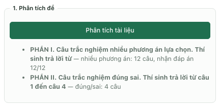
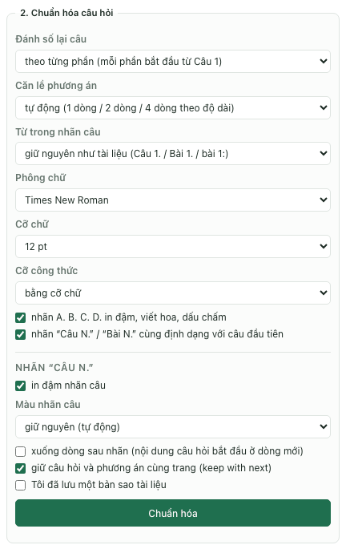
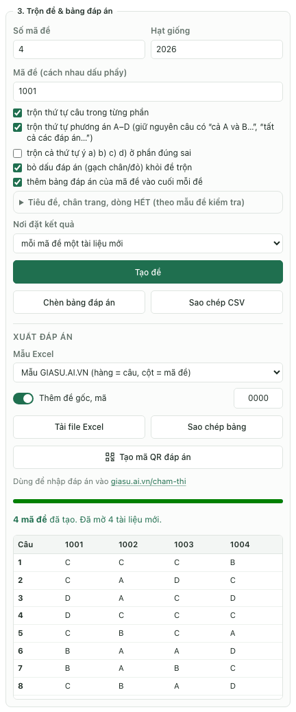
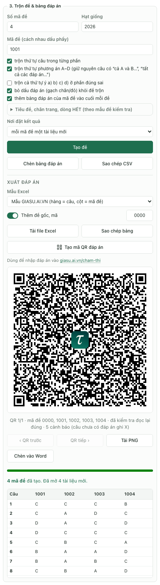
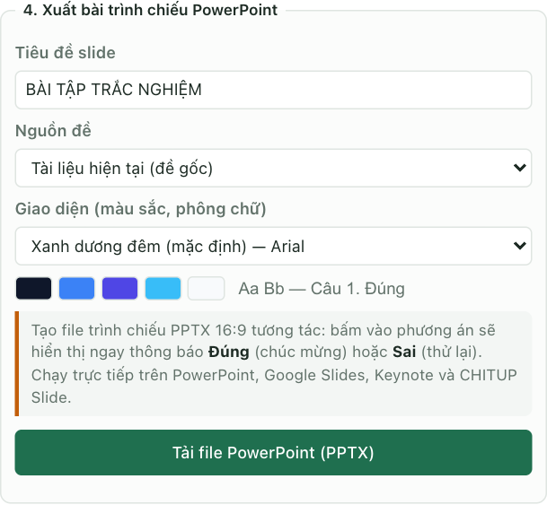

Để trộn đề trên MacBook, thầy cô có thể dùng tab Đề thi của TexCraft trong Microsoft Word: phân tích đề gốc, kiểm tra đáp án, chuẩn hóa câu hỏi rồi tạo các mã đề. Tiện ích hỗ trợ câu nhiều phương án A–D, đúng/sai và trả lời ngắn; có thể xuất bảng đáp án Excel hoặc QR để dùng tiếp ở công cụ chấm trắc nghiệm.

TexCraft được chia sẻ miễn phí; Microsoft Word là sản phẩm riêng, cần quyền sử dụng phù hợp. Nếu chưa có tiện ích, làm theo [hướng dẫn cài TexCraft trên Mac](../word-addin/huong-dan.html). Bài này dùng tên điều khiển của giao diện trong dự án; các ảnh chụp giao diện TexCraft chạy ở chế độ thử trong trình duyệt (không có Word) với một đề Toán mẫu; trong Word cho Mac, các bảng có cùng nội dung nhưng khung ngoài là của Word.

## Bước 1. Chuẩn bị đề Word có cấu trúc rõ ràng

Lưu một bản sao `.docx` trước khi làm. Nếu đề là PDF scan hoặc ảnh, cần soạn lại thành văn bản và công thức có thể biên tập; thao tác phân tích không tự nhận dạng chữ từ ảnh.

Với đề có đủ ba phần, đặt tên phần và nhãn câu theo ví dụ:

```text
PHẦN I. Câu trắc nghiệm nhiều phương án lựa chọn
Câu 1. Giá trị của 2 + 3 là
A. 4
B. 5
C. 6
D. 7

PHẦN II. Câu trắc nghiệm đúng sai
Câu 1. Xét các khẳng định sau:
a) 2 + 3 = 5.
b) 2 là số lẻ.
c) 3 là số nguyên tố.
d) 5 < 3.

PHẦN III. Câu trắc nghiệm trả lời ngắn
Câu 1. Tính 3 × 4.
Đáp án: 12
```

Đây là ví dụ về cấu trúc, chưa đánh dấu đáp án cho hai phần đầu. Trong Word, đánh dấu nhãn `B.` ở phần I và nhãn `a)`, `c)` ở phần II bằng một cách được hỗ trợ: gạch chân, chữ đỏ hoặc tô nổi. Nên dùng một cách nhất quán và kiểm tra lại khi phân tích. Không tô toàn bộ các nhãn A–D vì tiện ích có thể coi đó là định dạng chung thay vì đáp án.

Với đúng/sai, nhãn ý được đánh dấu biểu thị Đúng, ý không đánh dấu biểu thị Sai. Trường hợp cả bốn ý đều Sai cần đặc biệt kiểm tra: nếu toàn đề không có dấu đáp án nào, không thể mặc nhiên coi mọi câu đúng/sai là SSSS. Có thể dùng bảng đáp án cuối đề để thể hiện rõ đáp án.

Đề đã có bảng đáp án sau dòng HẾT hoặc BẢNG ĐÁP ÁN cũng có thể được nhận. Tuy nhiên, cần xem kết quả phân tích trước khi trộn; không giả định mọi cách trình bày bảng đều đọc đúng.

## Bước 2. Phân tích tài liệu và sửa câu chưa nhận đáp án

Mở TexCraft → Đề thi → Phân tích tài liệu. Đối chiếu số câu nhận được ở từng phần với đề gốc, rồi kiểm tra số câu đã có đáp án.



Hình 1. Kết quả Phân tích đề mẫu: Phần I có 12 câu, nhận đáp án 12/12; Phần II có 4 câu đúng/sai nhưng chưa nhận đáp án nên bốn nút “Phần II · Câu 1–4” màu cam hiện ra. Bấm nút để nhảy tới câu đó trong Word rồi đánh dấu nhãn đúng.

Nếu thiếu câu, kiểm tra nhãn `Câu N.`, tên phần và cách xuống đoạn. Nếu thiếu đáp án, kiểm tra định dạng nhãn phương án đúng hoặc bảng đáp án cuối đề. Các nút câu chưa có đáp án giúp chuyển đến vị trí cần sửa trong Word.

Với ví dụ trên, kết quả mong đợi là mỗi phần một câu, đáp án lần lượt B, ĐSĐS và 12. Chỉ tiếp tục khi đã đối chiếu đúng cả số câu lẫn đáp án. Sau khi sửa đề gốc, bấm Phân tích tài liệu lại.

Đề tiếng Anh dùng `Question N.` có cơ chế nhận nhóm câu theo đoạn văn hoặc chỉ dẫn. Xem các nhóm được liệt kê ở mục trộn đề; các nhóm có đoạn văn hoặc câu sắp xếp cần giữ quan hệ với ngữ liệu. Đọc lại từng nhóm sau khi tạo mã mới.

## Bước 3. Chuẩn hóa bố cục câu hỏi

Trong Chuẩn hóa câu hỏi, chọn kiểu đánh số theo từng phần hoặc liên tục toàn đề. Chọn bố cục phương án tự động, 4 cột, 2 cột hoặc mỗi phương án một dòng tùy độ dài nội dung.



Hình 2. Các thiết lập chuẩn hóa bố cục đề: đánh số theo từng phần, căn lề phương án tự động, Times New Roman 12 pt, cỡ công thức bằng cỡ chữ.

Một thiết lập dễ bắt đầu là Times New Roman, 12 pt, cỡ công thức bằng cỡ chữ và căn lề phương án tự động. Tích xác nhận đã lưu bản sao rồi bấm Chuẩn hóa.

Kiểm tra câu hỏi và hình vẽ sau bước này. Tùy chọn giữ câu hỏi cùng trang hỗ trợ bố cục nhưng không thể làm một câu dài hơn trang giấy tự vừa một trang. Các đối tượng MathType cũ cũng không nhất thiết đổi cỡ theo chữ; xem [chuẩn hóa MathType trên MacBook](./chuan-hoa-cong-thuc-mathtype-macbook.html) nếu công thức vẫn lệch cỡ.

## Bước 4. Chọn số lượng và mã đề

Trong Trộn đề & bảng đáp án, thử thiết lập:

| Trường | Giá trị ví dụ | Ý nghĩa |
| --- | --- | --- |
| Số mã đề | 4 | Tạo bốn phiên bản |
| Mã đề | 1001 | Các mã tăng thành 1001, 1002, 1003, 1004 |
| Hạt giống | 2026 | Dùng làm đầu vào cho thứ tự trộn |
| Nơi đặt kết quả | mỗi mã đề một tài liệu mới | Dễ kiểm tra và lưu riêng từng đề |

Nếu muốn mã riêng, nhập danh sách như `1001, 1003, 1005`; tiện ích dùng danh sách đó thay cho số lượng mã đề. Không nhập các mã trùng nhau.

Hạt giống giúp tái tạo thứ tự khi đề nguồn và các tùy chọn không đổi. Muốn thay cách trộn, đổi hạt giống; muốn lưu một đợt ra đề, giữ cùng bản đề gốc, hạt giống và thiết lập.



Hình 3. Cấu hình bốn mã đề bắt đầu từ 1001, hạt giống 2026. Sau khi bấm Tạo đề, thanh tiến độ báo “4 mã đề đã tạo”, kế bên là bảng đáp án: mỗi hàng là một câu, mỗi cột là một mã đề. Các nút Chèn bảng đáp án, Sao chép CSV, Tải file Excel nằm ngay trên bảng. Ảnh đang bật thêm bảng đáp án vào cuối đề; cần tắt lựa chọn này khi tạo bản phát cho học sinh ở bước 5.

## Bước 5. Chọn nội dung được trộn và bản dùng cho học sinh

Tích trộn thứ tự câu trong từng phần và trộn phương án A–D nếu phù hợp. Tiện ích có xử lý các phương án phụ thuộc nhãn như “cả A và B…” và một số nhóm dùng chung ngữ liệu; vẫn cần đọc lại đề sau trộn, nhất là khi tài liệu dùng cách diễn đạt riêng.

Chỉ bật trộn thứ tự ý a), b), c), d) nếu từng ý có thể đổi chỗ mà không làm sai lập luận. Những ý dùng kết quả của ý trước cần được giữ thứ tự hoặc biên tập lại.

Với bản phát cho học sinh:

1. Bật bỏ dấu đáp án khỏi đề trộn.
2. Tắt thêm bảng đáp án của mã đề vào cuối mỗi đề.
3. Mở Tiêu đề, chân trang, dòng HẾT để nhập trường, kỳ kiểm tra, môn, lớp và thời gian.
4. Kiểm tra Nơi đặt kết quả rồi bấm Tạo đề.
5. Lưu từng tài liệu mới dưới tên gắn với mã đề, chẳng hạn `toan-12-ma-1001.docx`.

Đặc biệt lưu ý tùy chọn thêm bảng đáp án: giao diện có thể đang bật sẵn. Cần kiểm tra tài liệu thực tế trước khi in hoặc xuất PDF cho học sinh.

## Bước 6. Xuất đáp án Excel và QR

Sau khi tạo mã đề, giữ nguyên phiên làm việc và xuống mục Xuất đáp án. Chọn mẫu Excel phù hợp rồi bấm Tải file Excel. Bảng đáp án phải đi cùng đúng bộ đề vừa tạo; không dùng lại bảng của một lần trộn khác.

Mẫu GIASU.AI.VN có hàng là câu, cột là mã đề. Mẫu TEXCRAFT có hàng là đề, cột là câu hoặc ý. Tùy chọn Thêm đề gốc mặc định dùng mã `0000`; nếu không cần chấm đề gốc, có thể tắt mục này.

Bấm Tạo mã QR đáp án nếu muốn chuyển đáp án sang điện thoại.



Hình 4. Mã QR đáp án. Dòng chú thích dưới ảnh cho biết QR chứa những mã đề nào và số cảnh báo (ở đề mẫu là các ý đúng/sai chưa có đáp án, ghi X). Có nút Tải PNG và Chèn vào Word; nếu có nhiều QR thì dùng QR trước / QR tiếp. Ảnh mẫu còn cảnh báo ý đúng/sai chưa có đáp án, được ghi X; đây chưa phải bộ đáp án hoàn chỉnh để chấm thật. Hãy bổ sung đáp án trong đề gốc, phân tích và tạo lại mã đề cùng Excel/QR. Không dùng X để thay cho đáp án còn thiếu vì ứng dụng chấm hiểu X là bỏ qua câu hoặc ý. Nếu bộ đáp án được chia thành nhiều QR, cần nhập đủ các QR. Công cụ chấm bài ở [giasu.ai.vn/cham-thi/](../cham-thi/) có chức năng nhập đáp án bằng Excel và QR; xem [hướng dẫn chấm trắc nghiệm miễn phí](./phan-mem-cham-trac-nghiem-mien-phi.html) để thực hiện phần tiếp theo.

Khi dùng công cụ chấm phiếu, nên chọn mã đề bằng số phù hợp với ô tô mã đề trên phiếu. Mã chữ tiện quản lý tài liệu nhưng không tương ứng với các cột tô chữ số.

## Bước 7. Kiểm tra một bộ đề trước khi in

Với mỗi mã đề, kiểm tra số câu, thứ tự phần, hình vẽ và công thức. Chọn vài câu đã đổi vị trí phương án, tự giải hoặc đối chiếu nội dung để xác nhận đáp án mới trỏ đúng phương án. Với đúng/sai và trả lời ngắn, đối chiếu cả thứ tự câu lẫn giá trị đáp án.

Mở xem trước khi in để kiểm tra khổ giấy, chân trang, mã đề và ngắt trang. Giữ một thư mục chứa đề gốc, các đề đã trộn và bảng đáp án của cùng đợt ra đề.

## Có thể xuất đề thành PowerPoint không?

Trong mục Xuất bài trình chiếu PowerPoint, đặt tiêu đề và chọn giao diện, sau đó bấm Tải file PowerPoint (PPTX). Đây là bước tùy chọn để dùng đề trong giờ ôn tập.



Hình 5. Xuất đề thành bài trình chiếu; cần thử liên kết phản hồi trong chế độ trình chiếu của ứng dụng sử dụng.

Khả năng hiển thị công thức và tương tác khác nhau giữa các ứng dụng. Mở tệp bằng phần mềm sẽ dùng để dạy và thử vài câu trước buổi học.

## Câu hỏi thường gặp

### Có phải cài Windows để trộn đề trên MacBook không?

Quy trình này dùng TexCraft trong Word trên Mac, không yêu cầu cài Windows. Word và tài khoản đang dùng vẫn cần cho phép chạy Office Add-ins.

### Vì sao đề đủ câu nhưng bảng đáp án có ô trống?

Nhận được câu hỏi không đồng nghĩa nhận được đáp án. Quay lại đề gốc, kiểm tra nhãn đánh dấu hoặc bảng đáp án cuối đề, phân tích lại rồi tạo lại bộ mã đề và bảng đáp án tương ứng.

### Có nên chuyển mọi công thức sang ảnh trước khi trộn?

Không cần làm bước này chỉ để trộn đề. Công thức sửa được thuận tiện hơn cho lần biên tập sau. Nếu gặp tài liệu MathType cũ, hãy xử lý theo [hướng dẫn gõ và sửa MathType trên MacBook](./go-mathtype-tren-macbook.html) hoặc [soạn công thức toán](./soan-cong-thuc-toan-macbook.html), rồi kiểm tra lại đề.

Nguồn đối chiếu: [hướng dẫn TexCraft](../word-addin/su-dung.html), giao diện tab Đề thi và mã xử lý phân tích/trộn đề trong dự án. Cập nhật ngày 22/10/2026. Hình 5 lấy từ hướng dẫn TexCraft hiện có; Hình 1–4 là ảnh chụp mới.
