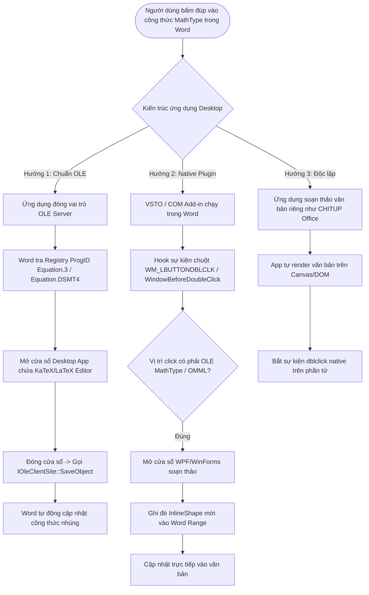

# Word Add-in: TexCraft / GIASU.AI.VN

> Tài liệu hướng dẫn kiến trúc, chức năng hiện tại và cẩm nang phát triển tiếp theo (Đặc biệt: Hướng dẫn phát triển ứng dụng Desktop hỗ trợ bấm đúp sửa công thức MathType).

---

## 1. Tổng quan dự án

Add-in này được xây dựng cho Microsoft Word (chạy trên Word Windows, Word macOS, Word Online và Word iPad) dựa trên nền tảng **Office.js Web Add-in** chuẩn của Microsoft.

### Các chức năng chính hiện có

1. **Chuyển đổi công thức Toán học hai chiều (`word-addin/taskpane/taskpane.js`, `word-addin/src/`)**:
   - MathType (OLE Object chứa MTEF nhị phân) $\rightarrow$ Word Equation (OMML).
   - Word Equation (OMML) $\rightarrow$ MathType (OLE Object).
   - Công thức dạng văn bản LaTeX (`$...$`, `$$...$$`, `\(...\)`, `\[...\]`) $\rightarrow$ Word Equation / MathType.
   - Bộ giải mã thuần JavaScript: [`src/mtef.js`](./src/mtef.js) giải mã MTEF byte stream sang LaTeX, [`src/latex2omml.js`](./src/latex2omml.js) chuyển LaTeX sang OMML, [`src/omml.js`](./src/omml.js) chuyển OMML sang LaTeX.

2. **Trình soạn thảo & chỉnh sửa công thức (`tab-editor`)**:
   - Xem trước công thức thời gian thực bằng KaTeX.
   - Bảng ký tự Toán học trực quan (Căn, Phân số, Tích phân, Tổng, Ma trận, Vector, Ký hiệu Hy Lạp...).
   - Đọc công thức đang chọn trong Word vào editor để sửa, hoặc soạn mới rồi chèn vào vị trí con trỏ (dưới dạng Word Equation hoặc MathType OLE).

3. **Chuẩn hóa & Trộn đề thi GDPT 2018 (`tab-exam`, `word-addin/src/exam.js`)**:
   - Nhận diện 3 phần thi chuẩn:
     - **Phần I**: Trắc nghiệm nhiều phương án (A, B, C, D).
     - **Phần II**: Trắc nghiệm Đúng/Sai (các ý a, b, c, d).
     - **Phần III**: Trắc nghiệm trả lời ngắn (tự động chuẩn hóa đánh số lại câu `Câu 1.` đến `Câu 6.`).
   - Tự động nhận diện đáp án đúng qua định dạng (gạch chân, chữ đỏ, tô sáng highlight).
   - Đánh số lại câu hỏi theo từng phần hoặc liên tục toàn đề.
   - Căn chỉnh layout phương án (1 dòng, 2 dòng, 4 dòng).
   - Trộn đề thông minh (giữ nguyên câu hỏi chung dữ kiện, giữ nguyên các phương án tham chiếu như "Cả A và B đúng").
   - Lập bảng đáp án đa mã đề, xuất file Excel (`.xlsx`) theo mẫu GIASU.AI.VN và TEXCRAFT.

4. **Xuất bài trình chiếu PowerPoint tương tác Đúng/Sai (`word-addin/src/pptx.js`)**:
   - Sinh file `.pptx` 16:9 widescreen chuẩn OpenXML thuần JavaScript (chạy 100% offline trong trình duyệt, không cần server).
   - Mỗi câu hỏi tạo thành một kịch bản tương tác:
     - Slide câu hỏi với các nút phương án A, B, C, D.
     - Bấm phương án **Đúng**: Tự động nhảy sang slide chúc mừng 🎉 "CHÍNH XÁC!" kèm giải thích và nút chuyển câu tiếp theo.
     - Bấm phương án **Sai**: Tự động nhảy sang slide động viên ❌ "CHƯA CHÍNH XÁC!" kèm nút "QUAY LẠI THỬ LẠI".
     - Slide sai được đánh dấu ẩn (`show="0"`), giúp giáo viên dùng bút trình chiếu vẫn lật bài tuần tự mà không bị gián đoạn.
     - Tương thích đa nền tảng: Microsoft PowerPoint (Win/Mac/Web), Google Slides, Apple Keynote, CHITUP Slide qua liên kết nội bộ `ppaction://hlinksldjump`.

---

## 2. Cấu trúc thư mục

```text
word-addin/
├── manifest.xml           # Tệp khai báo Add-in với Microsoft Office (Ribbon, Taskpane, URLs)
├── huong-dan.html         # Trang hướng dẫn cài đặt và sử dụng Add-in
├── taskpane/
│   ├── taskpane.html      # Giao diện chính của Add-in Taskpane
│   ├── taskpane.css       # Định dạng giao diện Taskpane
│   ├── taskpane.js        # Logic điều khiển chính, tabs, xử lý chuyển đổi công thức
│   ├── exam-ui.js         # Giao diện & xử lý sự kiện tab Chuẩn hóa & Trộn đề thi
│   └── katex/             # Thư viện KaTeX offline phục vụ preview công thức
└── src/
    ├── app-core.js        # Điểm vào nghiệp vụ lõi
    ├── ooxml.js           # Xử lý gói Word OOXML (document.xml, quan hệ rels, nhúng OLE)
    ├── mtef.js            # Trình giải mã nhị phân MathType Equation Format (MTEF v2 - v5)
    ├── latex2omml.js      # Bộ sinh OMML từ mã nguồn LaTeX
    ├── omml.js            # Bộ trích xuất LaTeX từ OMML
    ├── xml.js             # Tiện ích phân tích và escape XML
    ├── word-io.js         # Lớp trừu tượng đọc/ghi văn bản với Office.js API
    ├── exam.js            # Bộ phân tích cấu trúc đề thi, chuẩn hóa và trộn đề
    ├── xlsx.js            # Trình tạo file Excel .xlsx thuần JS (dùng ZipStore)
    ├── pptx.js            # Trình tạo bài trình chiếu PowerPoint .pptx tương tác
    └── tables.js          # Định dạng bảng đáp án trong Word
```

---

## 3. Cẩm nang phát triển tiếp: Ứng dụng Desktop hỗ trợ Bấm Đúp (Double-Click) sửa công thức MathType

### Vấn đề kỹ thuật với Web Add-in (Office.js)
Trong phiên bản Web Add-in hiện tại, người dùng phải **chọn công thức trên trang văn bản**, sau đó bấm nút **"Đọc công thức từ văn bản"** trên bảng tác vụ (Taskpane) hoặc thanh Ribbon để chỉnh sửa.
**Không thể làm thao tác "Bấm đúp trực tiếp vào công thức trên trang Word để bật popup sửa" chỉ bằng Web Add-in**, vì:
1. Web Add-in chạy trong môi trường WebView cô lập (Sandbox).
2. Microsoft Office.js **hoàn toàn không cung cấp sự kiện chuột (Mouse Double-Click)** trên nội dung văn bản cho Web Add-in vì lý do an toàn bảo mật.
3. Đối tượng OLE MathType được Word coi là một đối tượng nhúng hệ thống, Word sẽ tự động chuyển sự kiện double-click ra hệ điều hành để tìm OLE Server chứ không chuyển vào Web Add-in.

---

### Các phương án phát triển ứng dụng Desktop

Nếu xây dựng một **ứng dụng Desktop** (hoặc Native Add-in), tính năng **bấm đúp vào công thức MathType để hiện cửa sổ sửa và tự động cập nhật vào Word** hoàn toàn thực hiện được qua các hướng tiếp cận sau:



---

### Chi tiết kỹ thuật từng hướng tiếp cận

#### Hướng 1: Ứng dụng Desktop đóng vai trò OLE Server (Thay thế MathType)
*Khuyên dùng nếu muốn trải nghiệm 100% giống MathType bản gốc mà người dùng không cần cài đặt phần mềm MathType.*

1. **Cơ chế**:
   - Khi cài đặt ứng dụng desktop (viết bằng C++, C#, Electron hoặc Tauri có kèm native module), ứng dụng sẽ ghi vào Windows Registry:
     ```text
     HKEY_CLASSES_ROOT\Equation.3\protocol\StdFileEditing\server = "C:\Path\To\YourApp.exe"
     HKEY_CLASSES_ROOT\Equation.DSMT4\protocol\StdFileEditing\server = "C:\Path\To\YourApp.exe"
     HKEY_CLASSES_ROOT\CLSID\{0002CE02-0000-0000-C000-000000000046}\LocalServer32 = "C:\Path\To\YourApp.exe"
     ```
2. **Luồng dữ liệu**:
   - Khi người dùng bấm đúp vào công thức MathType trong Word: Word tự động gửi thông điệp OLE verb `OLEIVERB_PRIMARY` (hoặc `OLEIVERB_OPEN`) đến `YourApp.exe`.
   - Ứng dụng desktop nhận luồng dữ liệu nhị phân chứa stream OLE (gồm header OLE + block MTEF).
   - Tái sử dụng module [`src/mtef.js`](./src/mtef.js) của dự án này để giải mã MTEF sang LaTeX.
   - Hiển thị giao diện người dùng (gõ LaTeX, xem trước KaTeX, bảng ký hiệu Toán).
   - Khi người dùng đóng cửa sổ hoặc nhấn `Ctrl+S`, ứng dụng đóng gói lại dữ liệu MTEF mới và hình ảnh preview (WMF/EMF), sau đó gọi hàm giao tiếp OLE `IOleClientSite::SaveObject()`.
   - Word tự động lưu công thức mới vào file mà không cần thao tác copy/paste.

#### Hướng 2: Làm VSTO Add-in / COM Add-in cho Microsoft Word (Windows)
*Dành cho môi trường Windows, tích hợp trực tiếp vào tiến trình `WINWORD.EXE`.*

1. **Công nghệ**: C# (.NET 8 hoặc .NET Framework 4.8), VSTO (Visual Studio Tools for Office) hoặc Add-in Express.
2. **Cách bắt sự kiện**:
   - Sử dụng sự kiện `Application.WindowBeforeDoubleClick`:
     ```csharp
     void Application_WindowBeforeDoubleClick(Word.Selection Sel, ref bool Cancel)
     {
         if (Sel.InlineShapes.Count == 1)
         {
             var shape = Sel.InlineShapes[1];
             if (shape.Type == Word.WdInlineShapeType.wdInlineShapeEmbeddedOLEObject &&
                 shape.OLEFormat.ProgID.StartsWith("Equation"))
             {
                 Cancel = true; // Ngăn Word mở phần mềm MathType mặc định
                 OpenCustomEquationEditor(shape);
             }
         }
     }
     ```
   - Trích xuất dữ liệu OLE từ shape, chuyển sang LaTeX, hiển thị Form WPF đẹp mắt.
   - Khi chỉnh sửa xong, chèn lại đối tượng OMML hoặc OLE shape vào `Sel.Range`.

#### Hướng 3: Ứng dụng Desktop hoàn chỉnh độc lập (như CHITUP OFFICE)
- Viết ứng dụng desktop riêng (Electron / Tauri / Flutter Desktop / Qt C++).
- Tự parse tệp `.docx`, giải nén các phần OOXML, render trang trên Canvas hoặc web engine.
- Toàn quyền bắt sự kiện `ondblclick` trên các node công thức để hiển thị modal chỉnh sửa và ghi lại vào tệp `.docx`.

---

## 4. Tài nguyên có thể tái sử dụng ngay từ mã nguồn hiện tại

Khi phát triển ứng dụng Desktop hoặc các module mở rộng, người tiếp theo có thể tái sử dụng ngay 100% các thuật toán cốt lõi sau mà không cần viết lại từ đầu:

| Tệp nguồn | Chức năng có thể tái sử dụng |
| :--- | :--- |
| [`src/mtef.js`](./src/mtef.js) | Giải mã nhị phân MTEF (MathType Equation Format v2 đến v5) sang LaTeX |
| [`src/latex2omml.js`](./src/latex2omml.js) | Chuyển đổi mã nguồn LaTeX sang OMML XML để nhúng vào Word |
| [`src/omml.js`](./src/omml.js) | Trích xuất công thức LaTeX từ thẻ OMML `<m:oMath>` |
| [`src/ooxml.js`](./src/ooxml.js) | Quét gói docx OOXML, tìm và thay thế OLE MathType, OMML, LaTeX |
| [`src/exam.js`](./src/exam.js) | Nhận dạng cấu trúc đề thi, chuẩn hóa câu hỏi, thuật toán trộn đề thông minh |
| [`src/pptx.js`](./src/pptx.js) | Bộ sinh trình chiếu PowerPoint 16:9 tương tác Đúng/Sai thuần OpenXML |
| [`src/xlsx.js`](./src/xlsx.js) | Bộ tạo file bảng tính Excel `.xlsx` thuần JS |

---

## 5. Chạy kiểm thử tự động

Tất cả các tính năng quan trọng đều được kiểm thử tự động bằng Node.js test runner:

```bash
# Chạy toàn bộ test suite của dự án:
npm test

# Hoặc chạy riêng các bài kiểm thử liên quan đến Word Add-in:
node --test scripts/word-addin-exam.test.mjs
node --test scripts/word-addin-pptx.test.mjs
```
